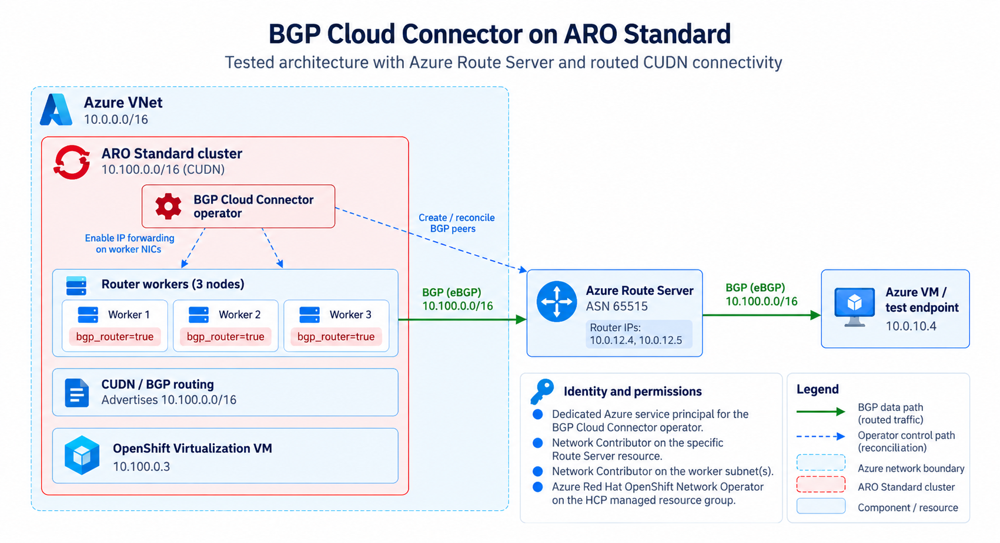

## Overview

BGP Cloud Connector connects ClusterUserDefinedNetworks (CUDNs) on Azure Red Hat OpenShift (ARO) to routed Azure networks through Azure Route Server. The operator discovers Route Server addresses and ASN, creates Azure BGP peers for selected router workers, enables IP forwarding on those workers' network interfaces, and renders the required FRR configuration. A `BGPRouting` resource then creates and advertises a CUDN.

This guide covers the supported ARO Standard service principal configuration in BGP Cloud Connector 1.1.0. CCO passes the cluster service principal credential to the operator, and that principal performs both worker NIC and Azure Route Server operations.

Test environment:

- ARO Standard and OpenShift 4.21.22
- BGP Cloud Connector 1.1.0 at commit [`77af5a3f22a49f843e2c29618ef8b8cbe6a2b54a`](https://github.com/openshift/bgp-cloud-connector/commit/77af5a3f22a49f843e2c29618ef8b8cbe6a2b54a)
- Operator image `registry.redhat.io/bgpcc/bgp-cloud-connector-rhel9-operator@sha256:36bbbd780ff4933a9060422b52f3f35c41062181e161228276320aac13862632`
- Two BGP router workers and one non-router worker

ARO HCP has a different identity and infrastructure model and is not covered by this ARO Standard procedure.

This guide does not validate production scale, production readiness, upgrade behavior, or every failure scenario.

## Architecture

BGP Cloud Connector enables routed connectivity between workloads on a ClusterUserDefinedNetwork (CUDN) and external Azure networks through Azure Route Server. On ARO Standard clusters using service principal authentication, the operator uses the cluster's existing service principal to configure IP forwarding on selected worker nodes and manage BGP peerings, with Network Contributor scoped to the Azure Route Server resource.

The architecture below was tested with BGP Cloud Connector 1.1.0 on ARO 4.21.22, including CUDN route advertisement, external workload connectivity, and automatic BGP reconciliation and recovery.



## Identity model

BGP Cloud Connector 1.1.0 supports ARO Standard clusters created with a service principal. CCO passthrough copies the cluster service principal credential into the operator credential Secret. The operator uses that credential for both worker NIC IP forwarding and Route Server peering operations.

ARO already grants the cluster principal the managed-resource-group and VNet permissions needed for worker NIC and subnet operations. This guide adds a separate `Network Contributor` assignment scoped to the exact Route Server resource for peer lifecycle management.

## Prerequisites

Prepare the ARO cluster and shared Azure networking. For this guide, the ARO control-plane subnet, worker subnet, Azure Route Server subnet, and connectivity-test VM subnet were separate subnets in the same customer VNet.

### ARO cluster prerequisites

- Use OpenShift 4.21 or newer.
- Use an Azure subscription where you can create ARO clusters, networking, role assignments, and test resources.
- Store the Red Hat pull secret outside source control.
- Prepare empty control-plane and worker subnets for the ARO cluster.
- Use the Microsoft [ARO Standard service principal deployment documentation](https://learn.microsoft.com/en-us/azure/openshift/tutorial-create-cluster) or our [quickstart guide](/experts/aro/quickstart/) as the baseline cluster-creation guidance.

### Shared Azure networking prerequisites

- Create or select one customer VNet with separate subnets for the ARO control plane, ARO workers, Azure Route Server, and the test VM.
- Deploy Azure Route Server in the same customer VNet as the ARO cluster for the configuration/setup documented here. Follow the Microsoft [Azure Route Server creation guidance](https://learn.microsoft.com/en-us/azure/route-server/quickstart-create-route-server-cli).
- Create a dedicated Route Server subnet named exactly `RouteServerSubnet`. Azure requires this exact subnet name, and current guidance requires a `/26` or larger prefix for new Route Server deployments.
- Keep `RouteServerSubnet` dedicated to Azure Route Server. Do not place the ARO cluster or test VM in it.

Do not manually configure Route Server peers. Peer lifecycle is part of the operator behavior being tested.

### Test endpoint prerequisites

- Create an Azure VM or another reachable endpoint for connectivity testing. For this guide, the Azure test VM was in the same customer VNet as ARO and Route Server, but in its own regular subnet.
- A test endpoint in a different routed VNet can also be used when end-to-end routing is already configured, but that setup was not tested for this guide.
- OpenShift Virtualization must be installed, configured, and available on supported worker SKUs if you want to use the optional VM example. See [Deploying OpenShift Virtualization on ARO](/experts/aro/aro-virt/) for installation guidance.

The shared VNet, Azure Route Server, and test VM can be reused between test clusters. The ARO control-plane and worker subnets may be reused only after the previous ARO cluster has been fully deleted and the subnets are empty. Resource reuse is optional.

### Required tools

- `oc`
- Azure CLI
- `git`
- `make`
- `jq`
- `envsubst`

The values below are placeholders unless explicitly described as examples.

```bash
export SUBSCRIPTION_ID="<subscription-id>"
export LOCATION="<azure-region>"
export RESOURCE_GROUP="<aro-and-network-resource-group>"
export CLUSTER_NAME="<aro-cluster-name>"
export VNET_NAME="<vnet-name>"
export MASTER_SUBNET="<control-plane-subnet-name>"
export WORKER_SUBNET="<worker-subnet-name>"
export ROUTE_SERVER_NAME="<route-server-name>"
export AZURE_TEST_VM_IP="<azure-test-vm-private-ip>"
export BGP_OPERATOR_NAMESPACE="openshift-bgp-cloud-connector"
```

Confirm that both ARO subnets are empty and review any attached NSG, route table, or NAT gateway:

An empty subnet may return `ipConfigurations: null`; the query treats that as an empty array so the count returns `0`.

```bash
az network vnet subnet show --resource-group "$RESOURCE_GROUP" --vnet-name "$VNET_NAME" \
  --name "$MASTER_SUBNET" \
  --query '{ipConfigurations:length(ipConfigurations || `[]`),nsg:networkSecurityGroup.id,routeTable:routeTable.id,natGateway:natGateway.id}'

az network vnet subnet show --resource-group "$RESOURCE_GROUP" --vnet-name "$VNET_NAME" \
  --name "$WORKER_SUBNET" \
  --query '{ipConfigurations:length(ipConfigurations || `[]`),nsg:networkSecurityGroup.id,routeTable:routeTable.id,natGateway:natGateway.id}'
```

## 1. Prepare ARO Standard with a service principal

Create an ARO Standard service-principal cluster through your normal ARO deployment procedure, using the shared network prerequisites. CCO passthrough supplies the cluster service principal credential, and that principal performs both worker NIC and Route Server operations.

Do not create a dedicated BGP workload identity or reuse an ARO platform workload identity. The 1.1.0 CRD does not contain `networkInterfaceClientID`.

Clone the tested source so its Azure estate and RBAC helpers are available:

```bash
export BGP_CC_COMMIT="77af5a3f22a49f843e2c29618ef8b8cbe6a2b54a"
git clone https://github.com/openshift/bgp-cloud-connector.git
git -C bgp-cloud-connector checkout "$BGP_CC_COMMIT"
```

Create the Route Server with the upstream helper used by the 1.1.0 E2E workflow:

```bash
bgp-cloud-connector/hack/azure/create-route-server.sh
export ROUTE_SERVER_NAME="$(oc get infrastructure cluster \
  -o jsonpath='{.status.infrastructureName}')-rs"
```

Identify the cluster service principal without displaying its credential, then use the 1.1.0 helper to grant `Network Contributor` on the exact Route Server resource:

```bash
export CLUSTER_CLIENT_ID="$(oc get secret azure-credentials -n kube-system \
  -o jsonpath='{.data.azure_client_id}' | base64 -d)"
export CLUSTER_OBJECT_ID="$(az ad sp show --id "$CLUSTER_CLIENT_ID" --query id -o tsv)"
ROUTE_SERVER_ASSIGNEE="$CLUSTER_OBJECT_ID" \
  bgp-cloud-connector/hack/azure/grant-route-server-role.sh
```

The helper resolves the Route Server resource ID and creates the assignment at that scope. It does not grant access across the network resource group. Keep the ARO-created managed-resource-group and VNet permissions: the cluster principal needs those separate permissions for NIC writes and Azure linked-scope checks on the worker subnet and load balancer backend pool.

Allow time for RBAC propagation. During 1.1.0 testing, the operator successfully reconciled worker NIC forwarding and Route Server peers with this scoped assignment.

## 2. Install BGP Cloud Connector 1.1.0

The procedure below pins the exact 1.1.0 source commit and release image used in this test. The source requires Go 1.26.0 and provides `make build-installer` to render the consolidated installer.

```bash
export BGP_CC_IMAGE="registry.redhat.io/bgpcc/bgp-cloud-connector-rhel9-operator@sha256:36bbbd780ff4933a9060422b52f3f35c41062181e161228276320aac13862632"
make -C bgp-cloud-connector build-installer IMG="$BGP_CC_IMAGE"
oc apply -f bgp-cloud-connector/dist/install.yaml
```

Wait for the Deployment to become Available:

```bash
oc wait deployment/openshift-bgp-cloud-connector-controller-manager \
  -n "$BGP_OPERATOR_NAMESPACE" --for=condition=Available --timeout=5m
```

Do not set `CLIENTID`, `TENANTID`, or `SUBSCRIPTIONID` on the Deployment for ARO Standard service principal clusters. CCO passthrough supplies the cluster service principal credential. The `CredentialsRequest` and credential Secret appear after `BGPCloudConfiguration` reconciliation begins.

## 3. Select router workers

The 1.1.0 E2E profile selected two of three workers as BGP routers, leaving one non-router worker for dataplane coverage. Label the intended nodes and their owning MachineSet templates so replacement nodes inherit the role:

```bash
export ROUTER_NODES="<worker-node-1> <worker-node-2>"
for node in $ROUTER_NODES; do
  machine_name="$(oc get node "$node" \
    -o jsonpath='{.metadata.annotations.machine\.openshift\.io/machine}')"
  machine_namespace="${machine_name%%/*}"
  machine_name="${machine_name##*/}"
  machineset_name="$(oc get machine "$machine_name" -n "$machine_namespace" \
    -o jsonpath='{.metadata.labels.machine\.openshift\.io/cluster-api-machineset}')"
  oc patch machineset "$machineset_name" -n "$machine_namespace" --type merge \
    --patch '{"spec":{"template":{"spec":{"metadata":{"labels":{"bgp_router":"true"}}}}}}'
  oc label node "$node" bgp_router=true
done
oc get nodes -l bgp_router=true -o wide
```

## 4. Configure `BGPCloudConfiguration`

```bash
envsubst <<'EOF' | oc apply -f -
apiVersion: networking.openshift.io/v1beta1
kind: BGPCloudConfiguration
metadata:
  name: cluster
spec:
  platform: Azure
  routerNodeSelector:
    bgp_router: "true"
  bgp:
    localASN: 65001
    livenessDetection: bgp-keepalive
  azure:
    subscriptionID: ${SUBSCRIPTION_ID}
    resourceGroup: ${RESOURCE_GROUP}
    routeServerName: ${ROUTE_SERVER_NAME}
EOF
```

During reconciliation, the operator creates `CredentialsRequest/bgp-cloud-connector-azure`. CCO responds by creating `Secret/bgp-cloud-connector-azure-credentials` in `$BGP_OPERATOR_NAMESPACE`. Confirm the Secret uses the cluster service principal without displaying its secret value:

```bash
oc get secret bgp-cloud-connector-azure-credentials \
  -n "$BGP_OPERATOR_NAMESPACE" \
  -o json | jq -r '.data | keys[]'
oc get secret bgp-cloud-connector-azure-credentials \
  -n "$BGP_OPERATOR_NAMESPACE" \
  -o jsonpath='{.data.azure_client_id}' | base64 -d
echo
echo "$CLUSTER_CLIENT_ID"
```

The keys include `azure_client_id` and `azure_client_secret`, and the two displayed client IDs must match. Do not print or decode `azure_client_secret`.

## 5. Configure `BGPRouting` and CUDN resources

```bash
export CUDN_NAMESPACE="<cudn-test-namespace>"
export CUDN_NETWORK_NAME="<cudn-network-name>"
export BGP_ROUTING_NAME="<bgp-routing-name>"
export CUDN_SUBNET="10.100.0.0/16"
envsubst <<'EOF' | oc apply -f -
apiVersion: v1
kind: Namespace
metadata:
  name: ${CUDN_NAMESPACE}
  labels:
    k8s.ovn.org/primary-user-defined-network: ""
    cluster-udn: ${CUDN_NETWORK_NAME}
---
apiVersion: networking.openshift.io/v1beta1
kind: BGPRouting
metadata:
  name: ${BGP_ROUTING_NAME}
spec:
  network:
    name: ${CUDN_NETWORK_NAME}
    subnets:
      - ${CUDN_SUBNET}
EOF
oc get bgprouting "$BGP_ROUTING_NAME" -o yaml
oc get clusteruserdefinednetwork "cluster-udn-${CUDN_NETWORK_NAME}" -o yaml
oc get routeadvertisements bgp-cc-route-advertisements -o yaml
```

Do not manually create or modify the generated CUDN or `RouteAdvertisements`.

## 6. OpenShift Virtualization VM example (optional)

You can skip this step if you already have a testing VM spun up. Make sure to use a supported worker SKU with sufficient capacity before installing OpenShift Virtualization or applying this example.

This manifest below uses a pinned Fedora containerdisk and the required `l2bridge` binding.

```bash
export CUDN_VM_NAME="cudn-connectivity-test"
export SSH_PUBLIC_KEY="$(cat /path/to/test-public-key)"
envsubst <<'EOF' | oc apply -f -
apiVersion: kubevirt.io/v1
kind: VirtualMachine
metadata:
  name: ${CUDN_VM_NAME}
  namespace: ${CUDN_NAMESPACE}
spec:
  runStrategy: Always
  template:
    metadata:
      labels:
        kubevirt.io/domain: cudn-connectivity-test
    spec:
      domain:
        resources:
          requests:
            memory: 1Gi
        devices:
          disks:
            - name: rootdisk
              disk:
                bus: virtio
            - name: cloudinitdisk
              disk:
                bus: virtio
          interfaces:
            - name: default
              model: virtio
              binding:
                name: l2bridge
      networks:
        - name: default
          pod: {}
      volumes:
        - name: rootdisk
          containerDisk:
            image: quay.io/containerdisks/fedora@sha256:1571d49ee43106e9c7cc4e9f487f6f885ee7c156dc5834fad87ad1e38768b778
        - name: cloudinitdisk
          cloudInitNoCloud:
            userData: |-
              #cloud-config
              user: cloud-user
              ssh_authorized_keys:
                - ${SSH_PUBLIC_KEY}
EOF
```

The guest username is `cloud-user`, and the manifest configures only the public key supplied through `SSH_PUBLIC_KEY`. It does not create a console password, so the OpenShift console may show **No credentials**, and a VNC or serial-console login prompt will not accept a password. Use SSH with the private key that corresponds to `SSH_PUBLIC_KEY`:

```bash
virtctl ssh \
  --username cloud-user \
  --identity-file <path-to-private-key> \
  -n "$CUDN_NAMESPACE" \
  vm/"$CUDN_VM_NAME"
```

If `virtctl ssh` fails with a WebSocket close 1006 error, see the separate OpenShift Virtualization observation under **Troubleshooting and gotchas**. That streaming failure is not by itself evidence of a BGP or CUDN failure.

## 7. Validate the deployment

```bash
oc get bgpcloudconfiguration cluster \
  -o jsonpath='{range .status.conditions[*]}{.type}{"="}{.status}{" reason="}{.reason}{"\n"}{end}'
oc get frrconfiguration bgp-cc-1 -n openshift-frr-k8s -o yaml
az network routeserver peering list -g "$RESOURCE_GROUP" \
  --routeserver "$ROUTE_SERVER_NAME" \
  --query '[].{name:name,peerIp:peerIp,peerAsn:peerAsn,provisioningState:provisioningState}' \
  -o table
```

For the two-router setup used in our test, expect `BGPCloudConfiguration/cluster` Ready, two healthy Azure peers, IP forwarding on the two selected worker NICs, four Established BGP sessions across the two Route Server instances, and `10.100.0.0/16` learned from both peers.

By the end of the test, we're able to confirm:

- CCO passthrough authentication with the cluster service principal.
- Automatic IP forwarding on both selected worker NICs.
- Four of four BGP sessions Established.
- CUDN and `RouteAdvertisements` reconciliation.
- CUDN route advertisement and external-client connectivity.
- Peer recovery, NIC IP forwarding recovery, and router label leave and rejoin reconciliation.
- Azure Activity Log attribution of both NIC and Route Server operations to the cluster service principal.

No dedicated BGP identity or ARO platform workload identity was used.

### VM connectivity checks (optional)

If you deployed the optional VM for testing, inspect its network state and test the Azure endpoint:

```bash
ip addr
ip route
ip rule
ip neigh show
ping -c 4 "$AZURE_TEST_VM_IP"
```

From a Linux shell on the Azure test VM, test the reverse direction to the guest VM's CUDN address:

```bash
export CUDN_VM_IP="<guest-cudn-ip>"
ping -c 4 "$CUDN_VM_IP"
```

For a test endpoint where `ping -c` is not available, use the equivalent connectivity test for its operating system. A successful test demonstrates that the Azure test VM reaches the guest directly at its CUDN IP through Azure Route Server and the selected BGP router workers. No NAT, NodePort, OpenShift Route, LoadBalancer service, translated address, or service IP is involved. The observed source and destination addresses should remain the routed endpoint addresses.

This same-VNet result does not establish universal or transitive reachability from every Azure-peered or on-premises network. Other connected networks require their own routing, peering, and route-propagation configuration for the CUDN prefix.

## 8. Lifecycle validation (optional)

Delete one router Machine through the OpenShift Machine API, never the Azure VM directly:

```bash
export ROUTER_MACHINE_NAME="<router-machine-name>"
oc delete machine "$ROUTER_MACHINE_NAME" -n openshift-machine-api
```

Verify automatic old peer cleanup, replacement creation and readiness, inherited `bgp_router=true`, replacement NIC forwarding, new peer creation, Established sessions, Ready BGP configuration, and learned CUDN routes.

This step did not replace a worker Machine. If you run the optional replacement procedure, confirm the same reconciliation outcomes and retain evidence separately.

## 9. Troubleshooting and gotchas

### 9.1 Reconciliation and dataplane observations

#### 9.1.1 FRR webhook startup race

Initial reconciliation can report `FRRConfigurationApplied=False` while `frr-k8s-webhook-service` has no healthy endpoint. Earlier testing recovered through normal reconciliation without configuration changes.

#### 9.1.2 `disableMP` warning

In the commit used for this guide, the operator intentionally sets this deprecated field to satisfy OCP 4.21 RouteAdvertisements validation. Do not edit generated FRR resources.

#### 9.1.3 Route Server learning and effective-route output

The Azure test NIC effective-route API did not display an exact `10.100.0.0/16` entry even though Route Server learned it and dataplane connectivity succeeded. Evaluate Route Server, FRR, and guest evidence together.

#### 9.1.4 `virtctl` WebSocket close 1006

Matching `virtctl` v1.7.4 enabled the initial guest test, but the issue later recurred. The VM remained Running and Ready, and no evidence indicated a BGP or CUDN failure. Matching versions are a diagnostic step, not a guaranteed fix.

### 9.2 ARO Standard service principal

The operator uses CCO passthrough. For Route Server authorization failures, confirm that the principal from `kube-system/azure-credentials` has `Network Contributor` on the exact Route Server resource, then allow for RBAC propagation. Use `hack/azure/grant-route-server-role.sh` to apply the tested scope.

The 1.1.0 source does not include `docs/azure-integration-test-plan.md`. The implementation, CRD schema, Azure E2E suite, and current authentication documentation were used as the source of truth.

## 10. ARO Standard with Managed Identity/Workload Identity

On separate testing, we managed to create a workaround for BGP Cloud Connector on an ARO Standard cluster configured with managed identities and workload identity. The workaround worked technically in that lab, but it is not officially supported by BGP Cloud Connector 1.1.0 and is not part of this guide/article.

In essence, the workaround reused the ARO `machine-api` managed identity for worker NIC forwarding and used a dedicated BGP Cloud Connector identity for Route Server operations. It required an additive operator federated credential on `machine-api` and selected that identity through `spec.azure.networkInterfaceClientID`. That field was removed in BGP Cloud Connector 1.1.0.

## 11. Cleanup

### 11.1 Kubernetes and operator resources

```bash
oc delete virtualmachine "$CUDN_VM_NAME" -n "$CUDN_NAMESPACE" --ignore-not-found
oc delete bgprouting "$BGP_ROUTING_NAME"
oc wait --for=delete clusteruserdefinednetwork/"cluster-udn-${CUDN_NETWORK_NAME}" \
  --timeout=10m
oc delete namespace "$CUDN_NAMESPACE"
oc delete bgpcloudconfiguration cluster
```

Wait for normal CUDN, `RouteAdvertisements`, FRR, and Azure peer cleanup, then remove the operator.

### 11.2 Service principal RBAC

Remove only the Route Server-scoped assignment added by this procedure. Preserve the ARO-managed VNet, subnet, managed-resource-group, and resource-provider permissions until the cluster is deleted.

```bash
export ROUTE_SERVER_ID="$(az network routeserver show \
  --resource-group "$RESOURCE_GROUP" --name "$ROUTE_SERVER_NAME" \
  --query id --output tsv)"
az role assignment delete --assignee "$CLUSTER_OBJECT_ID" \
  --role "Network Contributor" --scope "$ROUTE_SERVER_ID"
```

Remove the cluster service principal only if the cluster deployment owns it and it is not shared.

### 11.3 Azure resources

The upstream `hack/ci-e2e-azure-teardown.sh` helper removes the lab-created Azure client and Route Server estate. Delete the ARO cluster, then remove remaining VNet resources and resource groups according to their ownership and dependencies. Inspect ownership before deletion and do not delete shared resources.

## 12. References

- [BGP Cloud Connector repository](https://github.com/openshift/bgp-cloud-connector)
- [BGP Cloud Connector 1.1.0 commit used for testing](https://github.com/openshift/bgp-cloud-connector/commit/77af5a3f22a49f843e2c29618ef8b8cbe6a2b54a)
- [Azure authentication in BGP Cloud Connector 1.1.0](https://github.com/openshift/bgp-cloud-connector/blob/77af5a3f22a49f843e2c29618ef8b8cbe6a2b54a/docs/azure-authentication.md)
- [BGP Cloud Connector custom resources](https://github.com/openshift/bgp-cloud-connector/blob/77af5a3f22a49f843e2c29618ef8b8cbe6a2b54a/docs/custom-resources.md)
- [Route Server-scoped RBAC helper](https://github.com/openshift/bgp-cloud-connector/blob/77af5a3f22a49f843e2c29618ef8b8cbe6a2b54a/hack/azure/grant-route-server-role.sh)
- [Create an ARO Standard cluster using the service-principal deployment](https://learn.microsoft.com/en-us/azure/openshift/tutorial-create-cluster)
- [Azure Route Server overview](https://learn.microsoft.com/azure/route-server/overview)
- [Create Azure Route Server using Azure CLI](https://learn.microsoft.com/en-us/azure/route-server/quickstart-create-route-server-cli)
- [ARO Standard BGP Cloud Connector lab](https://github.com/diana-sari/aro-virt-bgp)
