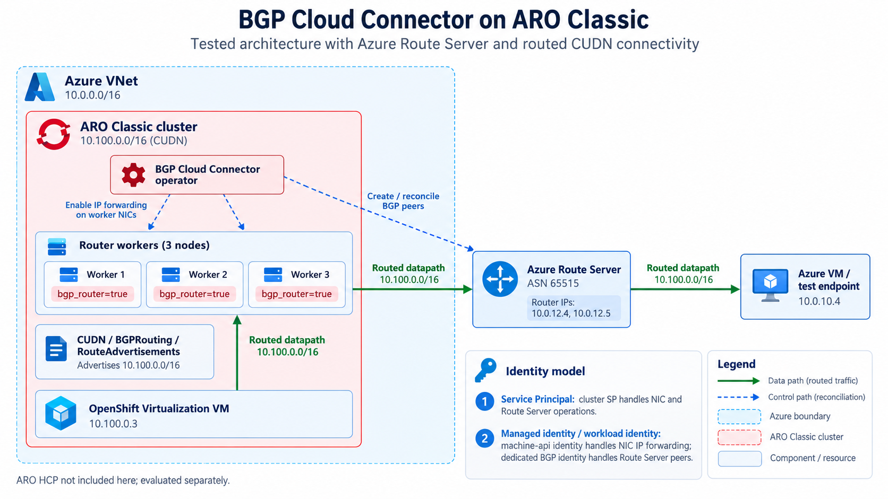
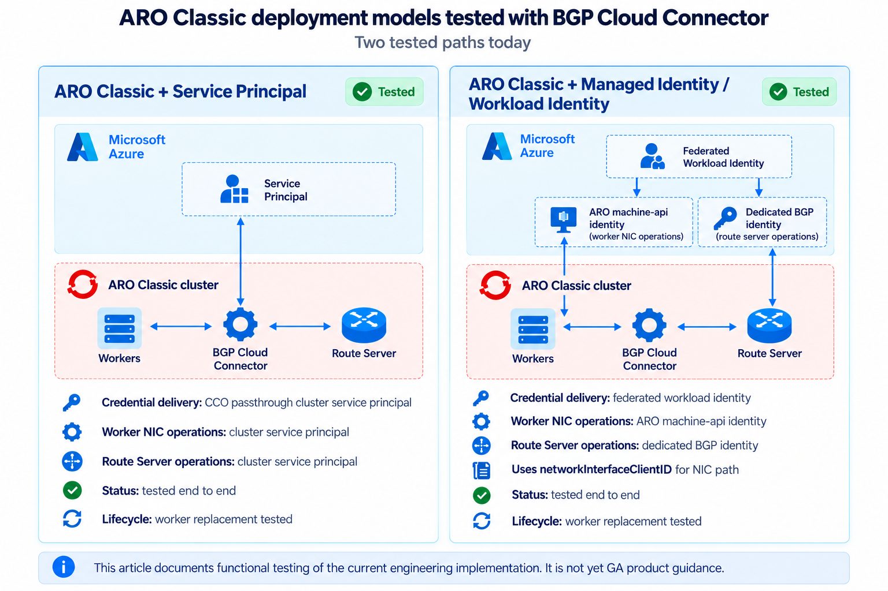
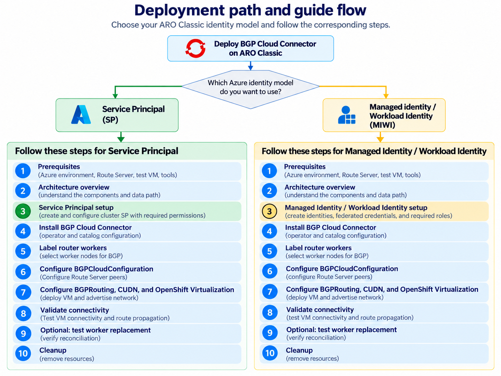

## Overview

BGP Cloud Connector connects ClusterUserDefinedNetworks (CUDNs) on Azure Red Hat OpenShift (ARO) to routed Azure networks through Azure Route Server. The operator discovers Route Server addresses and ASN, creates Azure BGP peers for selected router workers, enables IP forwarding on those workers' network interfaces, and renders the required FRR configuration. A `BGPRouting` resource then creates and advertises a CUDN.

This guide covers deploying and testing BGP Cloud Connector on ARO Classic using either of two tested deployment and identity models:

- ARO Classic with a service principal
- ARO Classic with Azure managed identities and workload identity (MIWI)

Both paths were tested with Azure Route Server, routed CUDN connectivity, and OpenShift Virtualization workloads.

The procedures were tested with:

- ARO Classic and OpenShift 4.21.22
- Azure CLI 2.90.0 for the MIWI deployment
- OpenShift Virtualization 4.21.17
- BGP Cloud Connector commit [`d317567b54e6d4457246032f952fa6c6b80973c7`](https://github.com/openshift/bgp-cloud-connector/commit/d317567b54e6d4457246032f952fa6c6b80973c7)
- Operator image `quay.io/redhat-user-workloads/bgp-cloud-connector-tenant/bgp-cloud-connector/bgp-cloud-connector-operator@sha256:1acd2ea1727ba868e4cd324730d76b3bdb12d48357b73cdf2b8b67fd80140bc5`

{}
This guide documents functional testing of the current engineering implementation. The BGP Cloud Connector integration described here is not yet GA product guidance. The additive federated credential on the ARO `machine-api` identity used by the MIWI path remains subject to Red Hat and Microsoft product and support approval, including whether that identity arrangement is acceptable for long-term supported use. This guide does not make a support-policy determination or present that identity arrangement as final product architecture.
{}

ARO HCP is being evaluated separately. The current BGP Cloud Connector implementation does not yet define a complete ARO HCP credential-delivery and worker-NIC identity model, so HCP procedures are intentionally not included in this guide.

This guide does not validate production scale, production readiness, upgrade behavior, or every failure scenario.

## Architecture

The architecture below shows the tested ARO Classic BGP Cloud Connector data path at a high level. OpenShift Virtualization workloads run on a CUDN, selected worker nodes act as BGP routers, and the BGP Cloud Connector reconciles Azure Route Server peers and worker NIC IP forwarding so the CUDN network can be routed directly into the Azure VNet. The same overall data path is used for both service principal and managed identity/workload identity deployments; the main difference between the two is how Azure API access is authenticated.


<br />

## Choose an ARO deployment and identity model

BGP Cloud Connector was tested on ARO Classic with two Azure identity models: a cluster service principal and managed identity/workload identity. With a service principal, the cluster credential is used for both worker NIC and Route Server operations. With managed identity/workload identity, those responsibilities are split: the ARO machine-api identity is used for worker NIC operations, while a dedicated BGP identity is used for Route Server operations.

The diagram below describes the configuration differences for each model.


<br />

## How to use this guide

This guide covers two tested ARO Classic deployment models for BGP Cloud Connector: Service Principal and Managed Identity / Workload Identity. Many configuration and validation steps are shared, but the Azure identity setup differs. Start with the shared prerequisites and architecture sections, follow the model-specific setup for your chosen deployment type, then continue with the shared BGP configuration, validation, lifecycle, and cleanup steps.

### Service Principal path

1. Review **Architecture** and **Choose an ARO deployment and identity model**, then complete **Shared prerequisites**.
2. Complete **ARO Classic with a service principal**.
3. Install the operator in **Install the validated engineering build**, following the service principal direction in **Configure the identity-specific operator environment**.
4. Complete **Select router workers** and the service principal configuration under **Configure BGPCloudConfiguration**.
5. Continue through **Configure shared BGPRouting and CUDN resources**, **Create a shared OpenShift Virtualization VM example**, and **Shared validation**.
6. Optionally complete **Optional lifecycle validation**, using the **ARO Classic with a service principal** subsection for the tested result.
7. Use the shared and service principal guidance under **Troubleshooting and gotchas**, then follow the shared and service principal steps under **Cleanup**.

### Managed Identity / Workload Identity path

1. Review **Architecture** and **Choose an ARO deployment and identity model**, then complete **Shared prerequisites**.
2. Complete **ARO Classic with MIWI**.
3. Install the operator in **Install the validated engineering build**, following the MIWI direction in **Configure the identity-specific operator environment**.
4. Complete **Select router workers** and the MIWI configuration under **Configure BGPCloudConfiguration**.
5. Continue through **Configure shared BGPRouting and CUDN resources**, **Create a shared OpenShift Virtualization VM example**, and **Shared validation**.
6. Optionally complete **Optional lifecycle validation**, using the **ARO Classic with MIWI** subsection for the tested result.
7. Use the shared and MIWI guidance under **Troubleshooting and gotchas**, then follow the shared and MIWI steps under **Cleanup**.


<br />

## 0. Shared prerequisites

You need:

- OpenShift 4.21 or newer.
- An Azure subscription where you can create ARO clusters, networking, role assignments, and test resources.
- `oc`, Azure CLI, `git`, `make`, `jq`, and `envsubst`.
- A Red Hat pull secret stored outside source control.
- An existing resource group, VNet, and empty ARO control-plane and worker subnets.
- An Azure Route Server in a subnet named exactly `RouteServerSubnet`.
- An Azure VM or another endpoint in a routed VNet subnet for connectivity testing.
- OpenShift Virtualization if you use the VM example in this guide.

Do not manually configure Route Server peers. Peer lifecycle is part of the operator behavior being validated.

Set shared environment variables. The values below are placeholders unless explicitly described as examples.

```bash
export SUBSCRIPTION_ID="<subscription-id>"
export TENANT_ID="<tenant-id>"
export LOCATION="<azure-region>"
export RESOURCE_GROUP="<aro-and-network-resource-group>"
export CLUSTER_NAME="<aro-cluster-name>"
export MANAGED_RESOURCE_GROUP="<aro-managed-resource-group>"
export VNET_NAME="<vnet-name>"
export MASTER_SUBNET="<control-plane-subnet-name>"
export WORKER_SUBNET="<worker-subnet-name>"
export NSG_NAME="<preconfigured-nsg-name>"
export ROUTE_SERVER_NAME="<route-server-name>"
export AZURE_TEST_VM_IP="<azure-test-vm-private-ip>"
export OPENSHIFT_VERSION="4.21.22"
export PULL_SECRET_PATH="<path-to-pull-secret>"
export BGP_OPERATOR_NAMESPACE="openshift-bgp-cloud-connector"
export BGP_OPERATOR_SERVICE_ACCOUNT="openshift-bgp-cloud-connector-controller-manager"
```

Confirm that both ARO subnets are empty and review any attached NSG, route table, or NAT gateway:

```bash
az network vnet subnet show --resource-group "$RESOURCE_GROUP" --vnet-name "$VNET_NAME" \
  --name "$MASTER_SUBNET" \
  --query '{ipConfigurations:length(ipConfigurations),nsg:networkSecurityGroup.id,routeTable:routeTable.id,natGateway:natGateway.id}'

az network vnet subnet show --resource-group "$RESOURCE_GROUP" --vnet-name "$VNET_NAME" \
  --name "$WORKER_SUBNET" \
  --query '{ipConfigurations:length(ipConfigurations),nsg:networkSecurityGroup.id,routeTable:routeTable.id,natGateway:natGateway.id}'
```

## 1. ARO Classic with MIWI

**Applies to: Managed Identity / Workload Identity only**

### 1.1 Create ARO managed identities and base RBAC

Use Azure CLI 2.90.0 or a current version that exposes the same managed-identity helpers. Ask the CLI to calculate requirements for your cluster version and network before it creates anything:

```bash
az aro identity get-required \
  --resource-group "$RESOURCE_GROUP" --location "$LOCATION" \
  --version "$OPENSHIFT_VERSION" --vnet "$VNET_NAME" \
  --vnet-resource-group "$RESOURCE_GROUP" \
  --master-subnet "$MASTER_SUBNET" --worker-subnet "$WORKER_SUBNET"
```

Review the identities, roles, and scopes, then create the base identities and assignments:

```bash
az aro identity create-required \
  --resource-group "$RESOURCE_GROUP" --location "$LOCATION" \
  --version "$OPENSHIFT_VERSION" --vnet "$VNET_NAME" \
  --vnet-resource-group "$RESOURCE_GROUP" \
  --master-subnet "$MASTER_SUBNET" --worker-subnet "$WORKER_SUBNET" --yes
```

The validated flow created these nine user-assigned managed identities:

- `aro-cluster`
- `aro-operator`
- `cloud-controller-manager`
- `cloud-network-config`
- `disk-csi-driver`
- `file-csi-driver`
- `image-registry`
- `ingress`
- `machine-api`

Use the helper output as the source of truth for the base roles. The validated topology produced 20 base assignments, including eight assignments that allow `aro-cluster` to create federated credentials on the platform identities.

### 1.2 Add BYO NSG role assignments where required

When the ARO subnets use a preconfigured NSG, current ARO guidance also requires four NSG-scoped assignments.

```bash
export NSG_ID="$(az network nsg show --resource-group "$RESOURCE_GROUP" \
  --name "$NSG_NAME" --query id --output tsv)"

assign_nsg_role() {
  identity_name="$1"
  role_name="$2"
  principal_id="$(az identity show --resource-group "$RESOURCE_GROUP" \
    --name "$identity_name" --query principalId --output tsv)"
  az role assignment create --assignee-object-id "$principal_id" \
    --assignee-principal-type ServicePrincipal --role "$role_name" --scope "$NSG_ID"
}

assign_nsg_role cloud-controller-manager "Azure Red Hat OpenShift Cloud Controller Manager"
assign_nsg_role machine-api "Azure Red Hat OpenShift Machine API Operator"
assign_nsg_role aro-operator "Azure Red Hat OpenShift Service Operator"
assign_nsg_role file-csi-driver "Azure Red Hat OpenShift File Storage Operator"
```

If the topology also brings a route table, NAT gateway, or another linked network resource, use `az aro identity get-required` and current ARO documentation to determine additional scoped assignments.

### 1.3 Create the ARO Classic MIWI cluster

```bash
az aro create \
  --resource-group "$RESOURCE_GROUP" --name "$CLUSTER_NAME" --location "$LOCATION" \
  --cluster-resource-group "$MANAGED_RESOURCE_GROUP" \
  --vnet-resource-group "$RESOURCE_GROUP" --vnet "$VNET_NAME" \
  --master-subnet "$MASTER_SUBNET" --worker-subnet "$WORKER_SUBNET" \
  --version "$OPENSHIFT_VERSION" --worker-count 3 --outbound-type Loadbalancer \
  --apiserver-visibility Public --ingress-visibility Public \
  --enable-preconfigured-nsg true --enable-managed-identity \
  --assign-cluster-identity aro-cluster \
  --assign-platform-workload-identity file-csi-driver file-csi-driver \
  --assign-platform-workload-identity cloud-controller-manager cloud-controller-manager \
  --assign-platform-workload-identity ingress ingress \
  --assign-platform-workload-identity image-registry image-registry \
  --assign-platform-workload-identity machine-api machine-api \
  --assign-platform-workload-identity cloud-network-config cloud-network-config \
  --assign-platform-workload-identity aro-operator aro-operator \
  --assign-platform-workload-identity disk-csi-driver disk-csi-driver \
  --pull-secret "@${PULL_SECRET_PATH}"
```

Wait for `Succeeded`, log in, and verify `oc get nodes` and `oc get clusteroperators` are healthy.

### 1.4 Create the dedicated BGP Cloud Connector identity

```bash
export BGP_IDENTITY_NAME="${CLUSTER_NAME}-bgp-cloud-connector"
az identity create --resource-group "$RESOURCE_GROUP" --location "$LOCATION" \
  --name "$BGP_IDENTITY_NAME"
export BGP_CLIENT_ID="$(az identity show -g "$RESOURCE_GROUP" -n "$BGP_IDENTITY_NAME" \
  --query clientId -o tsv)"
export BGP_PRINCIPAL_ID="$(az identity show -g "$RESOURCE_GROUP" -n "$BGP_IDENTITY_NAME" \
  --query principalId -o tsv)"
export NETWORK_RESOURCE_GROUP_ID="$(az group show -n "$RESOURCE_GROUP" --query id -o tsv)"
az role assignment create --assignee-object-id "$BGP_PRINCIPAL_ID" \
  --assignee-principal-type ServicePrincipal --role "Network Contributor" \
  --scope "$NETWORK_RESOURCE_GROUP_ID"
```

### 1.5 Configure workload identity federation

```bash
export SERVICE_ACCOUNT_ISSUER="$(oc get authentication cluster \
  -o jsonpath='{.spec.serviceAccountIssuer}')"
export BGP_OPERATOR_SUBJECT="system:serviceaccount:${BGP_OPERATOR_NAMESPACE}:${BGP_OPERATOR_SERVICE_ACCOUNT}"

az identity federated-credential create -g "$RESOURCE_GROUP" \
  --identity-name "$BGP_IDENTITY_NAME" --name bgp-cloud-connector \
  --issuer "$SERVICE_ACCOUNT_ISSUER" --subject "$BGP_OPERATOR_SUBJECT" \
  --audiences openshift
az identity federated-credential create -g "$RESOURCE_GROUP" \
  --identity-name machine-api --name bgp-cloud-connector \
  --issuer "$SERVICE_ACCOUNT_ISSUER" --subject "$BGP_OPERATOR_SUBJECT" \
  --audiences openshift
export MACHINE_API_CLIENT_ID="$(az identity show -g "$RESOURCE_GROUP" -n machine-api \
  --query clientId -o tsv)"
```

Do not replace or remove the ARO-managed FIC for `system:serviceaccount:openshift-machine-api:machine-api-controllers`.

## 2. ARO Classic with a service principal

**Applies to: Service Principal only**

Create an ARO Classic service-principal cluster through your normal ARO deployment procedure, using the shared network prerequisites. CCO passthrough supplies the cluster service principal credential, and that principal performs both worker NIC and Route Server operations.

No dedicated BGP workload identity, additive operator FIC on `machine-api`, or `networkInterfaceClientID` is required.

Grant the cluster principal `Network Contributor` on the resource group containing Route Server:

```bash
export CLUSTER_CLIENT_ID="$(oc get secret azure-credentials -n kube-system \
  -o jsonpath='{.data.azure_client_id}' | base64 -d)"
export CLUSTER_OBJECT_ID="$(az ad sp show --id "$CLUSTER_CLIENT_ID" --query id -o tsv)"
export NETWORK_RESOURCE_GROUP_ID="$(az group show -n "$RESOURCE_GROUP" --query id -o tsv)"
az role assignment create --assignee-object-id "$CLUSTER_OBJECT_ID" \
  --assignee-principal-type ServicePrincipal --role "Network Contributor" \
  --scope "$NETWORK_RESOURCE_GROUP_ID"
```

Allow time for RBAC propagation. The validated SP path reconciled worker NIC forwarding, Route Server peers, and worker replacement successfully.

Upstream engineering maintains [`e2e-aro-classic-operator`](https://github.com/openshift/release/blob/main/ci-operator/config/openshift/bgp-cloud-connector/openshift-bgp-cloud-connector-main.yaml) as an active CI path for this model. Open [`openshift/release#86440`](https://github.com/openshift/release/pull/86440) makes the job gating because ARO Classic with a service principal is a supported BGP Cloud Connector 1.1 configuration.

Earlier job failures caused by Microsoft Graph rejecting the Entra application `addPassword` operation occurred during ARO cluster provisioning, before a cluster existed. They were not BGP Cloud Connector functional failures. [`openshift/release#86426`](https://github.com/openshift/release/pull/86426) corrected that provisioning path by creating the application separately, retrying password creation, and waiting for the service principal to become visible before calling `az aro create`.

## 3. Install the validated engineering build

**Applies to: Both deployment models**

{}
This procedure reproduces the engineering implementation used in functional testing at the exact source commit and image digest below. It is not final production installation guidance. Recheck the upstream project and applicable product guidance before selecting an installation path or using a newer build.
{}

```bash
export BGP_CC_COMMIT="d317567b54e6d4457246032f952fa6c6b80973c7"
export BGP_CC_IMAGE="quay.io/redhat-user-workloads/bgp-cloud-connector-tenant/bgp-cloud-connector/bgp-cloud-connector-operator@sha256:1acd2ea1727ba868e4cd324730d76b3bdb12d48357b73cdf2b8b67fd80140bc5"
git clone https://github.com/openshift/bgp-cloud-connector.git
git -C bgp-cloud-connector checkout "$BGP_CC_COMMIT"
make -C bgp-cloud-connector kustomize
(
  cd bgp-cloud-connector/config/manager
  ../../bin/kustomize edit set image controller="$BGP_CC_IMAGE"
)
bgp-cloud-connector/bin/kustomize build bgp-cloud-connector/config/default \
  > bgp-cloud-connector-operator.yaml
oc apply -f bgp-cloud-connector-operator.yaml
```

### 3.1 Configure the identity-specific operator environment

For MIWI, set all three identity inputs:

```bash
oc set env deployment/openshift-bgp-cloud-connector-controller-manager \
  -n "$BGP_OPERATOR_NAMESPACE" CLIENTID="$BGP_CLIENT_ID" \
  TENANTID="$TENANT_ID" SUBSCRIPTIONID="$SUBSCRIPTION_ID"
```

For service principal, do not set these MIWI variables. CCO passthrough supplies the credential. Wait for the operator Deployment to become Available. At this commit, the `CredentialsRequest` appears only after `BGPCloudConfiguration` reconciliation begins.

## 4. Select router workers

This procedure is shared by both Classic identity models:

```bash
for node in $(oc get nodes -l node-role.kubernetes.io/worker -o name); do
  machine_name="$(oc get "$node" -o jsonpath='{.metadata.annotations.machine\.openshift\.io/machine}')"
  machine_namespace="${machine_name%%/*}"
  machine_name="${machine_name##*/}"
  machineset_name="$(oc get machine "$machine_name" -n "$machine_namespace" \
    -o jsonpath='{.metadata.labels.machine\.openshift\.io/cluster-api-machineset}')"
  oc patch machineset "$machineset_name" -n "$machine_namespace" --type merge \
    --patch '{"spec":{"template":{"spec":{"metadata":{"labels":{"bgp_router":"true"}}}}}}'
  oc label "$node" bgp_router=true
done
oc get nodes -l bgp_router=true -o wide
```

## 5. Configure `BGPCloudConfiguration`

### 5.1 ARO Classic with MIWI

**Applies to: Managed Identity / Workload Identity only**

```bash
envsubst <<'EOF' | oc apply -f -
apiVersion: networking.openshift.io/v1beta1
kind: BGPCloudConfiguration
metadata:
  name: cluster
spec:
  platform: Azure
  routerNodeSelector:
    bgp_router: "true"
  bgp:
    localASN: 65001
    livenessDetection: bgp-keepalive
  azure:
    subscriptionID: ${SUBSCRIPTION_ID}
    resourceGroup: ${RESOURCE_GROUP}
    routeServerName: ${ROUTE_SERVER_NAME}
    networkInterfaceClientID: ${MACHINE_API_CLIENT_ID}
EOF
```

Verify the generated Secret includes `azure_federated_token_file`, excludes `azure_client_secret`, and references the dedicated BGP identity.

### 5.2 ARO Classic with a service principal

**Applies to: Service Principal only**

Use the same resource but omit `networkInterfaceClientID`. The relevant block is:

```yaml
azure:
  subscriptionID: <subscription-id>
  resourceGroup: <route-server-resource-group>
  routeServerName: <route-server-name>
```

CCO creates the same `CredentialsRequest`, but the passthrough Secret carries the cluster service principal credential.

## 6. Configure shared `BGPRouting` and CUDN resources

```bash
export CUDN_NAMESPACE="<cudn-test-namespace>"
export CUDN_NETWORK_NAME="<cudn-network-name>"
export BGP_ROUTING_NAME="<bgp-routing-name>"
export CUDN_SUBNET="10.100.0.0/16"
envsubst <<'EOF' | oc apply -f -
apiVersion: v1
kind: Namespace
metadata:
  name: ${CUDN_NAMESPACE}
  labels:
    k8s.ovn.org/primary-user-defined-network: ""
    cluster-udn: ${CUDN_NETWORK_NAME}
---
apiVersion: networking.openshift.io/v1beta1
kind: BGPRouting
metadata:
  name: ${BGP_ROUTING_NAME}
spec:
  network:
    name: ${CUDN_NETWORK_NAME}
    subnets:
      - ${CUDN_SUBNET}
EOF
oc get bgprouting "$BGP_ROUTING_NAME" -o yaml
oc get clusteruserdefinednetwork "cluster-udn-${CUDN_NETWORK_NAME}" -o yaml
oc get routeadvertisements bgp-cc-route-advertisements -o yaml
```

Do not manually create or modify the generated CUDN or `RouteAdvertisements`.

## 7. Create a shared OpenShift Virtualization VM example

The validation used the `stable` channel, OpenShift Virtualization 4.21.17, a pinned Fedora containerdisk, and the required `l2bridge` binding.

```bash
export CUDN_VM_NAME="cudn-connectivity-test"
export SSH_PUBLIC_KEY="$(cat /path/to/test-public-key)"
envsubst <<'EOF' | oc apply -f -
apiVersion: kubevirt.io/v1
kind: VirtualMachine
metadata:
  name: ${CUDN_VM_NAME}
  namespace: ${CUDN_NAMESPACE}
spec:
  runStrategy: Always
  template:
    metadata:
      labels:
        kubevirt.io/domain: cudn-connectivity-test
    spec:
      domain:
        resources:
          requests:
            memory: 1Gi
        devices:
          disks:
            - name: rootdisk
              disk:
                bus: virtio
            - name: cloudinitdisk
              disk:
                bus: virtio
          interfaces:
            - name: default
              model: virtio
              binding:
                name: l2bridge
      networks:
        - name: default
          pod: {}
      volumes:
        - name: rootdisk
          containerDisk:
            image: quay.io/containerdisks/fedora@sha256:1571d49ee43106e9c7cc4e9f487f6f885ee7c156dc5834fad87ad1e38768b778
        - name: cloudinitdisk
          cloudInitNoCloud:
            userData: |-
              #cloud-config
              user: cloud-user
              ssh_authorized_keys:
                - ${SSH_PUBLIC_KEY}
EOF
```

## 8. Shared validation

```bash
oc get bgpcloudconfiguration cluster \
  -o jsonpath='{range .status.conditions[*]}{.type}{"="}{.status}{" reason="}{.reason}{"\n"}{end}'
oc get frrconfiguration bgp-cc-1 -n openshift-frr-k8s -o yaml
az network routeserver peering list -g "$RESOURCE_GROUP" \
  --routeserver "$ROUTE_SERVER_NAME" \
  --query '[].{name:name,peerIp:peerIp,peerAsn:peerAsn,provisioningState:provisioningState}' \
  -o table
```

Expect `BGPCloudConfiguration/cluster` Ready, all six sessions Established for three router workers, three healthy Azure peers, IP forwarding on exactly the selected NICs, and `10.100.0.0/16` learned from every peer.

Identity attribution differs:

- MIWI: NIC writes use `machine-api`; Route Server peer writes use the dedicated BGP identity.
- Service principal: both operations use the cluster service principal.

From the guest:

```bash
ip addr
ip route
ip rule
ip neigh show
ping -c 4 "$AZURE_TEST_VM_IP"
```

Both paths validated address `10.100.0.3/16`, gateway `10.100.0.1`, MTU 1400, AS path `65001`, and guest-to-Azure connectivity with zero packet loss.

## 9. Optional lifecycle validation

Delete one router Machine through the OpenShift Machine API, never the Azure VM directly:

```bash
export ROUTER_MACHINE_NAME="<router-machine-name>"
oc delete machine "$ROUTER_MACHINE_NAME" -n openshift-machine-api
```

Verify automatic old peer cleanup, replacement creation and readiness, inherited `bgp_router=true`, replacement NIC forwarding, new peer creation, Established sessions, Ready BGP configuration, and learned CUDN routes.

### 9.1 ARO Classic with MIWI

- Router address changed from `10.0.2.5` to `10.0.2.7`.
- Peer and NIC reconciliation succeeded automatically.
- Activity Logs attributed NIC writes to `machine-api` and peer writes to the dedicated BGP identity.
- Post-replacement guest ping was not repeated because of the separate KubeVirt streaming and login issue.

### 9.2 ARO Classic with a service principal

- Router address changed from `10.0.2.6` to `10.0.2.7`.
- Peer and NIC reconciliation succeeded automatically.
- The cluster service principal performed both operations.
- Post-replacement connectivity returned four replies from four packets with zero loss.

## 10. Troubleshooting and gotchas

### 10.1 Shared

#### 10.1.1 FRR webhook startup race

Initial reconciliation can report `FRRConfigurationApplied=False` while `frr-k8s-webhook-service` has no healthy endpoint. Both labs recovered through normal reconciliation without configuration changes.

#### 10.1.2 `disableMP` warning

At the validated commit, the operator intentionally sets this deprecated field to satisfy OCP 4.21 RouteAdvertisements validation. Do not edit generated FRR resources.

#### 10.1.3 Route Server learning and effective-route output

The Azure test NIC effective-route API did not display an exact `10.100.0.0/16` entry even though Route Server learned it and dataplane connectivity succeeded. Evaluate Route Server, FRR, and guest evidence together.

#### 10.1.4 `virtctl` WebSocket close 1006

Matching `virtctl` v1.7.4 enabled the initial guest test, but the issue later recurred. The VM remained Running and Ready, and no evidence indicated a BGP or CUDN failure. Matching versions are a diagnostic step, not a guaranteed fix.

### 10.2 ARO Classic with MIWI

If credentials remain pending, verify `CLIENTID`, `TENANTID`, and `SUBSCRIPTIONID`, the `CredentialsRequest`, and the dedicated identity's FIC issuer, subject, and audience.

ARO protects the managed resource group with an Azure deny assignment. For NIC write failures, verify `networkInterfaceClientID`, the additive operator FIC on `machine-api`, and expected Activity Log attribution.

### 10.3 ARO Classic with a service principal

The operator uses CCO passthrough. For Route Server authorization failures, verify the principal from `kube-system/azure-credentials` has `Network Contributor` on the Route Server resource group and allow for RBAC propagation.

At the validated commit, `docs/azure-integration-test-plan.md` was absent. The implementation, CRD schema, and current engineering documentation were used as the source of truth.

## 11. Cleanup

### 11.1 Shared Kubernetes and operator resources

**Applies to: Both deployment models**

```bash
oc delete virtualmachine "$CUDN_VM_NAME" -n "$CUDN_NAMESPACE"
oc delete bgprouting "$BGP_ROUTING_NAME"
oc wait --for=delete clusteruserdefinednetwork/"cluster-udn-${CUDN_NETWORK_NAME}" \
  --timeout=10m
oc delete namespace "$CUDN_NAMESPACE"
oc delete bgpcloudconfiguration cluster
```

Wait for normal CUDN, `RouteAdvertisements`, FRR, and Azure peer cleanup, then remove the operator.

### 11.2 ARO Classic with MIWI

Remove the dedicated BGP identity, role, and FIC, plus only the additive `bgp-cloud-connector` FIC from `machine-api`. Preserve the original `machine-api-controllers` FIC until cluster deletion. Distinguish MIWI-specific assignments from pre-existing network or ARO resource-provider permissions before deleting RBAC. After cluster deletion, remove the nine identities and cluster-specific roles.

### 11.3 ARO Classic with a service principal

Remove only the additional Route Server resource-group permission created by this procedure. Do not perform MIWI identity or FIC cleanup. Remove the service principal only if the cluster deployment owns it and it is not shared.

### 11.4 Shared Azure resources

Delete the ARO cluster, then remove Route Server, test infrastructure, VNet resources, and resource groups according to their ownership and dependencies.

## 12. References

- [BGP Cloud Connector engineering repository](https://github.com/openshift/bgp-cloud-connector)
- [Validated BGP Cloud Connector commit](https://github.com/openshift/bgp-cloud-connector/commit/d317567b54e6d4457246032f952fa6c6b80973c7)
- [Azure authentication in BGP Cloud Connector](https://github.com/openshift/bgp-cloud-connector/blob/d317567b54e6d4457246032f952fa6c6b80973c7/docs/azure-authentication.md)
- [BGP Cloud Connector custom resources](https://github.com/openshift/bgp-cloud-connector/blob/d317567b54e6d4457246032f952fa6c6b80973c7/docs/custom-resources.md)
- [Create ARO with managed identities](https://learn.microsoft.com/azure/openshift/howto-create-openshift-cluster?pivots=aro-deploy-az-cli)
- [Understand ARO managed identities](https://learn.microsoft.com/azure/openshift/howto-understand-managed-identities)
- [Azure Route Server overview](https://learn.microsoft.com/azure/route-server/overview)
- [ARO Classic BGP Cloud Connector lab](https://github.com/diana-sari/aro-virt-bgp)
