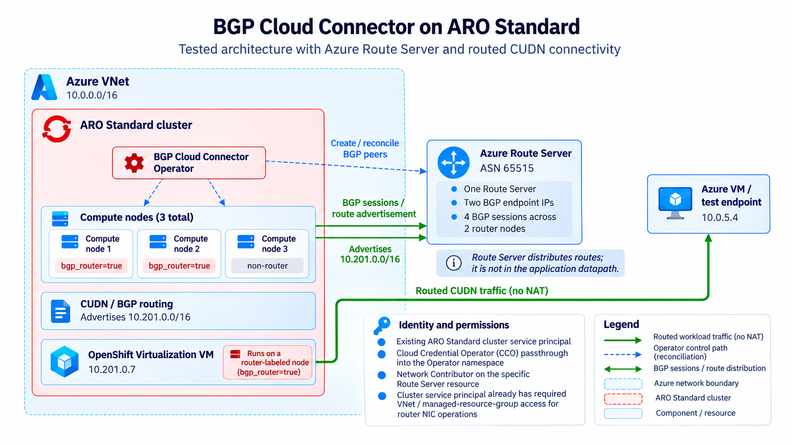

## Overview

BGP Cloud Connector provides direct Layer 3 connectivity between ClusterUserDefinedNetworks (CUDNs) on Azure Red Hat OpenShift (ARO) and routed Azure networks. It uses Azure Route Server to advertise CUDN prefixes and programs selected compute nodes to forward traffic.

This guide configures an existing ARO Standard cluster running OpenShift Container Platform 4.22 or later with service principal authentication, installs BGP Cloud Connector 1.1.0 through Operator Lifecycle Manager (OLM), configures two BGP router nodes, and tests bidirectional connectivity with an OpenShift Virtualization VM.

ARO clusters that use managed identities and ARO HCP have different identity and infrastructure models and are not covered.

## Architecture



1. FRR on each router node establishes sessions with the two redundant BGP endpoint IPs provided by one Azure Route Server.
1. BGP Cloud Connector advertises the CUDN prefix, which Route Server propagates to the virtual network.
1. Azure sends CUDN traffic to a router node network interface.
1. OVN-Kubernetes forwards the traffic between that node and the workload.

Azure Route Server distributes routes. It is not in the application data path. Two router nodes connected to both Route Server endpoint IPs produce four BGP sessions.

This guide was tested in West US 2 with ARO Standard 4.22.22, three `Standard_D8s_v5` compute nodes, BGP Cloud Connector 1.1.0 in the `bgp-cloud-connector` namespace, and OpenShift Virtualization 4.22.16.

## Prerequisites

You need:

- an ARO Standard 4.22 or later cluster created with a service principal and `cluster-admin` access
- a current global pull secret with valid `registry.redhat.io` credentials
- a virtual network with space for a dedicated `/26` Route Server subnet and a test subnet
- Azure permissions to manage networking, role assignments, and test resources
- a CUDN prefix that does not overlap any connected network
- Azure CLI, `jq`, `oc`, Python 3, and the `virtctl` client provided by the cluster
- OpenShift Virtualization and supported compute capacity for the VM test

See [Deploying OpenShift Virtualization on ARO](/experts/aro/aro-virt/). Record the owner and provisioning method for every Azure resource. Route Server, compute instances, VMs, and disks incur charges.

The commands use Bash:

```bash
export SUBSCRIPTION_ID="$(az account show --query id -o tsv)"
export RESOURCE_GROUP="<resource-group-containing-the-vnet>"
export LOCATION="<azure-region>"
export VNET_NAME="<vnet-name>"
export ROUTE_SERVER_NAME="<route-server-name>"
export ROUTE_SERVER_SUBNET_CIDR="<unused-/26-prefix>"
export TEST_SUBNET_NAME="<test-subnet-name>"
export TEST_SUBNET_CIDR="<unused-test-subnet-prefix>"
export TEST_VM_NAME="<azure-test-vm-name>"
export CUDN_CIDR="10.201.0.0/16"
export LOCAL_ASN="65001"
```

The local ASN must differ from the Azure Route Server ASN, 65515.

### Optional: upgrade from 4.21 to 4.22

Deploy 4.22 directly when your region offers it. Otherwise, create a supported 4.21 release and follow the OpenShift update graph. Do not force an update.

```bash
oc adm upgrade channel stable-4.22
oc adm upgrade
```

If the graph requires the 4.22 boot-image acknowledgment, review [Acknowledging the boot image management change](https://docs.redhat.com/en/documentation/openshift_container_platform/4.22/observability/updating_clusters/understanding-openshift-updates-1) before setting it:

```bash
oc -n openshift-config patch configmap admin-acks --type=merge \
  --patch '{"data":{"ack-4.21-boot-image-opt-out-in-4.22":"true"}}'
oc adm upgrade
```

Select only a recommended target returned by `oc adm upgrade`. In this guide, we followed the recommended path from 4.21.22 to 4.22.22.

Start the recommended update and wait for it to complete:

```bash
export TARGET_VERSION="<recommended-4.22-version>"
oc adm upgrade --to="${TARGET_VERSION}"
oc wait clusterversion/version \
  --for=jsonpath='{.status.history[0].state}'=Completed --timeout=90m
export ACTUAL_VERSION="$(oc get clusterversion version \
  -o jsonpath='{.status.history[0].version}')"
test "${ACTUAL_VERSION}" = "${TARGET_VERSION}"
oc wait clusteroperator --all --for=condition=Available=True --timeout=20m
oc wait clusteroperator --all --for=condition=Progressing=False --timeout=20m
oc get clusterversion,clusteroperator
```

## 1. Prepare FRR and RouteAdvertisements

Enable and verify both capabilities before installing the Operator:

```bash
oc patch network.operator.openshift.io cluster --type=merge --patch '{
  "spec": {
    "additionalRoutingCapabilities": {"providers": ["FRR"]},
    "defaultNetwork": {
      "ovnKubernetesConfig": {"routeAdvertisements": "Enabled"}
    }
  }
}'

oc wait clusteroperator/network --for=condition=Available=True --timeout=10m
oc wait clusteroperator/network --for=condition=Progressing=False --timeout=10m
oc get network.operator.openshift.io cluster \
  -o jsonpath='{.spec.additionalRoutingCapabilities.providers}{"\n"}{.spec.defaultNetwork.ovnKubernetesConfig.routeAdvertisements}{"\n"}'
oc get crd routeadvertisements.k8s.ovn.org
oc rollout status daemonset/frr-k8s -n openshift-frr-k8s --timeout=10m
oc get daemonset/frr-k8s -n openshift-frr-k8s
oc get pods -n openshift-frr-k8s
```

Continue only when the output includes `FRR`, RouteAdvertisements is `Enabled`, the CRD exists, and the FRR pods are Ready.

## 2. Create Azure Route Server and scoped RBAC

Azure requires a dedicated subnet named exactly `RouteServerSubnet`, sized `/26` or larger:

```bash
az network vnet subnet create -g "${RESOURCE_GROUP}" --vnet-name "${VNET_NAME}" \
  -n RouteServerSubnet --address-prefixes "${ROUTE_SERVER_SUBNET_CIDR}"
az network public-ip create -g "${RESOURCE_GROUP}" -n "${ROUTE_SERVER_NAME}-pip" \
  --location "${LOCATION}" --sku Standard --version IPv4 --allocation-method Static

export ROUTE_SERVER_SUBNET_ID="$(az network vnet subnet show \
  -g "${RESOURCE_GROUP}" --vnet-name "${VNET_NAME}" -n RouteServerSubnet \
  --query id -o tsv)"
az network routeserver create -g "${RESOURCE_GROUP}" -n "${ROUTE_SERVER_NAME}" \
  --hosted-subnet "${ROUTE_SERVER_SUBNET_ID}" \
  --public-ip-address "${ROUTE_SERVER_NAME}-pip"
```

Creation can take approximately 30 minutes. Wait until both endpoint IPs appear:

```bash
az network routeserver show -g "${RESOURCE_GROUP}" -n "${ROUTE_SERVER_NAME}" \
  --query '{asn:virtualRouterAsn,endpointIps:virtualRouterIps,state:provisioningState}'
```

Do not create peerings manually. The Operator owns their lifecycle.

Read the cluster service principal client ID without displaying its credential, then grant `Network Contributor` on only the Route Server:

```bash
export CLUSTER_CLIENT_ID="$(oc get secret azure-credentials -n kube-system \
  -o jsonpath='{.data.azure_client_id}' | base64 -d)"
export CLUSTER_OBJECT_ID="$(az ad sp show --id "${CLUSTER_CLIENT_ID}" --query id -o tsv)"
export ROUTE_SERVER_ID="$(az network routeserver show -g "${RESOURCE_GROUP}" \
  -n "${ROUTE_SERVER_NAME}" --query id -o tsv)"
export ROUTE_SERVER_ROLE_ASSIGNMENT_ID="$(az role assignment create \
  --assignee-object-id "${CLUSTER_OBJECT_ID}" \
  --assignee-principal-type ServicePrincipal --role "Network Contributor" \
  --scope "${ROUTE_SERVER_ID}" --query id -o tsv)"
```

Save the assignment ID with the resource inventory and allow time for RBAC propagation.

An Azure deny assignment takes precedence over RBAC. Confirm that the ARO cluster service principal is excluded from any managed resource group deny assignment that would block worker NIC writes:

```bash
export MANAGED_RESOURCE_GROUP="$(oc get infrastructure cluster \
  -o jsonpath='{.status.platformStatus.azure.resourceGroupName}')"
az rest --method GET \
  --url "https://management.azure.com/subscriptions/${SUBSCRIPTION_ID}/resourceGroups/${MANAGED_RESOURCE_GROUP}/providers/Microsoft.Authorization/denyAssignments?api-version=2022-04-01" \
  | jq --arg object_id "${CLUSTER_OBJECT_ID}" \
    '[.value[] | {name: .properties.denyAssignmentName, servicePrincipalExcluded: any(.properties.excludePrincipals[]?; .id == $object_id)}]'
```

For an applicable deny assignment, `servicePrincipalExcluded` must be `true`. Otherwise, the Operator cannot enable IP forwarding on the selected worker NICs, and an additional RBAC grant does not override the denial.

## 3. Select router nodes

Every node that can host a directly routed workload must match the Operator's selector. First confirm that the selected nodes belong to MachineSets intended only for routers:

```bash
oc get machines -n openshift-machine-api \
  -o custom-columns=NODE:.status.nodeRef.name,MACHINESET:.metadata.labels.machine\\.openshift\\.io/cluster-api-machineset
```

Patching a MachineSet template labels all future nodes created from that template. Do not patch a template that must continue creating non-router nodes. Use dedicated router MachineSets when router and non-router capacity must remain separate.

Patch the router MachineSet templates and label the two existing router nodes:

```bash
export ROUTER_NODES="<router-node-1> <router-node-2>"
for node in ${ROUTER_NODES}; do
  machine_ref="$(oc get node "${node}" \
    -o jsonpath='{.metadata.annotations.machine\.openshift\.io/machine}')"
  machine_namespace="${machine_ref%%/*}"
  machine_name="${machine_ref##*/}"
  machineset_name="$(oc get machine "${machine_name}" -n "${machine_namespace}" \
    -o jsonpath='{.metadata.labels.machine\.openshift\.io/cluster-api-machineset}')"
  oc patch machineset "${machineset_name}" -n "${machine_namespace}" \
    --type=merge \
    --patch '{"spec":{"template":{"spec":{"metadata":{"labels":{"bgp_router":"true"}}}}}}'
  oc label node "${node}" bgp_router=true --overwrite
done
oc get nodes -l bgp_router=true -o wide
```

## 4. Install BGP Cloud Connector 1.1.0 with OLM

If the global pull secret needs refreshing, merge the new registry entry into the existing secret. Do not replace ARO-created entries or print secret data.
Create a `BGPCloudConfiguration` custom resource (CR) to define the cluster-wide BGP configuration: 
```bash
oc get catalogsource redhat-operators -n openshift-marketplace
```

Create the namespace, OperatorGroup, and stable-channel Subscription. Manual approval prevents a newer channel head from replacing the tested version:

```bash
cat <<'EOF' | oc apply -f -
apiVersion: v1
kind: Namespace
metadata:
  name: bgp-cloud-connector
---
apiVersion: operators.coreos.com/v1
kind: OperatorGroup
metadata:
  name: bgp-cloud-connector
  namespace: bgp-cloud-connector
spec:
  targetNamespaces: [bgp-cloud-connector]
---
apiVersion: operators.coreos.com/v1alpha1
kind: Subscription
metadata:
  name: bgp-cloud-connector
  namespace: bgp-cloud-connector
spec:
  channel: stable
  installPlanApproval: Manual
  name: bgp-cloud-connector
  source: redhat-operators
  sourceNamespace: openshift-marketplace
  startingCSV: bgp-cloud-connector.v1.1.0
EOF

export INSTALL_PLAN="$(oc get subscription bgp-cloud-connector \
  -n bgp-cloud-connector -o jsonpath='{.status.installplan.name}')"
oc get installplan "${INSTALL_PLAN}" -n bgp-cloud-connector -o yaml
oc patch installplan "${INSTALL_PLAN}" -n bgp-cloud-connector \
  --type=merge --patch '{"spec":{"approved":true}}'
oc wait csv/bgp-cloud-connector.v1.1.0 -n bgp-cloud-connector \
  --for=jsonpath='{.status.phase}'=Succeeded --timeout=10m
```

Approve the plan only if it contains `bgp-cloud-connector.v1.1.0`.

## 5. Configure BGP Cloud Connector

`resourceGroup` is the resource group containing Route Server, not the ARO managed resource group:

```bash
cat <<EOF | oc apply -f -
apiVersion: networking.openshift.io/v1beta1
kind: BGPCloudConfiguration
metadata:
  name: cluster
spec:
  platform: Azure
  routerNodeSelector:
    bgp_router: "true"
  bgp:
    localASN: ${LOCAL_ASN}
    livenessDetection: bgp-keepalive
  azure:
    subscriptionID: ${SUBSCRIPTION_ID}
    resourceGroup: ${RESOURCE_GROUP}
    routeServerName: ${ROUTE_SERVER_NAME}
EOF
```
where:
* `metadata.name`: is always `cluster`. The resource is a cluster-scoped singleton.
* ` spec.bgp.localASN.<local_asn>`: Specifies the Autonomous System Number (ASN) for the FRRouting (FRR) router of your cluster. The <local_asn> value must be different from the Route Server ASN that you configured with --amazon-side-asn, which the Operator discovers automatically. Ensure you note the ARN of the role from the output.
* `spec.routerNodeSelector.bgp_router`:  Specifies the label key used in the routerNodeSelector to identify which compute nodes participate in BGP routing. Nodes that match this selector have the following characteristics:
    * Establish BGP peering sessions with Route Server.
    * Act as the next-hop for BGP-advertised routes for traffic that ingresses from the VNet to the primary Cluster User Default Network (CUDN) of the workload.
    * Have IP Forwarding on their Azure Network Interfaces. Note that traffic always egresses from pods or VMs directly through their worker node Azure Network Interface. Therefore, you must apply this selector to any node where these workloads can be scheduled, not just the nodes intended to receive incoming traffic. 
The Cloud Credential Operator copies the cluster service principal credential into the Operator namespace. Compare only client IDs:

```bash
oc get credentialsrequest bgp-cloud-connector-azure \
  -n openshift-cloud-credential-operator \
  -o jsonpath='{.status.provisioned}{"\n"}'
export OPERATOR_CLIENT_ID="$(oc get secret bgp-cloud-connector-azure-credentials \
  -n bgp-cloud-connector -o jsonpath='{.data.azure_client_id}' | base64 -d)"
test "${OPERATOR_CLIENT_ID}" = "${CLUSTER_CLIENT_ID}" \
  && echo "Operator client ID matches the cluster service principal"
oc get bgpcloudconfiguration cluster \
  -o jsonpath='{range .status.conditions[*]}{.type}={.status} {.reason}{"\n"}{end}'
```

Wait for all conditions to become True.

## 6. Create and advertise a CUDN

Create the namespace with both labels present at creation time:

```bash
cat <<EOF | oc apply -f -
apiVersion: v1
kind: Namespace
metadata:
  name: bgp-test-vms
  labels:
    cluster-udn: bgp-test-cudn
    k8s.ovn.org/primary-user-defined-network: ""
---
apiVersion: networking.openshift.io/v1beta1
kind: BGPRouting
metadata:
  name: bgp-test-cudn
spec:
  network:
    name: bgp-test-cudn
    subnets:
      - ${CUDN_CIDR}
where:
* `Namespace.metadata.name`: provide your choice of name for the namespace where your workloads will run
* `Namespace.metadata.labels.cluster-udn`: provide your choice of name for the network. The operator will add the prefix `cluster-udn-` when used as the name of the created `ClusterDefinedNetwork`.
* `BGPRouting.metadata.name`: provide your choice of name for the `BGPRouting` CR.
* `BGPRouting.spec.network.subnets[0]`: This value is set as the `spec.network.layer2.subnets` of the CUDN. The value must not overlap with any of the CIDRs in your VNet.
oc get bgprouting bgp-test-cudn
oc get clusteruserdefinednetwork cluster-udn-bgp-test-cudn
oc get routeadvertisements
```

`BGPRouting` owns the generated Layer 2 CUDN and RouteAdvertisements resources. Do not create or edit them separately.

## 7. Create test endpoints

Create a dedicated Azure test endpoint:

```bash
az network vnet subnet create -g "${RESOURCE_GROUP}" --vnet-name "${VNET_NAME}" \
  -n "${TEST_SUBNET_NAME}" --address-prefixes "${TEST_SUBNET_CIDR}"
az vm create -g "${RESOURCE_GROUP}" -n "${TEST_VM_NAME}" \
  --location "${LOCATION}" --image Ubuntu2204 --size Standard_D2s_v5 \
  --vnet-name "${VNET_NAME}" --subnet "${TEST_SUBNET_NAME}" \
  --public-ip-address "" --generate-ssh-keys \
  --os-disk-delete-option Delete --nic-delete-option Delete
export AZURE_TEST_VM_IP="$(az vm list-ip-addresses -g "${RESOURCE_GROUP}" \
  -n "${TEST_VM_NAME}" \
  --query '[0].virtualMachine.network.privateIpAddresses[0]' -o tsv)"
export TEST_NIC_ID="$(az vm show -g "${RESOURCE_GROUP}" -n "${TEST_VM_NAME}" \
  --query 'networkProfile.networkInterfaces[0].id' -o tsv)"
az network nic show-effective-route-table --ids "${TEST_NIC_ID}" -o table
az network nic list-effective-nsg --ids "${TEST_NIC_ID}" -o json
```

Review effective routes and every effective NSG. Configured CIDRs alone do not prove that Azure permits the complete path.

The OpenShift Virtualization VM must use the CUDN as its primary network and run on a router node because its egress traffic uses the hosting node's Azure network interface, and the Operator enables IP forwarding only on selected router nodes. Set the public key used for the test, then apply the VM:

```bash
export SSH_PUBLIC_KEY="$(cat <path-to-test-public-key>)"
cat <<EOF | oc apply -f -
apiVersion: kubevirt.io/v1
kind: VirtualMachine
metadata:
  name: bgp-test-vm
  namespace: bgp-test-vms
spec:
  runStrategy: Always
  template:
    metadata:
      labels:
        app: bgp-test-vm
    spec:
      nodeSelector:
        bgp_router: "true"
      domain:
        resources:
          requests:
            memory: 2Gi
        devices:
          disks:
            - name: rootdisk
              disk:
                bus: virtio
            - name: cloudinit
              disk:
                bus: virtio
          interfaces:
            - name: default
              bridge: {}
      networks:
        - name: default
          pod: {}
      volumes:
        - name: rootdisk
          containerDisk:
            image: quay.io/containerdisks/fedora@sha256:1571d49ee43106e9c7cc4e9f487f6f885ee7c156dc5834fad87ad1e38768b778
        - name: cloudinit
          cloudInitNoCloud:
            userData: |-
              #cloud-config
              user: cloud-user
              ssh_authorized_keys:
                - ${SSH_PUBLIC_KEY}
EOF

oc wait virtualmachine/bgp-test-vm -n bgp-test-vms \
  --for=condition=Ready --timeout=15m
for attempt in {1..60}; do
  export CUDN_VM_IP="$(oc get vmi bgp-test-vm -n bgp-test-vms \
    -o jsonpath='{.status.interfaces[0].ipAddress}')"
  [ -n "${CUDN_VM_IP}" ] && break
  sleep 5
done
test -n "${CUDN_VM_IP}"
python3 -c 'import ipaddress, sys; assert ipaddress.ip_address(sys.argv[1]) in ipaddress.ip_network(sys.argv[2])' \
  "${CUDN_VM_IP}" "${CUDN_CIDR}"
echo "CUDN VM IP: ${CUDN_VM_IP}"
oc get vmi bgp-test-vm -n bgp-test-vms -o wide
```

## 8. Test routing and connectivity

Confirm the generated routing resources, sessions, NIC forwarding, peerings, and learned routes:

```bash
oc get frrconfiguration -n openshift-frr-k8s
oc get bgpsessionstate -n openshift-frr-k8s
export MANAGED_RESOURCE_GROUP="$(oc get infrastructure cluster \
  -o jsonpath='{.status.platformStatus.azure.resourceGroupName}')"
az network nic list -g "${MANAGED_RESOURCE_GROUP}" \
  --query "[?enableIPForwarding].{name:name,ipForwarding:enableIPForwarding,ip:ipConfigurations[0].privateIPAddress}" \
  -o table
az network routeserver peering list -g "${RESOURCE_GROUP}" \
  --routeserver "${ROUTE_SERVER_NAME}" \
  --query '[].{name:name,peerIp:peerIp,peerAsn:peerAsn,state:provisioningState}' -o table

for peering in $(az network routeserver peering list -g "${RESOURCE_GROUP}" \
  --routeserver "${ROUTE_SERVER_NAME}" --query '[].name' -o tsv); do
  az network routeserver peering list-learned-routes \
    -g "${RESOURCE_GROUP}" --routeserver "${ROUTE_SERVER_NAME}" \
    -n "${peering}" -o table
done
```

Use normal SSH through `virtctl` for guest commands. Set the private key that matches `SSH_PUBLIC_KEY`:

```bash
export SSH_PRIVATE_KEY="<path-to-test-private-key>"
virtctl ssh --namespace bgp-test-vms --username cloud-user \
  --identity-file "${SSH_PRIVATE_KEY}" vm/bgp-test-vm \
  --command 'nohup python3 -m http.server 8080 >/tmp/cudn-http.log 2>&1 &'
```

Test Azure VM to OpenShift VM and inspect the VM server log:

```bash
az vm run-command invoke -g "${RESOURCE_GROUP}" -n "${TEST_VM_NAME}" \
  --command-id RunShellScript \
  --scripts "curl --fail --show-error --max-time 10 http://${CUDN_VM_IP}:8080/"
virtctl ssh --namespace bgp-test-vms --username cloud-user \
  --identity-file "${SSH_PRIVATE_KEY}" vm/bgp-test-vm \
  --command 'tail -n 5 /tmp/cudn-http.log'
```

Start an HTTP server on the Azure VM, then test OpenShift VM to Azure VM. The Azure log must show the VM's CUDN address as the source:

```bash
az vm run-command invoke -g "${RESOURCE_GROUP}" -n "${TEST_VM_NAME}" \
  --command-id RunShellScript \
  --scripts 'sudo systemd-run --unit="bgp-test-http-$(date +%s)" --collect /usr/bin/python3 -m http.server 8080'
virtctl ssh --namespace bgp-test-vms --username cloud-user \
  --identity-file "${SSH_PRIVATE_KEY}" vm/bgp-test-vm \
  --command "curl --fail --show-error --max-time 10 http://${AZURE_TEST_VM_IP}:8080/"
az vm run-command invoke -g "${RESOURCE_GROUP}" -n "${TEST_VM_NAME}" \
  --command-id RunShellScript \
  --scripts 'sudo journalctl --unit="bgp-test-http-*" --no-pager -n 5'
```

Packet captures on the router nodes and Azure VM are optional diagnostics for confirming source preservation and equal-cost multipath behavior.

Here's what we verified so far:

- four Established BGP sessions for two router nodes and two Route Server endpoint IPs
- IP forwarding on both selected Azure network interfaces
- successful CUDN and RouteAdvertisements reconciliation
- bidirectional HTTP requests between the Azure VM and OpenShift Virtualization VM
- preservation of the OpenShift VM's CUDN source IP at the Azure VM
- return traffic through the alternate router using ECMP
- regular pod connectivity on the same CUDN with source IP preservation

Other peered or on-premises networks require separate route-propagation and security validation.

## 9. Cleanup

Remove only resources that this procedure owns:

```bash
oc delete virtualmachine bgp-test-vm -n bgp-test-vms --ignore-not-found
oc delete bgprouting bgp-test-cudn --ignore-not-found
oc wait clusteruserdefinednetwork/cluster-udn-bgp-test-cudn \
  --for=delete --timeout=10m
oc delete namespace bgp-test-vms --ignore-not-found
oc delete bgpcloudconfiguration cluster --ignore-not-found
```

Wait for the Operator to remove generated CUDN, RouteAdvertisements, FRR, and Azure peering resources. Verify that no Operator-created Route Server peerings remain:

```bash
for attempt in {1..40}; do
  peer_count="$(az network routeserver peering list -g "${RESOURCE_GROUP}" \
    --routeserver "${ROUTE_SERVER_NAME}" --query 'length(@)' -o tsv)"
  [ "${peer_count}" -eq 0 ] && break
  echo "Waiting for Route Server peer removal"
  sleep 15
done
test "${peer_count}" -eq 0
```

If this procedure installed the Operator, remove its OLM resources:

```bash
oc delete subscription bgp-cloud-connector -n bgp-cloud-connector --ignore-not-found
oc delete csv bgp-cloud-connector.v1.1.0 -n bgp-cloud-connector --ignore-not-found
oc delete operatorgroup bgp-cloud-connector -n bgp-cloud-connector --ignore-not-found
oc delete namespace bgp-cloud-connector --ignore-not-found
```

Do not revert cluster-level routing capabilities if another workload uses them. Verify NIC IP forwarding separately because it can outlive the custom resource.

```bash
az role assignment delete --ids "${ROUTE_SERVER_ROLE_ASSIGNMENT_ID}"
az vm delete -g "${RESOURCE_GROUP}" -n "${TEST_VM_NAME}" --yes
az network routeserver delete -g "${RESOURCE_GROUP}" -n "${ROUTE_SERVER_NAME}" --yes
az network public-ip delete -g "${RESOURCE_GROUP}" -n "${ROUTE_SERVER_NAME}-pip"
az network vnet subnet delete -g "${RESOURCE_GROUP}" \
  --vnet-name "${VNET_NAME}" -n "${TEST_SUBNET_NAME}"
az network vnet subnet delete -g "${RESOURCE_GROUP}" \
  --vnet-name "${VNET_NAME}" -n RouteServerSubnet

az vm list -g "${RESOURCE_GROUP}" --query "[?name=='${TEST_VM_NAME}'].name" -o tsv
az network nic list -g "${RESOURCE_GROUP}" \
  --query "[?starts_with(name, '${TEST_VM_NAME}')].name" -o tsv
az disk list -g "${RESOURCE_GROUP}" \
  --query "[?starts_with(name, '${TEST_VM_NAME}')].name" -o tsv
```

Do not delete a shared VNet or resource group. Confirm that no lab-owned disks, network interfaces, public IPs, or role assignments remain.

## References

- [BGP Cloud Connector repository](https://github.com/openshift/bgp-cloud-connector)
- [BGP Cloud Connector Azure authentication](https://github.com/openshift/bgp-cloud-connector/blob/main/docs/azure-authentication.md)
- [BGP Cloud Connector custom resources](https://github.com/openshift/bgp-cloud-connector/blob/main/docs/custom-resources.md)
- [Create an ARO cluster using a service principal](https://learn.microsoft.com/en-us/azure/openshift/tutorial-create-cluster)
- [Azure Route Server overview](https://learn.microsoft.com/en-us/azure/route-server/overview)
- [Quickstart: Create an Azure Route Server using Azure CLI](https://learn.microsoft.com/en-us/azure/route-server/quickstart-create-route-server-cli)
