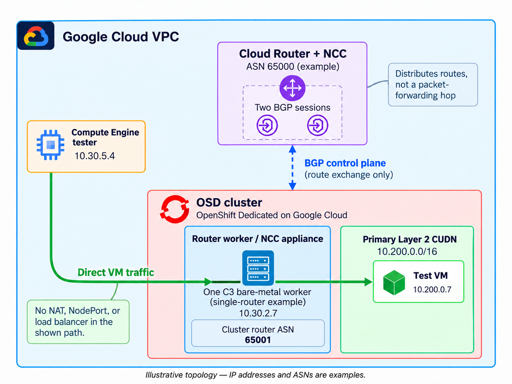

The BGP Cloud Connector Operator advertises a cluster user defined network (CUDN) into the cloud routing fabric, so workloads on that network are reachable by their own addresses from outside the cluster, with no load balancer or NAT. This guide deploys it on OpenShift Dedicated (OSD) on Google Cloud with Workload Identity Federation (WIF), and tests it with a virtual machine on a bare metal router node.

## Architecture

Router nodes run FRR and peer over BGP with a Cloud Router in the same VPC. The cluster advertises the CUDN prefix, the Cloud Router installs it, and anything in the VPC can reach pods and virtual machines on that prefix directly.



Two Google Cloud specifics shape the steps below:

- A VM can only peer with a Cloud Router once it belongs to a router appliance spoke on a Network Connectivity Center (NCC) hub. You create the hub; the Operator manages the spokes.
- The Operator authenticates with Application Default Credentials only, so on a WIF cluster you wire up its identity yourself (section 4).

## Prerequisites

- An OSD 4.22 cluster on Google Cloud using WIF, in a single zone that offers C3 bare metal, with quota for one bare metal node
- `oc` logged in to the cluster as a member of `cluster-admins`
- Permission in the cluster's Google Cloud project to create Cloud Routers, NCC hubs, service accounts, firewall rules, and IAM bindings
- `gcloud`, `ocm`, `oc`, and `jq` installed and authenticated

Set the cluster name and read the remaining values from the cluster:

```bash
export CLUSTER=<cluster-name>

export CLUSTER_ID=$(ocm list clusters --parameter search="name = '$CLUSTER'" \
  --columns id --no-headers | tr -d ' ')
CLUSTER_JSON=$(ocm get /api/clusters_mgmt/v1/clusters/$CLUSTER_ID)

export GCP_PROJECT=$(echo "$CLUSTER_JSON" | jq -r .gcp.project_id)
export REGION=$(echo "$CLUSTER_JSON" | jq -r .region.id)
export ZONE=$(echo "$CLUSTER_JSON" | jq -r '.nodes.availability_zones[0]')
export WIF_ID=$(echo "$CLUSTER_JSON" | jq -r .gcp.authentication.id)
export INFRA_ID=$(echo "$CLUSTER_JSON" | jq -r .infra_id)
export NETWORK=$(echo "$CLUSTER_JSON" | jq -r '.gcp_network.vpc_name // (.infra_id + "-network")')
export WORKER_SUBNET=$(echo "$CLUSTER_JSON" | jq -r '.gcp_network.compute_subnet // (.infra_id + "-worker-subnet")')
export WORKER_CIDR=$(gcloud compute networks subnets describe $WORKER_SUBNET \
  --project $GCP_PROJECT --region $REGION --format='value(ipCidrRange)')

echo "project=$GCP_PROJECT region=$REGION zone=$ZONE network=$NETWORK worker_subnet=$WORKER_SUBNET ($WORKER_CIDR)"
```

Set the BGP values. `LOCAL_ASN` (cluster) and `CLOUD_ROUTER_ASN` must differ. `CUDN_CIDR` must not overlap the cluster's machine, pod, or service networks. `RS_IF_0` and `RS_IF_1` are two unused addresses in the worker subnet for the Cloud Router interfaces; addresses near the top of the range avoid those assigned to nodes:

```bash
export CUDN_CIDR=10.212.0.0/16
export LOCAL_ASN=65001
export CLOUD_ROUTER_ASN=65002
export CLOUD_ROUTER=osdbgp-bgp-router
export NCC_HUB=osdbgp-hub
export NCC_SPOKE_PREFIX=osdbgp-spoke
export RS_IF_0=<unused-address-in-worker-subnet>
export RS_IF_1=<another-unused-address-in-worker-subnet>
```

Define a helper for the waits in this guide. It retries a command until it succeeds, and returns a failure status with a message if the time limit is reached:

```bash
wait_for() {  # usage: wait_for <seconds> <command...>
  local deadline=$((SECONDS + $1)); shift
  until "$@"; do
    if [ $SECONDS -ge $deadline ]; then
      echo "Timed out waiting for: $*. Stop here and investigate." >&2; return 1
    fi
    sleep 15
  done
}
```

## 1. Create the BGP Cloud Router and NCC hub

Create a dedicated Cloud Router with two redundant interfaces in the worker subnet. The cluster's existing NAT router has no interfaces, so it cannot be used for BGP. The interface addresses become the BGP neighbors of every router node:

```bash
gcloud compute routers create $CLOUD_ROUTER --project $GCP_PROJECT \
  --network=$NETWORK --region=$REGION --asn=$CLOUD_ROUTER_ASN

gcloud compute routers add-interface $CLOUD_ROUTER --project $GCP_PROJECT \
  --region=$REGION --subnetwork=$WORKER_SUBNET \
  --ip-address=$RS_IF_0 --interface-name=if-0
gcloud compute routers add-interface $CLOUD_ROUTER --project $GCP_PROJECT \
  --region=$REGION --subnetwork=$WORKER_SUBNET \
  --ip-address=$RS_IF_1 --interface-name=if-1 --redundant-interface=if-0

gcloud network-connectivity hubs create $NCC_HUB --project $GCP_PROJECT

gcloud compute routers describe $CLOUD_ROUTER --project $GCP_PROJECT --region=$REGION \
  --format="value(bgp.asn,interfaces[].name,interfaces[].privateIpAddress)"
```

Expect the ASN, `if-0;if-1`, and your two interface addresses. Without interfaces the Operator discovers no neighbors.

## 2. Add the bare metal router node

The router node runs FRR and hosts the test VM, so it must be bare metal. The `bgp_router=true` label is what the Operator selects in section 5:

```bash
ocm create machinepool -c $CLUSTER_ID --replicas 1 \
  --instance-type c3-highcpu-192-metal --labels bgp_router=true bgp

router_ready() { oc get nodes -l bgp_router=true --no-headers 2>/dev/null \
  | awk '$2=="Ready"{f=1} END{exit !f}'; }
wait_for 1800 router_ready && oc get nodes -l bgp_router=true
```

This example uses one router node, which is enough to demonstrate BGP and direct connectivity. Live migration needs at least two bare metal router nodes, so use `--replicas 2` or more if you need it.

## 3. Install the Operator

Enable the FRR routing provider and install the Operator from `redhat-operators`:

```bash
oc patch network.operator.openshift.io/cluster --type=merge \
  -p '{"spec":{"additionalRoutingCapabilities":{"providers":["FRR"]}}}'

cat <<'EOF' | oc apply -f -
apiVersion: v1
kind: Namespace
metadata:
  name: bgp-cloud-connector
---
apiVersion: operators.coreos.com/v1
kind: OperatorGroup
metadata:
  name: bgp-cloud-connector-operatorgroup
  namespace: bgp-cloud-connector
spec:
  targetNamespaces:
    - bgp-cloud-connector
---
apiVersion: operators.coreos.com/v1alpha1
kind: Subscription
metadata:
  name: bgp-cloud-connector-operator
  namespace: bgp-cloud-connector
spec:
  channel: stable
  installPlanApproval: Automatic
  name: bgp-cloud-connector
  source: redhat-operators
  sourceNamespace: openshift-marketplace
EOF

csv_succeeded() { oc get csv -n bgp-cloud-connector -o jsonpath='{.items[*].status.phase}' \
  2>/dev/null | grep -q Succeeded; }
wait_for 600 csv_succeeded && oc get csv -n bgp-cloud-connector
```

The validated run used channel `stable` (the catalog default), CSV `bgp-cloud-connector.v1.1.0`, on OSD 4.22.20. Check the channels your catalog offers with `oc get packagemanifest bgp-cloud-connector -n openshift-marketplace`.

## 4. Grant the Operator access to Google Cloud

The Operator needs a Google Cloud service account, a workload identity binding to its Kubernetes ServiceAccount, and an `external_account` credentials file backed by a projected token.

Create the service account and grant it permissions. IAM can take a short time to recognise a new service account, so each binding is retried for up to two minutes:

```bash
export SA_NAME=bgp-cloud-connector
export SA_EMAIL=${SA_NAME}@${GCP_PROJECT}.iam.gserviceaccount.com

gcloud iam service-accounts create $SA_NAME --project $GCP_PROJECT \
  --display-name="BGP Cloud Connector operator"

for ROLE in roles/compute.networkAdmin roles/compute.instanceAdmin.v1 \
            roles/networkconnectivity.hubAdmin; do
  wait_for 120 gcloud projects add-iam-policy-binding $GCP_PROJECT \
    --member="serviceAccount:${SA_EMAIL}" --role="$ROLE" --condition=None --format=none \
    || break
done
```

{}
These predefined roles are project-wide and broad. For production, use a custom role with only what the Operator needs: `compute.routers.get` and `compute.routers.update` (discover neighbors, manage peers), `compute.instances.get`, `list`, `update`, and `use` (find router nodes, set `canIpForward`, link them to spokes), `networkconnectivity.spokes.*` on the hub, and possibly `compute.networks.use`. Verify the set against your Operator version.
{}

Read the Google pool and provider IDs from the WIF configuration, and bind the Operator's ServiceAccount to the service account:

```bash
export SUBJECT="system:serviceaccount:bgp-cloud-connector:openshift-bgp-cloud-connector-controller-manager"

if WIF_JSON=$(ocm get /api/clusters_mgmt/v1/gcp/wif_configs/$WIF_ID) \
   && POOL_ID=$(echo "$WIF_JSON" | jq -er '.gcp.workload_identity_pool.pool_id') \
   && PROVIDER_ID=$(echo "$WIF_JSON" | jq -er '.gcp.workload_identity_pool.identity_provider.identity_provider_id') \
   && PROJNUM=$(gcloud projects describe $GCP_PROJECT --format='value(projectNumber)') \
   && [ -n "$POOL_ID" ] && [ -n "$PROVIDER_ID" ] && [ -n "$PROJNUM" ]; then
  export POOL_ID PROVIDER_ID PROJNUM
  echo "pool=$POOL_ID provider=$PROVIDER_ID project=$PROJNUM"
  gcloud iam service-accounts add-iam-policy-binding $SA_EMAIL --project $GCP_PROJECT \
    --role="roles/iam.workloadIdentityUser" \
    --member="principal://iam.googleapis.com/projects/${PROJNUM}/locations/global/workloadIdentityPools/${POOL_ID}/subject/${SUBJECT}"
else
  echo "Could not read the WIF pool, provider, or project number. Stop here."
fi
```

Create the credentials secret:

```bash
[ -n "$POOL_ID" ] && [ -n "$PROVIDER_ID" ] && [ -n "$PROJNUM" ] \
&& oc create secret generic gcp-credentials -n bgp-cloud-connector \
  --from-file=service_account.json=/dev/stdin <<EOF \
|| echo "Secret not created: POOL_ID, PROVIDER_ID, or PROJNUM is missing or oc failed. Stop here."
{
    "type": "external_account",
    "audience": "//iam.googleapis.com/projects/${PROJNUM}/locations/global/workloadIdentityPools/${POOL_ID}/providers/${PROVIDER_ID}",
    "subject_token_type": "urn:ietf:params:oauth:token-type:jwt",
    "token_url": "https://sts.googleapis.com/v1/token",
    "service_account_impersonation_url": "https://iamcredentials.googleapis.com/v1/projects/-/serviceAccounts/${SA_EMAIL}:generateAccessToken",
    "credential_source": {
        "file": "/var/run/secrets/openshift/serviceaccount/token",
        "format": { "type": "text" }
    }
}
EOF
```

Once the secret exists, inject it into the Operator through its Subscription. The projected token audience must be `openshift`. OLM applies the Subscription config to the deployment shortly after the patch, so the block waits for the credentials volume before checking the rollout:

```bash
creds_mounted() { oc get deploy openshift-bgp-cloud-connector-controller-manager \
  -n bgp-cloud-connector -o jsonpath='{.spec.template.spec.volumes[*].name}' \
  | tr ' ' '\n' | grep -qx bound-sa-token; }

if oc get secret gcp-credentials -n bgp-cloud-connector -o name >/dev/null; then
  oc patch subscription bgp-cloud-connector-operator -n bgp-cloud-connector --type=merge -p '{
    "spec": {"config": {
      "env": [{"name": "GOOGLE_APPLICATION_CREDENTIALS", "value": "/var/run/secrets/gcp/service_account.json"}],
      "volumes": [
        {"name": "gcp-credentials", "secret": {"secretName": "gcp-credentials"}},
        {"name": "bound-sa-token", "projected": {"sources": [
          {"serviceAccountToken": {"audience": "openshift", "expirationSeconds": 3600, "path": "token"}}]}}
      ],
      "volumeMounts": [
        {"name": "gcp-credentials", "mountPath": "/var/run/secrets/gcp", "readOnly": true},
        {"name": "bound-sa-token", "mountPath": "/var/run/secrets/openshift/serviceaccount", "readOnly": true}
      ]
    }}}' \
  && wait_for 300 creds_mounted \
  && oc rollout status deploy/openshift-bgp-cloud-connector-controller-manager \
       -n bgp-cloud-connector --timeout=5m
else
  echo "Secret gcp-credentials not found. Stop here."
fi
```

## 5. Configure BGP and the CUDN

Create the `BGPCloudConfiguration` singleton. Peer addresses are discovered from the Cloud Router:

```bash
cat <<EOF | oc apply -f -
apiVersion: networking.openshift.io/v1beta1
kind: BGPCloudConfiguration
metadata:
  name: cluster
spec:
  platform: GCP
  routerNodeSelector:
    bgp_router: "true"
  bgp:
    localASN: ${LOCAL_ASN}
    livenessDetection: bgp-keepalive
  gcp:
    project: ${GCP_PROJECT}
    region: ${REGION}
    cloudRouterName: ${CLOUD_ROUTER}
    ncc:
      hubName: ${NCC_HUB}
      spokePrefix: ${NCC_SPOKE_PREFIX}
EOF

oc wait bgpcloudconfiguration/cluster --for=condition=CloudResourcesReconciled --timeout=10m
oc get bgpcloudconfiguration cluster \
  -o jsonpath='{range .status.conditions[*]}{.type}={.status}{"\n"}{end}{.status.peerGroups}{"\n"}'
```

All six conditions should be `True`, and the peer group should list `$RS_IF_0` and `$RS_IF_1`. The Operator may restart router nodes during its first reconciliation, so wait for them to be `Ready` again, then for the BGP sessions:

```bash
wait_for 1800 router_ready

sessions_up() { oc get bgpsessionstate -n openshift-frr-k8s -o jsonpath='{.items[*].status.bgpStatus}' \
  | tr ' ' '\n' | grep -c Established | grep -qx 2; }
wait_for 900 sessions_up && oc get bgpsessionstate -n openshift-frr-k8s \
  -o custom-columns=NODE:.status.node,PEER:.status.peer,STATE:.status.bgpStatus
```

Each router node peers with both Cloud Router interfaces, so one router node gives two `Established` sessions. Adjust the count in `sessions_up` if you run more router nodes.

Create the workload namespace and the `BGPRouting` resource, which generates the CUDN and its route advertisement. Both namespace labels must be set at creation:

```bash
cat <<EOF | oc apply -f -
apiVersion: v1
kind: Namespace
metadata:
  name: bgp-test-vms
  labels:
    cluster-udn: bgp-test-cudn
    k8s.ovn.org/primary-user-defined-network: ""
---
apiVersion: networking.openshift.io/v1beta1
kind: BGPRouting
metadata:
  name: bgp-test-cudn
spec:
  network:
    name: bgp-test-cudn
    subnets:
      - ${CUDN_CIDR}
EOF

oc wait bgprouting/bgp-test-cudn --for=condition=RouteAdvertisementsCreated --timeout=5m

route_learned() { gcloud compute routers get-status $CLOUD_ROUTER --project $GCP_PROJECT \
  --region $REGION --format=json | jq -e --arg p "$CUDN_CIDR" \
  '[.result.bestRoutes[]?.destRange] | index($p)' >/dev/null; }
wait_for 300 route_learned && echo "Cloud Router learned $CUDN_CIDR"
```

## 6. Test connectivity with a virtual machine

Install OpenShift Virtualization, if it is not already installed:

```bash
cat <<'EOF' | oc apply -f -
apiVersion: v1
kind: Namespace
metadata:
  name: openshift-cnv
---
apiVersion: operators.coreos.com/v1
kind: OperatorGroup
metadata:
  name: kubevirt-hyperconverged-group
  namespace: openshift-cnv
spec:
  targetNamespaces:
    - openshift-cnv
---
apiVersion: operators.coreos.com/v1alpha1
kind: Subscription
metadata:
  name: hco-operatorhub
  namespace: openshift-cnv
spec:
  source: redhat-operators
  sourceNamespace: openshift-marketplace
  name: kubevirt-hyperconverged
  channel: stable
  installPlanApproval: Automatic
EOF

cnv_succeeded() { oc get csv -n openshift-cnv -o jsonpath='{.items[*].status.phase}' \
  2>/dev/null | grep -q Succeeded; }
wait_for 900 cnv_succeeded

cat <<'EOF' | oc apply -f -
apiVersion: hco.kubevirt.io/v1beta1
kind: HyperConverged
metadata:
  name: kubevirt-hyperconverged
  namespace: openshift-cnv
spec: {}
EOF

oc wait hyperconverged/kubevirt-hyperconverged -n openshift-cnv \
  --for=condition=Available --timeout=15m
oc get nodes -l bgp_router=true \
  -o custom-columns=NODE:.metadata.name,KVM:.status.allocatable.devices\\.kubevirt\\.io/kvm
```

The router node should report a non-zero `KVM` count.

Create a test VM pinned to the router node, because only a BGP speaker can deliver traffic for the CUDN. It uses a `containerDisk`, which the kubelet pulls over the node network; a `DataVolume` import in this namespace would fail, because the CUDN has no internet egress. Cloud-init starts a small HTTP server:

```bash
cat <<'EOF' | oc apply -f -
apiVersion: kubevirt.io/v1
kind: VirtualMachine
metadata:
  name: bgp-test-vm
  namespace: bgp-test-vms
spec:
  runStrategy: Always
  template:
    metadata:
      labels:
        app: bgp-test-vm
    spec:
      nodeSelector:
        bgp_router: "true"
      domain:
        cpu:
          cores: 2
        memory:
          guest: 2Gi
        devices:
          disks:
            - name: rootdisk
              disk:
                bus: virtio
            - name: cloudinit
              disk:
                bus: virtio
          interfaces:
            - name: default
              bridge: {}
      networks:
        - name: default
          pod: {}
      volumes:
        - name: rootdisk
          containerDisk:
            image: quay.io/containerdisks/fedora:latest
        - name: cloudinit
          cloudInitNoCloud:
            userData: |
              #cloud-config
              write_files:
                - path: /var/tmp/bgp-test/index.html
                  permissions: "0644"
                  content: "BGP Cloud Connector VM endpoint\n"
                - path: /etc/systemd/system/bgp-test-http.service
                  permissions: "0644"
                  content: |
                    [Unit]
                    Description=BGP connectivity test endpoint
                    After=network-online.target
                    Wants=network-online.target

                    [Service]
                    ExecStart=/usr/bin/python3 -m http.server 8080 --directory /var/tmp/bgp-test
                    Restart=on-failure

                    [Install]
                    WantedBy=multi-user.target
              runcmd:
                - [systemctl, daemon-reload]
                - [systemctl, enable, --now, bgp-test-http.service]
EOF
```

The validated run used the `bridge: {}` binding shown. If you use a different binding, such as `l2bridge`, re-run the tests below.

Wait for the guest agent to report the VM's CUDN address:

```bash
wait_for 120 oc get vmi/bgp-test-vm -n bgp-test-vms -o name \
  && oc wait vmi/bgp-test-vm -n bgp-test-vms --for=condition=AgentConnected --timeout=10m

vm_ip() { VM_IP=$(oc get vmi bgp-test-vm -n bgp-test-vms \
  -o jsonpath='{.status.interfaces[0].ipAddress}') && [ -n "$VM_IP" ]; }
wait_for 300 vm_ip && export VM_IP && echo "VM_IP=$VM_IP"
```

Confirm the guest service answers from inside the cluster. A pod in the same namespace shares the CUDN:

```bash
oc run bgp-test-check -n bgp-test-vms --image=registry.access.redhat.com/ubi9/ubi-minimal \
  --restart=Never --rm -i --quiet \
  --overrides='{"spec":{"securityContext":{"runAsNonRoot":true,"seccompProfile":{"type":"RuntimeDefault"}},"containers":[{"name":"bgp-test-check","image":"registry.access.redhat.com/ubi9/ubi-minimal","command":["curl","-fsS","-m","5","http://'"${VM_IP}"':8080/"],"securityContext":{"allowPrivilegeEscalation":false,"capabilities":{"drop":["ALL"]}}}]}}'
```

Expect `BGP Cloud Connector VM endpoint`. If this fails, fix the guest before testing the BGP path.

Create a client VM in the VPC, allow IAP SSH to it, and allow it to reach the test VM. Traffic for the CUDN prefix is delivered to the router node, so the rule targets the cluster's worker tag:

```bash
gcloud compute instances create osdbgp-client --project $GCP_PROJECT --zone $ZONE \
  --machine-type=e2-medium --subnet=$WORKER_SUBNET --no-address \
  --image-family=debian-12 --image-project=debian-cloud

gcloud compute firewall-rules create osdbgp-allow-iap --project $GCP_PROJECT \
  --network=$NETWORK --allow=tcp:22 --source-ranges=35.235.240.0/20

gcloud compute firewall-rules create osdbgp-allow-vm-test --project $GCP_PROJECT \
  --network=$NETWORK --allow=tcp:8080,icmp \
  --source-ranges=$WORKER_CIDR --target-tags=${INFRA_ID}-worker

wait_for 300 gcloud compute ssh osdbgp-client --project $GCP_PROJECT --zone $ZONE \
  --tunnel-through-iap --quiet \
  --command "sudo apt-get update -qq && sudo apt-get install -y -qq traceroute"
```

The client VM and the IAP rule take a minute or two to become reachable, so the install retries until SSH succeeds.

These firewall rules are for a disposable lab VPC. In a shared VPC, scope rules to the exact sources, targets, and ports you need. Traffic initiated from the CUDN carries a source address in `$CUDN_CIDR`, so rules for that direction must list it explicitly.

Reach the VM by its CUDN address from the client. The test stops at the first failed check:

```bash
gcloud compute ssh osdbgp-client --project $GCP_PROJECT --zone $ZONE --tunnel-through-iap \
  --command "set -e
ping -c3 -W2 ${VM_IP} >/dev/null
echo 'PING ok'
BODY=\$(curl -fsS -m 5 http://${VM_IP}:8080/)
test \"\$BODY\" = 'BGP Cloud Connector VM endpoint'
echo \"HTTP ok: \$BODY\"
sudo traceroute -n -I -m 6 ${VM_IP}" || echo "Connectivity test failed. Stop here."
```

Output from the validated run:

```text
PING ok
HTTP ok: BGP Cloud Connector VM endpoint
traceroute to 10.212.0.3 (10.212.0.3), 6 hops max, 60 byte packets
 1  10.52.2.9  2.884 ms  2.864 ms  2.859 ms
 2  100.88.0.20  3.579 ms  3.576 ms  3.572 ms
 3  10.212.0.3  2.138 ms  2.134 ms  2.130 ms
```

The client reached the VM on the address the guest itself holds, through a route the cluster advertised over BGP. The first hop is the router node, which advertised the prefix.

## Troubleshooting

Start with the Operator log and the per-node state in Google Cloud:

```bash
oc logs -n bgp-cloud-connector deploy/openshift-bgp-cloud-connector-controller-manager --tail=100

for NODE in $(oc get nodes -l bgp_router=true -o jsonpath='{.items[*].metadata.name}'); do
  gcloud compute instances describe ${NODE%%.*} --project $GCP_PROJECT --zone $ZONE \
    --format="value(name,status,canIpForward)"
done
gcloud network-connectivity spokes list --project $GCP_PROJECT --format="table(name,state)"
gcloud compute routers get-status $CLOUD_ROUTER --project $GCP_PROJECT --region $REGION \
  --format="table(result.bgpPeerStatus[].peerIpAddress,result.bgpPeerStatus[].state)"
```

| Symptom | Likely cause |
|---|---|
| `CloudEndpointsDiscovered` is `False` | Credentials. Check the secret is mounted, `GOOGLE_APPLICATION_CREDENTIALS` is set, the token audience is `openshift`, and the `workloadIdentityUser` binding names the exact ServiceAccount and pool. |
| `status.peerGroups` is empty | The Cloud Router has no interfaces, or `cloudRouterName` points at the NAT router. |
| Sessions stay in `Connect` | The node is missing from the spoke, the spoke is not `ACTIVE`, or `localASN` equals the Cloud Router ASN. |
| Some router nodes have no sessions | Every selected node must be `RUNNING`, in the spoke, have Cloud Router peers, and show `canIpForward` `True`. If one selected node cannot be configured, reconciliation for the others can stall while conditions still report `True`. |
| Sessions up, no route learned | `BGPRouting` is not `RouteAdvertisementsCreated`, or the route advertisement is not `Accepted`. |
| Route learned, traffic fails | Firewall rules, or the workload is not on a router node. |

## Cleanup

Delete the workloads and the BGP configuration. The Operator's finalizer then removes the NCC spokes and Cloud Router peers it created:

```bash
oc delete vm bgp-test-vm -n bgp-test-vms
oc delete bgprouting bgp-test-cudn
oc delete bgpcloudconfiguration cluster --wait=false
oc delete namespace bgp-test-vms
```

Wait until the cleanup is confirmed. Each check only passes on a successful query that finds nothing, so an API or permission error keeps it waiting:

```bash
operator_cleanup_done() {
  local spokes peers cfg
  spokes=$(gcloud network-connectivity spokes list --project $GCP_PROJECT \
    --filter="name~${NCC_SPOKE_PREFIX}" --format=json) || return 1
  peers=$(gcloud compute routers describe $CLOUD_ROUTER --project $GCP_PROJECT \
    --region $REGION --format=json) || return 1
  cfg=$(oc get bgpcloudconfiguration cluster --ignore-not-found -o name) || return 1
  echo "$spokes" | jq -e 'length == 0' >/dev/null \
    && echo "$peers" | jq -e '(.bgpPeers // []) | length == 0' >/dev/null \
    && [ -z "$cfg" ]
}
wait_for 600 operator_cleanup_done && echo "Spokes, peers, and BGPCloudConfiguration removed"
```

Do not remove the router machine pool until this succeeds, because router nodes linked to a spoke cannot be deleted.

Remove the router machine pool and the Google Cloud resources this guide created. The cluster, its network, and its WIF configuration are left in place:

```bash
ocm delete machinepool -c $CLUSTER_ID bgp

gcloud compute instances delete osdbgp-client --project $GCP_PROJECT --zone $ZONE
gcloud compute firewall-rules delete osdbgp-allow-vm-test osdbgp-allow-iap --project $GCP_PROJECT
gcloud network-connectivity hubs delete $NCC_HUB --project $GCP_PROJECT
gcloud compute routers delete $CLOUD_ROUTER --project $GCP_PROJECT --region $REGION
gcloud iam service-accounts delete $SA_EMAIL --project $GCP_PROJECT
```

The Operator and OpenShift Virtualization remain installed. Uninstall them from the console if you no longer need them.

## References

- [BGP Cloud Connector Operator source](https://github.com/openshift/bgp-cloud-connector)
- [Google Cloud Workload Identity Federation](https://cloud.google.com/iam/docs/workload-identity-federation)
- [Network Connectivity Center router appliances](https://cloud.google.com/network-connectivity/docs/network-connectivity-center/concepts/ra-overview)
