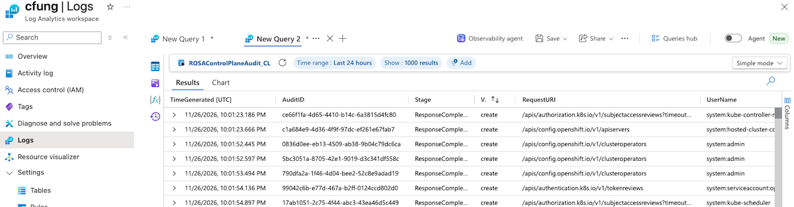

## Overview

ROSA HCP provides a control plane log forwarder that is a separate system outside your cluster. You can use the control plane log forwarder to send your logs to either an Amazon CloudWatch group or Amazon S3 bucket. 

This guide walks through one way to get those logs into Microsoft Sentinel, which is a cloud-native Security Information and Event Management (SIEM) solution. There is no native way of shipping logs directly from the cluster to Sentinel, so we will configure ROSA's control plane log forwarder writes to S3, then use an AWS Lambda function (triggered by an SQS queue fed by S3 event notifications) to reshape the audit events and push them into a Microsoft Sentinel custom table over the Azure Monitor Logs Ingestion API.

This guide differs from [Forwarding and Monitoring ROSA HCP Control Plane Audit Logs with Filebeat](https://cloud.redhat.com/experts/rosa/audit-logs-filebeat/) by swapping filebeat for a serverless lambda and a Sentinel destination. 


## Prerequisites

* [AWS CLI](https://docs.aws.amazon.com/cli/latest/userguide/install-cliv2.html) configured with permissions to create S3 buckets, SQS queues, AWS Lambda and IAM roles
* [ROSA CLI](https://console.redhat.com/openshift/downloads) v1.2.64 or later, logged in (`rosa login`)
* [OpenShift CLI (`oc`)](https://console.redhat.com/openshift/downloads), logged in to the target cluster as a cluster administrator
* A ROSA HCP cluster. This guide was validated on a ROSA 4.22 version
* Microsoft EntraID Permissions to register an application
* [AZ CLI](https://docs.microsoft.com/en-us/cli/azure/install-azure-cli?view=azure-cli-latest) configured with permissions to create a Sentinel workspace, Data Collection rules, and assign IAM roles

{}
Many enterprise tenants disable self-service app registration for regular users. If you see "You do not have access ... You don't have permission to register applications in this directory" when you reach [Register a new application in Azure AD for Lambda](#register-a-new-application-in-azure-ad-for-lambda), ask your Entra ID admin to either grant you the **Application Developer** role, enable self-service app registration tenant-wide, or create the app registration for you and share the client ID, tenant ID, and a client secret.
{}

## Set Environment Variables

Let's set some enviroment variables.

```bash
export CLUSTER_NAME="my-hcp-cluster"
export CLUSTER_REGION="ca-central-1"       # region where the ROSA HCP cluster runs
export AWS_ACCOUNT_ID=$(aws sts get-caller-identity --query Account --output text)
export BUCKET_NAME="${CLUSTER_NAME}-audit-logs"
export SQS_QUEUE_NAME="${CLUSTER_NAME}-audit-s3-events"
export LOG_PREFIX="${CLUSTER_NAME}"
```

## Forward Control Plane Logs to S3

### Create an AssumeRole policy file and Required IAM Role

It is required to create an IAM role and policy to give the cluster log forwarder permission to send logs to our S3 bucket.

{}
This step is only required if you're forwarding to a CloudWatch log group. Per the [Red Hat documentation](https://docs.redhat.com/en/documentation/red_hat_openshift_service_on_aws/4/html/logging/rosa-forwarding-control-plane-logs), "To use an S3 bucket, you do not need an IAM role and policy." We include it here because it's harmless to create and keeps this guide self-contained, but if you're only forwarding to S3 you can skip straight to [Create the S3 bucket and associated Policy](#create-the-s3-bucket-and-associated-policy).
{}

1. To enable the log forwarder delivery capability, prepare the IAM policy by creating an `assume-role-policy.json` file. 

    ```bash 
    cat > assume-role-policy.json << 'EOF'
    {
        "Version": "2012-10-17",
        "Statement": [
            {
                "Effect": "Allow",
                "Principal": {
                    "AWS": "arn:aws:iam::859037107838:role/ROSA-CentralLogDistributionRole-241c1a86"
                },
                "Action": "sts:AssumeRole"
            }
        ]
    }
    EOF
    ```

2. Create a role with the created AssumeRole Policy above to enable the log forwarder distribution capability

    ```bash
    aws iam create-role \
    --role-name CustomerLogDistribution-RH \
    --assume-role-policy-document file://assume-role-policy.json
    ```
  {}
  The Role MUST be prefixed with `CustomerLogDistribution-`.
  {}

### Create the S3 bucket and associated Policy

1. Create the S3 bucket 

    {}
    The S3 bucket **must be in the same AWS region as the ROSA HCP cluster**. ROSA's OCM API validates bucket accessibility by attempting to reach the bucket from the cluster's region. A bucket in a different region fails the pre-flight check with `Failed to reach bucket`, even if the bucket exists and the policy is correct.
    {}

    ```bash
    aws s3api create-bucket \
        --bucket ${BUCKET_NAME} \
        --region ${CLUSTER_REGION} \
        --create-bucket-configuration LocationConstraint=${CLUSTER_REGION}
    ```

2. Configure the policy for the S3 bucket 

    ```bash
    cat > s3-bucket-policy.json << 'EOF'
    {
        "Version": "2012-10-17",
        "Statement": [
            {
                "Sid": "AllowCentralLogDistributionWrite",
                "Effect": "Allow",
                "Principal": {
                    "AWS": "arn:aws:iam::859037107838:role/ROSA-CentralLogDistributionRole-241c1a86"
                },
                "Action": "s3:PutObject",
                "Resource": "arn:aws:s3:::${BUCKET_NAME}/*",
                "Condition": {
                    "StringEquals": {
                        "s3:x-amz-acl": "bucket-owner-full-control"
                    }
                }
            }
        ]
    }
    EOF
    ```

3. Attach the policy to the S3 role

    ```bash
    aws s3api put-bucket-policy \
    --bucket ${BUCKET_NAME} \
    --policy file://s3-bucket-policy.json
    ```

### Create the audit log forwarder

```bash
cat > log-fwd-config.yaml << 'EOF'
s3:
  s3_config_bucket_name: "${BUCKET_NAME}"
  s3_config_bucket_prefix: "${LOG_PREFIX}"
groups:
  - "api"
  - "authentication"
EOF

rosa create log-forwarder -c ${CLUSTER_NAME} --log-fwd-config="log-fwd-config.yaml" -o yaml
```
  {}
  The example log forwarder above only specifies log groups. You can also specify one or more applications in addition to the log groups.  Please refer to [Log groups](https://docs.redhat.com/en/documentation/red_hat_openshift_service_on_aws/4/html/logging/rosa-forwarding-control-plane-logs#:~:text=Table%C2%A02.1.%C2%A0Log%20groups) to learn more about the different log group types and related applications. 
  {}

Verify the created log-forwarder

  ```bash
  rosa list log-forwarder -c ${CLUSTER_NAME}
  ```
Verify logs are flowing to S3

 ```bash
 aws s3 ls "s3://${BUCKET_NAME}/${LOG_PREFIX}/" \
  --region "${CLUSTER_REGION}" \
  --recursive | head -10
```

Expected output
```bash
2026-11-25 13:23:19       1611 control-plane-logs/ocm-production-2uad3r2oer56k32o0p0girj071ov5rod-cfung/audit-webhook/audit-webhook-67b7c48569-dh65n/20261125-202316-a2f2e594-b8e2-4d80-b86e-8657466ecb47.json.gz
2026-11-25 14:11:26       1618 control-plane-logs/ocm-production-2uad3r2oer56k32o0p0girj071ov5rod-cfung/audit-webhook/audit-webhook-67b7c48569-dh65n/20261125-211123-b4913730-2ddf-4214-9419-d5e459b5e7ab.json.gz
2026-11-25 14:59:23       1614 control-plane-logs/ocm-production-2uad3r2oer56k32o0p0girj071ov5rod-cfung/audit-webhook/audit-webhook-67b7c48569-dh65n/20261125-215920-e63d8565-038c-4c31-9f75-08bad86e9ce9.json.gz
2026-11-25 15:47:21       1611 control-plane-logs/ocm-production-2uad3r2oer56k32o0p0girj071ov5rod-cfung/audit-webhook/audit-webhook-67b7c48569-dh65n/20261125-224718-2a06dc26-8f65-4c77-a322-bc0418a12a1f.json.gz
2026-11-25 16:35:17       1613 control-plane-logs/ocm-production-2uad3r2oer56k32o0p0girj071ov5rod-cfung/audit-webhook/audit-webhook-67b7c48569-dh65n/20261125-233515-1ee4212e-eda4-4769-889d-756e1e20155b.json.gz
2026-11-25 17:23:24       1617 control-plane-logs/ocm-production-2uad3r2oer56k32o0p0girj071ov5rod-cfung/audit-webhook/audit-webhook-67b7c48569-dh65n/20261126-002322-cb00ae01-5593-4ddf-9c6d-23b000199c7f.json.gz
2026-11-25 18:11:21       1618 control-plane-logs/ocm-production-2uad3r2oer56k32o0p0girj071ov5rod-cfung/audit-webhook/audit-webhook-67b7c48569-dh65n/20261126-011119-96e03837-40a4-4093-bcdd-4348bfa08f51.json.gz
2026-11-25 18:59:18       1618 control-plane-logs/ocm-production-2uad3r2oer56k32o0p0girj071ov5rod-cfung/audit-webhook/audit-webhook-67b7c48569-dh65n/20261126-015916-9d35ec4d-73a9-4ee0-855f-13468298e394.json.gz
2026-11-25 19:47:26       1620 control-plane-logs/ocm-production-2uad3r2oer56k32o0p0girj071ov5rod-cfung/audit-webhook/audit-webhook-67b7c48569-dh65n/20261126-024723-ec859167-494b-4ea9-aa91-bcf234ae54b8.json.gz
2026-11-25 20:35:23       1621 control-plane-logs/ocm-production-2uad3r2oer56k32o0p0girj071ov5rod-cfung/audit-webhook/audit-webhook-67b7c48569-dh65n/20261126-033520-25ccd9e7-89a5-4103-bbd0-6fa450628805.json.gz
```

Please refer to [S3 Log Format](https://cloud.redhat.com/experts/rosa/audit-logs-filebeat/#:~:text=privilege%20escalation%20attempts%3F-,S3%20Log%20Format,-Before%20configuring%20ingestion) to understand the format produced by ROSA's log-forwarder


## Configure Sentinel workspace, custom table, and Data Collection Rule

### Set environment variable 

```bash
export RESOURCE_GROUP=example-rg 
export WORKSPACE_NAME=example-workspace
export LOCATION=canadacentral # replace with your desired region
export SUBSCRIPTION_ID="xxxxxxxx-xxxx-xxxx-xxxx-xxxxxxxxxxxx" 
``` 

### Configure Workspace and Sentinel

```bash
az monitor log-analytics workspace create -g ${RESOURCE_GROUP} -n ${WORKSPACE_NAME} -l ${LOCATION} --sku PerGB2018

az rest --method put \
  --url "https://management.azure.com/subscriptions/${SUBSCRIPTION_ID}/resourceGroups/${RESOURCE_GROUP}/providers/Microsoft.OperationalInsights/workspaces/${WORKSPACE_NAME}/providers/Microsoft.SecurityInsights/onboardingStates/default?api-version=2024-03-01" \
  --body '{"properties":{"customerManagedKey": false}}'
  ```
Take note of the `id` value of the output of the workspace creation command, that is the WORKSPACE_RESOURCE_ID

```bash
export WORKSPACE_RESOURCE_ID=<value of `id` in above output>
```

### Configure Data Collection Endpoint

```bash
az monitor data-collection endpoint create -g ${RESOURCE_GROUP} -l ${LOCATION} --name rosa-cplf-dce --public-network-access Enabled
```
Note the `logsIngestion.endpoint` and `id` values in the output — that's DCE_INGESTION_ENDPOINT for the Lambda.

Create some environment variables with the values noted from above
```bash
export DCE_INGESTION_ENDPOINT=<value of logsIngestion.endpoint above>
export DCE_INGESTION_ENDPOINT_ID=<value of `id` in output above>
```

### Create Custom table

```bash
az monitor log-analytics workspace table create \
  --resource-group ${RESOURCE_GROUP} --workspace-name ${WORKSPACE_NAME} \
  --name ROSAControlPlaneAudit_CL \
  --columns TimeGenerated=datetime AuditID=string Stage=string Verb=string RequestURI=string \
            UserName=string UserGroups=dynamic SourceIPs=dynamic UserAgent=string ResponseCode=int \
            ObjectRef=dynamic AuthorizationDecision=string AuthorizationReason=string \
            SourceApplication=string ClusterId=string RequestReceivedTime=datetime \
            StageTime=datetime RawEvent=dynamic
```

### Create Data Collection Rule (DCR)

The DCR declares the incoming stream schema and maps it to the custom table's _CL output stream

```bash
cat > dcr.json << 'EOF'
{
  "location": "${LOCATION}",
  "properties": {
    "dataCollectionEndpointId": "${DCE_INGESTION_ENDPOINT_ID}",
    "streamDeclarations": {
      "Custom-ROSAControlPlaneAudit": {
        "columns": [
          { "name": "TimeGenerated", "type": "datetime" },
          { "name": "AuditID", "type": "string" },
          { "name": "Stage", "type": "string" },
          { "name": "Verb", "type": "string" },
          { "name": "RequestURI", "type": "string" },
          { "name": "UserName", "type": "string" },
          { "name": "UserGroups", "type": "dynamic" },
          { "name": "SourceIPs", "type": "dynamic" },
          { "name": "UserAgent", "type": "string" },
          { "name": "ResponseCode", "type": "int" },
          { "name": "ObjectRef", "type": "dynamic" },
          { "name": "AuthorizationDecision", "type": "string" },
          { "name": "AuthorizationReason", "type": "string" },
          { "name": "SourceApplication", "type": "string" },
          { "name": "ClusterId", "type": "string" },
          { "name": "RequestReceivedTime", "type": "datetime" },
          { "name": "StageTime", "type": "datetime" },
          { "name": "RawEvent", "type": "dynamic" }
        ]
      }
    },
    "destinations": {
      "logAnalytics": [{ "workspaceResourceId": "${WORKSPACE_RESOURCE_ID}", "name": "rosaSentinelWorkspace" }]
    },
    "dataFlows": [{
      "streams": ["Custom-ROSAControlPlaneAudit"],
      "destinations": ["rosaSentinelWorkspace"],
      "outputStream": "Custom-ROSAControlPlaneAudit_CL"
    }]
  }
}
EOF

az rest --method put \
  --url "https://management.azure.com/subscriptions/${SUBSCRIPTION_ID}/resourceGroups/${RESOURCE_GROUP}/providers/Microsoft.Insights/dataCollectionRules/rosa-cplf-dcr?api-version=2023-03-11" \
  --body @dcr.json
```
Take note of the response's `properties.immutableId (dcr-...) —` and `id`
that's DCR_IMMUTABLE_ID for the Lambda. Also take note of the `id` output as that corresponds to the DCR_RESOURCE_ID needed for assigning permissions to the lambda app.  

Create environment variables as below

```bash
export DCR_IMMUTABLE_ID=<value of `properties.immutableId (dcr-...) —`>
export DCR_RESOURCE_ID=<value of `id`>
```

### Register a new application in Azure AD for Lambda

Login to the Azure portal, and navigate to [App registrations blade](https://portal.azure.com/#blade/Microsoft_AAD_RegisteredApps/ApplicationsListBlade), then click on "New registration" to create a new application.

Provide a name for the application, for example `rosa-sentinel-ingest`. Under **Supported account types** Select "Single tenant only - ". Leave the Redirect URI empty. Once you fill in the necessary information, click "Register" to create the application.

Then, click on the "Certificates & secrets" sub-blade and select "New client secret". Fill in the details request and make note of the generated `client secret value`, as you'll use it in a later step. You won't be able to retrieve it again.

Then, click on the "Overview" sub-blade and make note of the "Application (client) ID" and "Directory (tenant) ID". You'll need those values in a later step as well.

### Grant the Lambda App Permissions to publish metrics

```bash
APP_ID=yyyyyyyy-yyyy-yyyy-yyyy-yyyyyyyyyyyy # Replace this with the Application (client) ID
CLIENT_SECRET=xxxxxxxx-xxxx-xxxx-xxxx-xxxxxxxxxxxx # Replace this with the Client Secret
TENANT_ID=zzzzzzzz-zzzz-zzzz-zzzz-zzzzzzzzzzzz # Replace this with the Directory (tenant) ID

az role assignment create \
  --assignee ${APP_ID} \
  --role "Monitoring Metrics Publisher" \
  --scope "${DCR_RESOURCE_ID}"
```  

## Create SQS Queue and Lambda

1. Create an SQS queue that is fed by an S3 event notification

    ```bash
    SQS_QUEUE_URL=$(aws sqs create-queue --queue-name "${SQS_QUEUE_NAME}" --region "${REGION}" --query QueueUrl --output text)

    cat > sqs-attrs.json <<EOF
    {
    "Policy": "{\"Version\":\"2012-10-17\",\"Statement\":[{\"Sid\":\"AllowS3SendMessage\",\"Effect\":\"Allow\",\"Principal\":{\"Service\":\"s3.amazonaws.com\"},\"Action\":\"SQS:SendMessage\",\"Resource\":\"arn:aws:sqs:${REGION}:${ACCOUNT_ID}:${SQS_QUEUE_NAME}\",\"Condition\":{\"ArnEquals\":{\"aws:SourceArn\":\"arn:aws:s3:::${BUCKET_NAME}\"}}}]}",
    "VisibilityTimeout": "120"
    }
    EOF
    aws sqs set-queue-attributes --queue-url "${SQS_QUEUE_URL}" --attributes file://sqs-attrs.json
    ```
    {}
    The visibility timeout (120s) must exceed the Lambda's configured timeout, or Lambda will refuse to attach the event source mapping.
    {}

2. Create an S3 Event notification

    ```bash
    cat > notification.json <<EOF
    {
    "QueueConfigurations": [{
        "Id": "rosa-cplf-to-sentinel-sqs",
        "QueueArn": "arn:aws:sqs:${REGION}:${ACCOUNT_ID}:${SQS_QUEUE_NAME}",
        "Events": ["s3:ObjectCreated:*"],
        "Filter": { "Key": { "FilterRules": [{ "Name": "prefix", "Value": "control-plane-logs/" }] } }
    }]
    }
    EOF
    aws s3api put-bucket-notification-configuration --bucket "$BUCKET_NAME" --notification-configuration file://notification.json
    ```
3. Create the Lambda Function

    ```bash
    cat > lambda_function.py << 'PYEOF'
    """
    ROSA control plane audit logs -> Microsoft Sentinel (custom table via Logs Ingestion API)
    """
    import os, gzip, json, time, urllib.request, urllib.error, urllib.parse
    import boto3

    s3 = boto3.client("s3")

    AAD_TENANT_ID = os.environ["AAD_TENANT_ID"]
    AAD_CLIENT_ID = os.environ["AAD_CLIENT_ID"]
    AAD_CLIENT_SECRET = os.environ["AAD_CLIENT_SECRET"]
    DCE_INGESTION_ENDPOINT = os.environ["DCE_INGESTION_ENDPOINT"]
    DCR_IMMUTABLE_ID = os.environ["DCR_IMMUTABLE_ID"]
    DCR_STREAM_NAME = os.environ.get("DCR_STREAM_NAME", "Custom-ROSAControlPlaneAudit")

    _token_cache = {"value": None, "expires_at": 0}

    def _get_token():
        if _token_cache["value"] and time.time() < _token_cache["expires_at"] - 60:
            return _token_cache["value"]
        url = f"https://login.microsoftonline.com/{TENANT_ID}/oauth2/v2.0/token"
        body = urllib.parse.urlencode({
            "client_id": APP_ID,
            "client_secret": CLIENT_SECRET,
            "scope": "https://monitor.azure.com/.default",
            "grant_type": "client_credentials",
        }).encode()
        with urllib.request.urlopen(urllib.request.Request(url, data=body, method="POST"), timeout=10) as resp:
            payload = json.loads(resp.read())
        _token_cache["value"] = payload["access_token"]
        _token_cache["expires_at"] = time.time() + int(payload.get("expires_in", 3600))
        return _token_cache["value"]

    def _to_sentinel_record(wrapper_record, event):
        user, ann = event.get("user", {}) or {}, event.get("annotations", {}) or {}
        return {
            "TimeGenerated": event.get("stageTimestamp") or event.get("requestReceivedTimestamp"),
            "AuditID": event.get("auditID", ""),
            "Stage": event.get("stage", ""),
            "Verb": event.get("verb", ""),
            "RequestURI": event.get("requestURI", ""),
            "UserName": user.get("username", ""),
            "UserGroups": user.get("groups", []),
            "SourceIPs": event.get("sourceIPs", []),
            "UserAgent": event.get("userAgent", ""),
            "ResponseCode": (event.get("responseStatus") or {}).get("code", 0),
            "ObjectRef": event.get("objectRef", {}),
            "AuthorizationDecision": ann.get("authorization.k8s.io/decision", ""),
            "AuthorizationReason": ann.get("authorization.k8s.io/reason", ""),
            "SourceApplication": wrapper_record.get("application", ""),
            "ClusterId": wrapper_record.get("mc_cluster_id", ""),
            "RequestReceivedTime": event.get("requestReceivedTimestamp"),
            "StageTime": event.get("stageTimestamp"),
            "RawEvent": event,
        }

    def _extract_audit_records(body_bytes):
        records = json.loads(gzip.decompress(body_bytes))
        out = []
        for r in records:
            if r.get("container_name") != "audit-logs":
                continue
            try:
                event = json.loads(r["message"])
            except (KeyError, json.JSONDecodeError):
                continue
            if event.get("kind") != "Event":
                continue
            out.append(_to_sentinel_record(r, event))
        return out

    MAX_BATCH_BYTES = 800_000

    def _chunk_by_size(records):
        chunk, chunk_bytes = [], 0
        for r in records:
            size = len(json.dumps(r))
            if chunk and chunk_bytes + size > MAX_BATCH_BYTES:
                yield chunk
                chunk, chunk_bytes = [], 0
            chunk.append(r)
            chunk_bytes += size
        if chunk:
            yield chunk

    def _post_batch(token, batch):
        url = f"{DCE_INGESTION_ENDPOINT}/dataCollectionRules/{DCR_IMMUTABLE_ID}/streams/{DCR_STREAM_NAME}?api-version=2023-01-01"
        req = urllib.request.Request(
            url, data=json.dumps(batch).encode(), method="POST",
            headers={"Authorization": f"Bearer {token}", "Content-Type": "application/json"},
        )
        try:
            with urllib.request.urlopen(req, timeout=20) as resp:
                return resp.status
        except urllib.error.HTTPError as e:
            raise RuntimeError(f"Sentinel ingestion failed: {e.code} {e.read().decode()[:500]}")

    def handler(event, context):
        token = _get_token()
        processed = 0
        for sqs_record in event["Records"]:
            body = json.loads(sqs_record["body"])
            for s3_event in body.get("Records", []):
                bucket = s3_event["s3"]["bucket"]["name"]
                key = urllib.parse.unquote_plus(s3_event["s3"]["object"]["key"])
                obj = s3.get_object(Bucket=bucket, Key=key)
                batch = _extract_audit_records(obj["Body"].read())
                if not batch:
                    continue
                for chunk in _chunk_by_size(batch):
                    _post_batch(token, chunk)
                    processed += len(chunk)
        return {"processed": processed}
    PYEOF

    zip lambda.zip lambda_function.py
    ```
    Next, create the lambda function role 

    ```bash
    aws iam create-role --role-name <lambda-role-name> \
    --assume-role-policy-document '{"Version":"2012-10-17","Statement":[{"Effect":"Allow","Principal":{"Service":"lambda.amazonaws.com"},"Action":"sts:AssumeRole"}]}'
    ```
    Proceed to add required permissions. In this guide, we provide full SQS access, which can be scoped down further in production

    ```bash
    aws iam attach-role-policy --role-name <lambda-role-name> --policy-arn arn:aws:iam::aws:policy/service-role/AWSLambdaBasicExecutionRole
    aws iam attach-role-policy --role-name <lambda-role-name> --policy-arn arn:aws:iam::aws:policy/AmazonSQSFullAccess
    aws iam attach-role-policy --role-name <lambda-role-name> --policy-arn arn:aws:iam::aws:policy/AmazonS3ReadOnlyAccess
    ```
    Finally, create the Lambda function

    ```bash
    aws lambda create-function \
    --function-name <lambda-function-name> \
    --runtime python3.12 \
    --handler lambda_function.handler \
    --role arn:aws:iam::${ACCOUNT_ID}:role/<lambda_role_name> \
    --zip-file fileb://lambda.zip \
    --timeout 60 \
    --memory-size 256 \
    --environment "Variables={
        AAD_TENANT_ID=${TENANT_ID},
        AAD_CLIENT_ID=${APP_ID},
        AAD_CLIENT_SECRET=${CLIENT_SECRET},
        DCE_INGESTION_ENDPOINT=${DCE_INGESTION_ENDPOINT},
        DCR_IMMUTABLE_ID=${DCR_IMMUTABLE_ID}, 
        DCR_STREAM_NAME=Custom-ROSAControlPlaneAudit
    }"
    ```

 ## Validate the Set-up
 In  your Log Analytics workspace, confirm data is flowing. Click on Logs menu in the left hand panel, then click on the Tables icon under New Query. Under Custom  Logs, select the custom table we created **ROSAControlPlaneAudit_CL**.You should see logs being shipped. You can also run custom queries to filter the logs. 



 ## Some Useful Queries

 ```bash
 # Failed/denied requests
ROSAControlPlaneAudit_CL
| where ResponseCode >= 400 or AuthorizationDecision == "forbid"
| project TimeGenerated, UserName, Verb, RequestURI, ResponseCode, AuthorizationReason
| order by TimeGenerated desc
```
```bash
# Activity by source application and verb
ROSAControlPlaneAudit_CL
| summarize count() by SourceApplication, Verb
| order by count_ desc
```
```bash
# Who's creating/deleting/updating cluster-scoped objects
ROSAControlPlaneAudit_CL
| where Verb in ("create", "update", "delete", "patch")
| project TimeGenerated, UserName, Verb, ObjectRef, SourceIPs
| order by TimeGenerated desc
```
