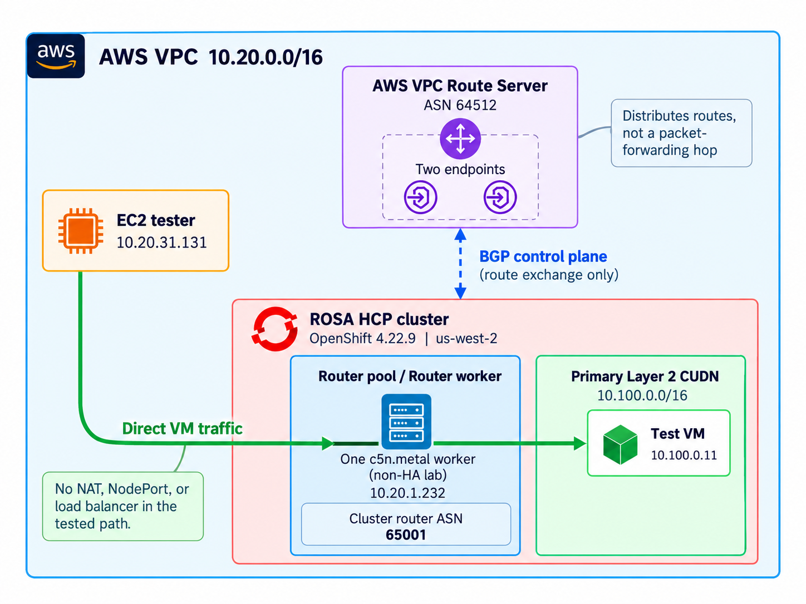

The official Red Hat BGP Cloud Connector Operator provides direct Layer 3 connectivity between Cluster User Defined Networks (CUDNs) and the Amazon Virtual Private Cloud (VPC) that hosts a Red Hat OpenShift Service on AWS (ROSA) cluster. It uses AWS VPC Route Server to advertise CUDN routes into VPC route tables.

This guide configures BGP Cloud Connector on an existing ROSA cluster with hosted control planes (HCP), creates a primary Layer 2 CUDN, and confirms that an existing EC2 instance can reach an OpenShift Virtualization VM at its CUDN address without inbound NAT, a load balancer, or a NodePort Service.

## Architecture



The traffic path has two parts:

1. FRR on selected ROSA compute nodes establishes BGP sessions with two AWS Route Server endpoints.
1. BGP Cloud Connector advertises the CUDN prefix. Route Server propagates the learned route into selected VPC route tables.
1. An EC2 instance sends traffic for the VM address to a selected compute-node ENI.
1. OVN-Kubernetes forwards the packet from that node to the VM on the primary CUDN.

Note that the AWS Route Server distributes routes. It is not in the application data path.

The lab used one `c5n.metal` router worker, two Route Server endpoints, CUDN `10.100.0.0/16`, VM `10.100.0.11`, and EC2 tester `10.20.31.131`. This single-worker topology was sufficient for a functional test, but it is not highly available. A production design should use eligible workers and Route Server endpoints across the required subnets and Availability Zones.

The recorded lab environment ran OpenShift 4.22.9, OpenShift Virtualization 4.22.12, and BGP Cloud Connector Operator 1.0.0.

## Prerequisites

You need:

* An existing ROSA HCP cluster and `cluster-admin` access.
* OpenShift Virtualization installed and a suitable storage class. See [Deploying OpenShift Virtualization on ROSA](/experts/rosa/ocp-virt/basic/).
* AWS and ROSA CLI credentials with permission to manage IAM, EC2 security groups, ROSA machine pools, VPC Route Server resources, and route propagation.
* A CUDN CIDR that does not overlap the VPC, cluster, peered VPC, Transit Gateway, VPN, Direct Connect, or on-premises networks.
* An existing EC2 tester in the cluster VPC. Its subnet route table must receive Route Server propagation, and its security group must allow the test protocol from the CUDN CIDR.
* Current `aws`, `rosa`, `oc`, `jq`, and `virtctl` clients.

{}
Route Server endpoints, bare-metal workers, EC2 instances, and VM storage incur charges. Record the owner and provisioning method for each resource before creating it. Do not delete shared resources during cleanup.
{}

Set the values used repeatedly:

```bash
export CLUSTER_NAME="<rosa-cluster-name>"
export AWS_REGION="<aws-region>"
export VPC_ID="<cluster-vpc-id>"
```

## 1. Prepare AWS and the router workers

### Create the Operator IAM role

Get the cluster OIDC issuer and AWS account ID:

```bash
OIDC_PROVIDER=$(oc get authentication cluster \
  -o jsonpath='{.spec.serviceAccountIssuer}' | sed 's|https://||')
AWS_ACCOUNT_ID=$(aws sts get-caller-identity --query Account --output text)
```

Create `operator-permission-policy.json`:

```json
{
  "Version": "2012-10-17",
  "Statement": [{
    "Effect": "Allow",
    "Action": [
      "sts:GetCallerIdentity",
      "ec2:DescribeRouteServers",
      "ec2:DescribeRouteServerEndpoints",
      "ec2:DescribeSubnets",
      "ec2:DescribeRouteServerPeers",
      "ec2:CreateRouteServerPeer",
      "ec2:DeleteRouteServerPeer",
      "ec2:CreateTags",
      "ec2:DescribeInstances",
      "ec2:ModifyNetworkInterfaceAttribute"
    ],
    "Resource": "*"
  }]
}
```

Create `operator-trust-policy.json`. Replace both placeholders with the values collected above:

```json
{
  "Version": "2012-10-17",
  "Statement": [{
    "Effect": "Allow",
    "Principal": {
      "Federated": "arn:aws:iam::<account-id>:oidc-provider/<oidc-provider>"
    },
    "Action": "sts:AssumeRoleWithWebIdentity",
    "Condition": {
      "StringEquals": {
        "<oidc-provider>:sub": "system:serviceaccount:bgp-cloud-connector:openshift-bgp-cloud-connector-controller-manager",
        "<oidc-provider>:aud": ["openshift", "sts.amazonaws.com"]
      }
    }
  }]
}
```

The subject restricts the role to the Operator service account. The `openshift` audience is used by the Manual/STS token projected through the Cloud Credential Operator flow configured later with `ROLEARN`. The `sts.amazonaws.com` audience is used by the alternative pod-injected IRSA flow. The upstream authentication guidance includes both audiences so the same role can support either documented credential path. This guide uses the Manual/STS `ROLEARN` flow.

The permission policy above retains `"Resource": "*"` because it is the simplified policy used for this lab. Read-only `Describe` actions and `sts:GetCallerIdentity` require that scope. For a hardened deployment, scope the mutating Route Server peer, tagging, and ENI actions as described in the upstream [AWS authentication least-privilege guidance](https://github.com/openshift/bgp-cloud-connector/blob/main/docs/aws-authentication.md#create-the-iam-role-and-policy). Verify current EC2 action and condition-key support before applying a restricted policy.

Create the policy and role:

```bash
POLICY_ARN=$(aws iam create-policy \
  --policy-name bgp-cloud-connector-operator-policy \
  --policy-document file://operator-permission-policy.json \
  --query Policy.Arn --output text)

aws iam create-role \
  --role-name bgp-cloud-connector-operator \
  --assume-role-policy-document file://operator-trust-policy.json

aws iam attach-role-policy \
  --role-name bgp-cloud-connector-operator \
  --policy-arn "${POLICY_ARN}"

BGP_ROLE_ARN=$(aws iam get-role \
  --role-name bgp-cloud-connector-operator \
  --query Role.Arn --output text)
```

### Create the BGP security group and machine pool

Create a dedicated security group in the cluster VPC:

```bash
BGP_SG_ID=$(aws ec2 create-security-group \
  --region "${AWS_REGION}" \
  --vpc-id "${VPC_ID}" \
  --group-name bgp-peering-sg \
  --description "BGP Cloud Connector peering traffic" \
  --query GroupId --output text)
```

Configure these rules according to your network policy:

* TCP 179 ingress and egress between router workers and Route Server endpoint subnets.
* TCP and UDP 32768 through 60999 ingress for return traffic that can enter through a different compute node.
* Workload protocols required for the test, such as ICMP and TCP 8080 from the VPC CIDR.
* UDP 3784 if you use BFD rather than BGP keepalives.

Security groups do not override network ACLs. Confirm that the worker and endpoint subnet ACLs allow TCP 179 in both directions. BGP rules alone are not sufficient for the connectivity test. The worker and EC2 tester subnet ACLs must also allow the application traffic, such as ICMP and TCP 8080, plus the corresponding response traffic. Network ACLs are stateless, so define both ingress and egress rules, including the applicable ephemeral TCP ports for replies. Check every subnet that can carry the request or return path, especially when traffic can enter through one router worker and leave through another. The dedicated security group supplements the ROSA-managed groups; it does not replace them.

Create a machine pool with the security group and router label. The lab used one worker. Use a topology appropriate for your availability requirements.

```bash
rosa create machinepool \
  --cluster "${CLUSTER_NAME}" \
  --name bgp-workers \
  --availability-zone <availability-zone> \
  --additional-security-group-ids "${BGP_SG_ID}" \
  --labels "bgp_router=true" \
  --instance-type <bare-metal-instance-type> \
  --replicas 1

rosa describe machinepool --cluster "${CLUSTER_NAME}" bgp-workers
oc get nodes -l bgp_router=true -o wide
```

Attach the security group when creating the machine pool. Adding one to an existing ROSA HCP machine pool can require replacement.

## 2. Create AWS VPC Route Server resources

Create a Route Server with an ASN that differs from the cluster ASN used later:

```bash
ROUTE_SERVER_ID=$(aws ec2 create-route-server \
  --region "${AWS_REGION}" \
  --amazon-side-asn 64512 \
  --query RouteServer.RouteServerId --output text)

aws ec2 associate-route-server \
  --region "${AWS_REGION}" \
  --route-server-id "${ROUTE_SERVER_ID}" \
  --vpc-id "${VPC_ID}"

aws ec2 get-route-server-associations \
  --region "${AWS_REGION}" \
  --route-server-id "${ROUTE_SERVER_ID}"
```

Wait until the VPC association is `associated`. Create two endpoints in every subnet that contains a BGP-enabled worker:

```bash
aws ec2 create-route-server-endpoint \
  --region "${AWS_REGION}" \
  --route-server-id "${ROUTE_SERVER_ID}" \
  --subnet-id <router-worker-subnet-id>

aws ec2 create-route-server-endpoint \
  --region "${AWS_REGION}" \
  --route-server-id "${ROUTE_SERVER_ID}" \
  --subnet-id <router-worker-subnet-id>

aws ec2 describe-route-server-endpoints \
  --region "${AWS_REGION}" \
  --filters Name=route-server-id,Values="${ROUTE_SERVER_ID}"
```

Wait until both endpoints are `available`.

Enable propagation on the route tables used by the router-worker subnets and EC2 tester subnet:

```bash
aws ec2 describe-route-tables \
  --region "${AWS_REGION}" \
  --filters Name=vpc-id,Values="${VPC_ID}" \
  --query 'RouteTables[].{ID:RouteTableId,Subnets:Associations[].SubnetId}' \
  --output table

aws ec2 enable-route-server-propagation \
  --region "${AWS_REGION}" \
  --route-server-id "${ROUTE_SERVER_ID}" \
  --route-table-id <route-table-id>

aws ec2 get-route-server-propagations \
  --region "${AWS_REGION}" \
  --route-server-id "${ROUTE_SERVER_ID}"
```

Repeat the enable command for each required route table. Do not continue until each propagation is `available`.

## 3. Install the official Operator

Enable the FRR routing provider:

```bash
oc patch network.operator.openshift.io/cluster --type=merge -p '{
  "spec": {
    "additionalRoutingCapabilities": {
      "providers": ["FRR"]
    }
  }
}'

oc get pods -n openshift-frr-k8s -o wide
```

Create `bgp-cloud-connector-operator.yaml`. Replace `<operator-role-arn>` with `BGP_ROLE_ARN`:

```yaml
apiVersion: v1
kind: Namespace
metadata:
  name: bgp-cloud-connector
---
apiVersion: operators.coreos.com/v1
kind: OperatorGroup
metadata:
  name: bgp-cloud-connector-operatorgroup
  namespace: bgp-cloud-connector
spec:
  targetNamespaces:
    - bgp-cloud-connector
---
apiVersion: operators.coreos.com/v1alpha1
kind: Subscription
metadata:
  name: bgp-cloud-connector-operator
  namespace: bgp-cloud-connector
spec:
  channel: stable
  installPlanApproval: Automatic
  name: bgp-cloud-connector
  source: redhat-operators
  sourceNamespace: openshift-marketplace
  config:
    env:
      - name: ROLEARN
        value: <operator-role-arn>
```

```bash
oc apply -f bgp-cloud-connector-operator.yaml
oc get csv -n bgp-cloud-connector
```

Wait for the ClusterServiceVersion to report `Succeeded`. This guide uses only the official Red Hat Operator distributed through the `redhat-operators` catalog. Its source is available in the [openshift/bgp-cloud-connector repository](https://github.com/openshift/bgp-cloud-connector).

## 4. Configure BGP and the primary CUDN

Save the following cluster-scoped singleton as `bgpcloudconfiguration.yaml`. The local ASN must differ from the Route Server ASN:

```yaml
apiVersion: networking.openshift.io/v1beta1
kind: BGPCloudConfiguration
metadata:
  name: cluster
spec:
  platform: AWS
  bgp:
    localASN: 65001
    livenessDetection: bgp-keepalive
  routerNodeSelector:
    bgp_router: "true"
  aws:
    region: <aws-region>
    routeServerIDs:
      - <route-server-id>
```

```bash
oc apply -f bgpcloudconfiguration.yaml
oc get bgpcloudconfiguration cluster -o jsonpath='{.status.phase}{"\n"}'
```

Every node that can run a directly routed workload must match `routerNodeSelector`. VM traffic exits through the ENI of the node that hosts the VM. The Operator also disables source and destination checks on selected nodes' primary ENIs.

Save the workload namespace as `namespace.yaml` with both labels present at creation time:

```yaml
apiVersion: v1
kind: Namespace
metadata:
  name: bgp-test-vms
  labels:
    cluster-udn: bgp-test-cudn
    k8s.ovn.org/primary-user-defined-network: ""
```

ROSA admission policy can prevent adding the primary-UDN label later.

Save `BGPRouting` as `bgprouting.yaml` with a non-overlapping prefix:

```yaml
apiVersion: networking.openshift.io/v1beta1
kind: BGPRouting
metadata:
  name: bgp-test-cudn
spec:
  network:
    name: bgp-test-cudn
    subnets:
      - 10.100.0.0/16
```

```bash
oc apply -f namespace.yaml
oc apply -f bgprouting.yaml
oc get bgprouting bgp-test-cudn -o jsonpath='{.status.phase}{"\n"}'
oc get clusteruserdefinednetwork cluster-udn-bgp-test-cudn
oc get routeadvertisements
```

`BGPRouting` owns the generated Layer 2 CUDN and route advertisements. Do not create or edit that generated CUDN separately. Wait for both BGP custom resources to report `Ready`.

## 5. Test connectivity with a VM

If you already have an OpenShift Virtualization VM connected to the primary CUDN advertised by BGP Cloud Connector, you can use it for the connectivity tests below. Confirm that the VM runs on a node selected by `BGPCloudConfiguration.spec.routerNodeSelector` and uses a compatible network binding that exposes its CUDN address directly.

Otherwise, follow the example below to deploy a disposable VM for testing.

The example preserves the native KubeVirt `bridge` binding used in the original inbound BGP connectivity test. The official ROSA BGP routing guide also shows `bridge: {}`. The upstream BGP Cloud Connector [`kubevirt-testing.md`](https://github.com/openshift/bgp-cloud-connector/blob/main/docs/kubevirt-testing.md) example instead shows the `l2bridge` binding, although its binding table also reports that `bridge` supports inbound and outbound traffic. Separate RHEL tests in this lab used `l2bridge` for persistent identity and live migration. Those tests did not establish that `bridge` is live-migratable, and the original inbound test did not use `l2bridge`.

The lab used `quay.io/containerdisks/fedora:latest`, but the resolved digest was not recorded. Resolve and pin an image digest for a repeatable deployment, then test that image with your OpenShift release. The manifest assumes the guest image includes cloud-init, systemd, and Python 3 so it can create the HTTP endpoint. If the selected image lacks one of these components, use a compatible image or adjust the service.

Replace `<storage-class>` with an available storage class and save the following manifest as `vm.yaml`:

```yaml
apiVersion: kubevirt.io/v1
kind: VirtualMachine
metadata:
  name: bgp-test-vm
  namespace: bgp-test-vms
spec:
  runStrategy: Always
  dataVolumeTemplates:
    - metadata:
        name: bgp-test-vm-root
      spec:
        source:
          registry:
            url: docker://quay.io/containerdisks/fedora:latest
        storage:
          accessModes: [ReadWriteOnce]
          resources:
            requests:
              storage: 20Gi
          storageClassName: <storage-class>
  template:
    metadata:
      labels:
        app: bgp-test-vm
    spec:
      nodeSelector:
        bgp_router: "true"
      domain:
        cpu:
          cores: 2
        memory:
          guest: 2Gi
        devices:
          disks:
            - name: rootdisk
              disk:
                bus: virtio
            - name: cloudinit
              disk:
                bus: virtio
          interfaces:
            - name: default
              bridge: {}
      networks:
        - name: default
          pod: {}
      volumes:
        - name: rootdisk
          dataVolume:
            name: bgp-test-vm-root
        - name: cloudinit
          cloudInitNoCloud:
            userData: |
              #cloud-config
              write_files:
                - path: /var/tmp/bgp-test/index.html
                  permissions: "0644"
                  content: "BGP Cloud Connector VM endpoint\n"
                - path: /etc/systemd/system/bgp-test-http.service
                  permissions: "0644"
                  content: |
                    [Unit]
                    Description=BGP connectivity test endpoint
                    After=network-online.target
                    Wants=network-online.target

                    [Service]
                    ExecStart=/usr/bin/python3 -m http.server 8080 --directory /var/tmp/bgp-test
                    Restart=on-failure

                    [Install]
                    WantedBy=multi-user.target
              runcmd:
                - [systemctl, daemon-reload]
                - [systemctl, enable, --now, bgp-test-http.service]
```

```bash
oc apply -f vm.yaml
oc wait vm/bgp-test-vm -n bgp-test-vms \
  --for=condition=Ready --timeout=15m
oc get vm,vmi -n bgp-test-vms -o wide

VM_IP=$(oc get vmi bgp-test-vm -n bgp-test-vms \
  -o jsonpath='{.status.interfaces[0].ipAddress}')
echo "${VM_IP}"
```

## 6. Confirm BGP and direct connectivity

Confirm the generated resources and BGP sessions:

```bash
oc get bgpcloudconfiguration cluster
oc get bgprouting bgp-test-cudn
oc get frrconfiguration -n openshift-frr-k8s
oc get bgpsessionstate -n openshift-frr-k8s
```

Every expected endpoint peer must report `Established`. One router worker and two endpoints produced two sessions in the lab.

Confirm that the CUDN prefix appears as an active advertised route in the EC2 tester's route table:

```bash
aws ec2 describe-route-tables \
  --region "${AWS_REGION}" \
  --route-table-ids <ec2-tester-route-table-id> \
  --query 'RouteTables[].Routes[?DestinationCidrBlock==`10.100.0.0/16`]'
```

The route should have `State` set to `active` and `Origin` set to `Advertisement`.

The `VM_IP` shell variable above exists only on the workstation. Copy its printed value into a normal shell on the EC2 tester, then run the tests there:

```bash
VM_IP="<address-printed-by-oc>"
ping -c 5 "${VM_IP}"
curl --fail --show-error "http://${VM_IP}:8080/"
```

The lab observed five ICMP replies and HTTP 200 between EC2 `10.20.31.131` and VM `10.100.0.11`. No inbound NAT, load balancer, or NodePort was used. A short capture on the tester showed the unchanged EC2 and CUDN addresses:

```bash
sudo timeout 20 tcpdump -ni <ec2-interface> \
  "host ${VM_IP} and (icmp or tcp port 8080)"
```

This proves the EC2-to-VM path. The original lab also observed VM-to-EC2 HTTP with the VM's CUDN source address. Outbound internet routing is a separate design and is not covered here.

## Troubleshooting

### BGP sessions do not establish

Check the Route Server endpoints, TCP 179 security-group and network-ACL rules, differing ASNs, the `bgp_router=true` node label, FRR pods, and the Operator STS role.

### BGP is established but the route is missing

Confirm that `BGPRouting` is `Ready`, its generated CUDN and `RouteAdvertisements` exist, and propagation is `available` on the tester's route table. Check for overlapping or more-specific routes.

### The route exists but traffic fails

Check worker and tester security groups, network ACLs, the guest firewall, the HTTP listener, and source/destination checks on selected worker ENIs. Confirm that the VM runs on a selected node and uses `bridge: {}` on the primary CUDN.

If ICMP succeeds but HTTP fails, troubleshoot the guest HTTP service separately. BGP routing does not start the service or open the guest firewall.

### Optional guest service checks

Guest SSH is not required to prove BGP connectivity. During the lab, some `virtctl ssh` attempts ended with WebSocket error 1006 even when other network evidence was healthy. A failed `virtctl ssh` session does not, by itself, prove that BGP connectivity is broken.

If authorized guest access is already configured and `virtctl ssh` works, these checks can distinguish a guest service problem from a routing problem:

```bash
virtctl ssh <user>@vm/bgp-test-vm -n bgp-test-vms -i <private-key>

# Run these commands inside the guest.
cloud-init status --wait
sudo systemctl --no-pager status bgp-test-http.service
sudo ss -ltnp | grep ':8080'
curl --fail --show-error http://127.0.0.1:8080/
```

If guest access is unavailable, use an existing authorized console or guest-agent workflow. Do not change guest SSH, SELinux, or firewall settings solely to complete this BGP test.

## Cleanup

If you deployed temporary resources for this walkthrough, remove them through the same provisioning method used to create them.

The cleanup sequence below is provided as general guidance. Before removing resources, verify their ownership, dependencies, and storage reclaim policies.

Do not delete shared ROSA, VPC, IAM, or storage resources solely because they were used in this example.

1. Delete the disposable VM and confirm its storage follows the intended reclaim policy.
1. Delete `BGPRouting` and wait for its CUDN, route advertisements, and advertised route to disappear.
1. Delete `BGPCloudConfiguration` and wait for Operator-created Route Server peers to be removed.
1. Remove the Operator only if no other configuration uses it.
1. Disable propagation, delete endpoints, disassociate the VPC, and delete the Route Server through the workflow that created them.
1. Delete the dedicated machine pool only after confirming that it contains no shared workloads:

   ```bash
   rosa delete machinepool --cluster "${CLUSTER_NAME}" bgp-workers
   rosa list machinepools --cluster "${CLUSTER_NAME}"
   ```

1. Wait for the machine-pool EC2 instances and their ENIs to disappear. Do not delete the security group while an instance or ENI still uses it:

   ```bash
   aws ec2 describe-instances \
     --region "${AWS_REGION}" \
     --filters \
       Name=instance.group-id,Values="${BGP_SG_ID}" \
       Name=instance-state-name,Values=pending,running,stopping,stopped,shutting-down

   aws ec2 describe-network-interfaces \
     --region "${AWS_REGION}" \
     --filters Name=group-id,Values="${BGP_SG_ID}"
   ```

1. After both checks return no resources, delete the dedicated security group:

   ```bash
   aws ec2 delete-security-group \
     --region "${AWS_REGION}" \
     --group-id "${BGP_SG_ID}"
   ```

   Remove the IAM role only if no other workload uses it. Do not remove a shared machine pool, security group, or role.

## References

* [BGP routing for OpenShift Virtualization on AWS](https://docs.redhat.com/en/documentation/red_hat_openshift_service_on_aws/4/html/advanced_networking/bgp-routing)
* [Official BGP Cloud Connector source](https://github.com/openshift/bgp-cloud-connector)
* [AWS VPC Route Server documentation](https://docs.aws.amazon.com/vpc/latest/userguide/route-server.html)
* [AWS Route Server endpoint procedure](https://docs.aws.amazon.com/vpc/latest/userguide/route-server-tutorial-create-endpoints.html)
* [AWS Route Server propagation procedure](https://docs.aws.amazon.com/vpc/latest/userguide/route-server-tutorial-enable-prop.html)
