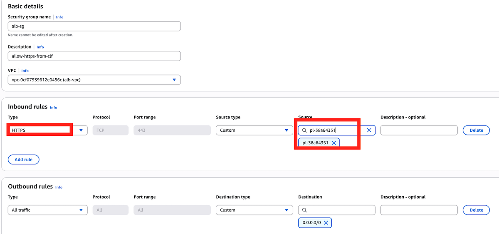
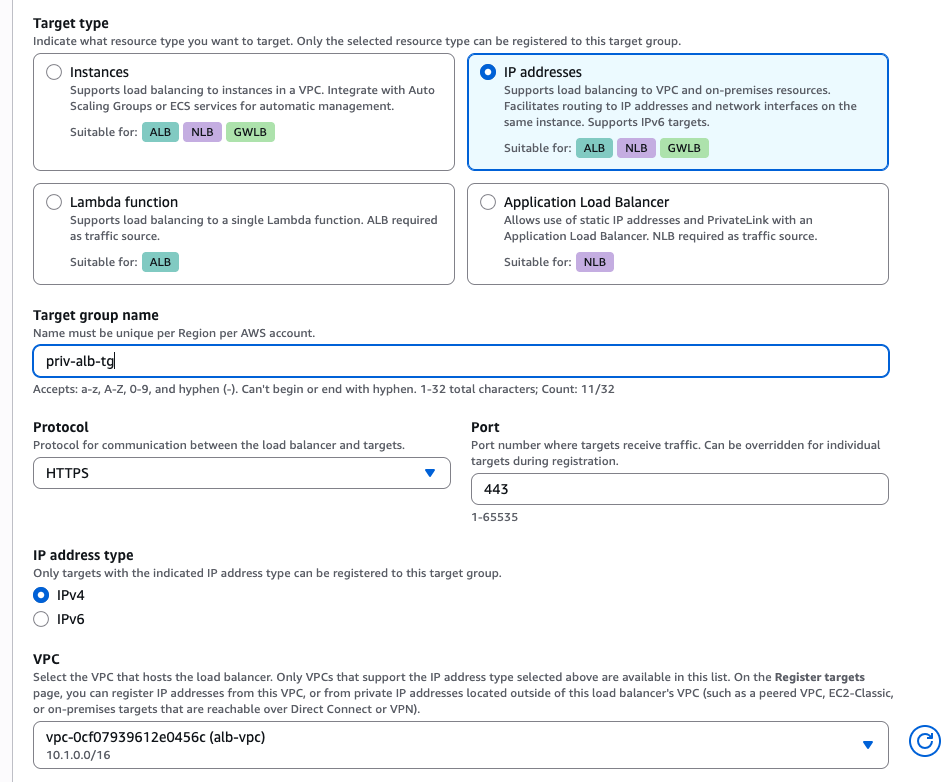
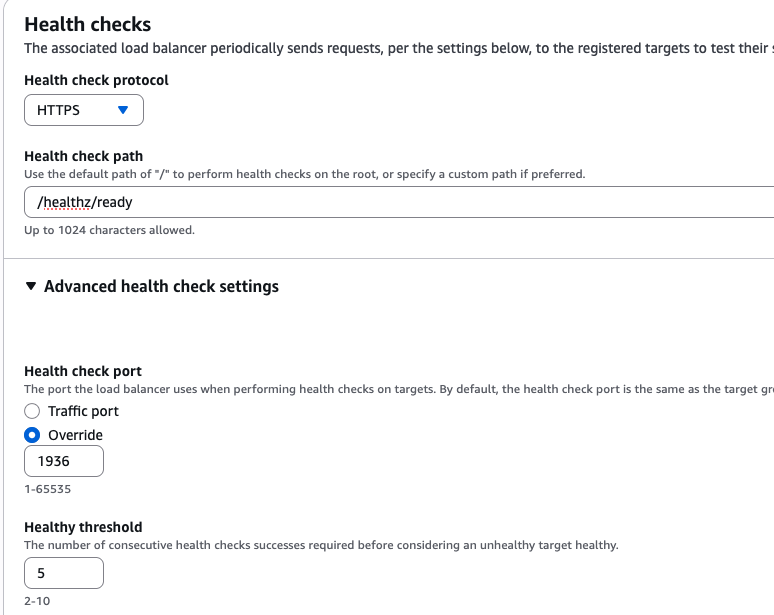
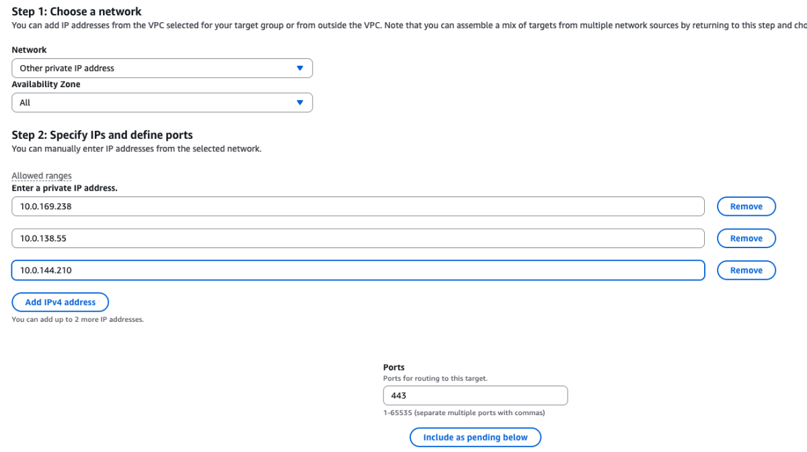
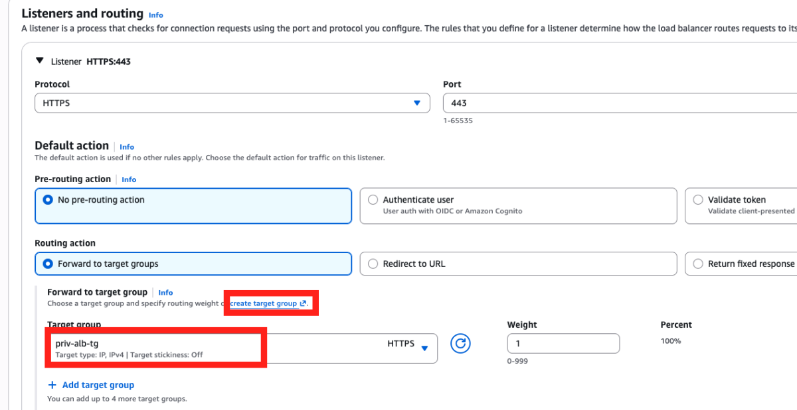
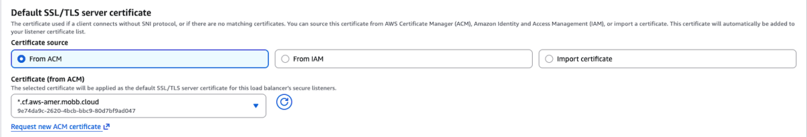
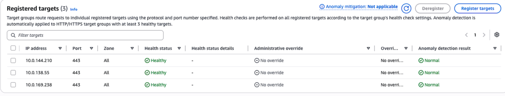

## Architecture Overview
Enterprise customers frequently require multi-tenant account structures to isolate different teams. For example, the team consuming a ROSA cluster often resides in a completely separate AWS tenant from the team operating it. Establishing a clean multi-account network pattern is critical to safely exposing workloads running in ROSA without exposing developer teams to backend cluster changes.

In this guide, we set up a cross-account architecture where a CloudFront distribution in Account A routes traffic through a private ALB in Account B, which then forwards requests to a ROSA cluster's secondary Ingress Controller. This enterprise multi-tenant design pattern delivers significant benefits across security, infrastructure control, network isolation, and operational governance.

Using a Private ALB as an intermediate abstraction layer between CloudFront and ROSA is particularly valuable during major architectural transitions—such as migrating from ROSA Classic to ROSA HCP (Hosted Control Planes). This pattern establishes a unified, secure, and resilient routing tier that abstracts backend cluster complexities from end users. By pairing a centralized Private ALB with cross-account edge services, organizations achieve robust security, simplified operations, and seamless traffic management across multi-cluster environments.

### High-Level Multi-cluster Architecture


> In this guide, we will set up the architecture using a single cluster. However, you can repeat these steps to point the Private ALB to additional ROSA targets, as shown above. 

### High-Level Traffic Routing Flow


## 1. Prerequisites

- **Account A**: AWS account for Cloudfront distribution
- **Account B**: AWS accunt hosting ALB VPC, ROSA VPC, ALB, an ROSA cluster
- **A private multi-AZ ROSA Cluster**: (Version 4.20 or earlier) deployed in AWS Account B. You can use this guides to deply either a [ROSA classic](https://cloud.redhat.com/experts/rosa/terraform/classic/) or [ROSA HCP](https://cloud.redhat.com/experts/rosa/terraform/hcp/). We will be using a ROSA HCP 4.22 cluster in this guide. 
- **ALB VPC**: VPC for the private ALB
- **ROSA VPC**: VPC where the ROSA cluster runs
- **Custom Domain**: A public domain you control with access to DNS management. In this guide we will be using a Route 53 domain e.g. cf.aws-amer.mobb.cloud
- **AWS CLI**
- **oc CLI**
- **CIDR Requirement**: The ALB VPC and the ROSA VPC must have **non-overlapping** CIDRs for VPC Peering to work

## 2. Create a private IngressController (ROSA Secondary NLB)

To connect to your private ROSA cluster, check this [guide](https://cloud.redhat.com/experts/rosa/vpn/) on how to configure an AWS Client VPN connection. Alternatively, you can setup a [jump host](https://cloud.redhat.com/experts/rosa/hcp-private-nlb/rosa-private-nlb-jumphost/) to connect to the private ROSA cluster. 

Once you're logged into your cluster, please take a look at this [guide](https://cloud.redhat.com/experts/rosa/private-ingress-controller-with-alb/).

From there, follow the steps to create the private IngressController and its corresponding private NLB.
Complete that guide through the point where:

- the IngressController service has been patched to expose the router health check port (`1936`)
- the NLB is healthy
- you have retrieved the private IP addresses of the NLB targets

Please keep these IP addresses handy, as we are going to use them in a subsequent step when creating the target group for the ALB

## 3. VPC Peering Between Edge (ALB) VPC and ROSA VPC (Account B)

Both VPCs are in Account B, so this will be a same account VPC peering connection

### 3.1: Create the VPC peering connection

Let's set some environment variables
```bash
ALB_VPC_ID="vpc-aaaaaaaaaa" #Replace with your ALB_VPC_ID
ROSA_VPC_ID="vpc-bbbbbbbbbb" #Replace with your ROSA_VPC_ID
ROSA_VPC_CIDR="10.0.0.0/16" #Replace with your ROSA_VPC_CIDR
ALB_VPC_CIDR="10.1.0.0/16" #Replace with your ALB_VPC_CIDR
REGION="ca-central-1" #Replace with your AWS region
```

Create VPC Peering Connection
```bash
aws ec2 create-vpc-peering-connection \
--vpc-id $ALB_VPC_ID \
--peer-vpc-id $ROSA_VPC_ID \
--region $REGION 
``` 

Note the PeeringConnectionId from the output, and create a variable as below
```bash 
PEERING_ID="pcx-xxxxxxxxx" #Replace with your VpcPeeringConnectionId
```
Accept the peering connection
```bash
aws ec2 accept-vpc-peering-connection \
--vpc-peering-connection-id $PEERING_ID \
--region $REGION
```
### 3.2: Update Route Tables
 
Get the ALB_VPC subnet-associated route table IDs
```bash
aws ec2 describe-route-tables \
  --filters "Name=vpc-id,Values=$ALB_VPC_ID" \
             "Name=association.main,Values=false" \
  --query 'RouteTables[*].{RouteTableId:RouteTableId,SubnetId:Associations[?Main==`false`].SubnetId|[0]}' \
  --output table

```

For EACH ALB_VPC subnet-associated route table, add a route to the ROSA_VPC CIDR
```bash
for route_table_id in <rtb-xxxxxxxxxxxxxxxx1> <rtb-xxxxxxxxxxxxxxxx2> <rtb-xxxxxxxxxxxxxxxx3>; do
  aws ec2 create-route \
    --route-table-id "$route_table_id" \
    --destination-cidr-block "$ROSA_VPC_CIDR" \
    --vpc-peering-connection-id "$PEERING_ID"
done
```

Get the ROSA_VPC subnet-associated route table IDs
```bash
aws ec2 describe-route-tables \
  --filters "Name=vpc-id,Values=$ROSA_VPC_ID" \
             "Name=association.main,Values=false" \
  --query 'RouteTables[*].{RouteTableId:RouteTableId,SubnetId:Associations[?Main==`false`].SubnetId|[0]}' \
  --output table
```

For EACH ROSA_VPC subnet-associated route table, add a route to the ALB_VPC CIDR
```bash
for route_table_id in <rtb-xxxxxxxxxxxxxxxx4> <rtb-xxxxxxxxxxxxxxxx5> <rtb-xxxxxxxxxxxxxxxx6> ; do
  aws ec2 create-route \
    --route-table-id "$route_table_id" \
    --destination-cidr-block "$ALB_VPC_CIDR" \
    --vpc-peering-connection-id "$PEERING_ID"
done
```

### 3.3: Update ROSA_VPC Security Group

Get the ROSA_VPC security group
```bash
ROSA_VPC_SG=$(aws ec2 describe-security-groups \
  --filters "Name=vpc-id,Values=$ROSA_VPC_ID" \
            "Name=group-name,Values=*vpc*" \
  --query 'SecurityGroups[0].GroupId' --output text)
 ``` 

Allow inbound traffic fromthe ALB_VPC CIDR on port 443

```bash
aws ec2 authorize-security-group-ingress \
  --group-id $ROSA_VPC_SG \
  --protocol tcp \
  --port 443 \
  --cidr $ALB_VPC_CIDR\
  --tag-specifications 'ResourceType=security-group-rule,Tags=[{Key=Name,Value=ALB-to-NLB-HTTPS}]'
```

## 4. Create the External Private ALB

1. Navigate to the EC2 dashborad in the same account and region where your cluster exists, select **Load balancers**. Click on **Create load balancer** button. Select ALB, and click **Create** buttton

1. Configure the Load balancer name, e.g. priv-alb, select **Internal** as scheme, and leave the IP address type to IPv4.

1. Under **Network mapping**, select your ALB_VPC and all the relevant AZs and private subnets

1. Under **Security groups**, click on the link **create a new security group** to get to a new tab. Give the security group a name, e.g. alb-sg. Add a description e.g allow-https-from-clf, and select your ALB-VPC. Under **Inbound rules**, click on **Add rule** button. Select **HTTPS** with port **443** for type, **Custom** for source and search for **com.amazonaws.global.cloudfront.origin-facing**, which is the CloudFront managed prefix list. Leave the **Outbound rules** as is, and click on the button **Create security group**.

   

1. Return to the ALB creation tab, hit the refresh button besides the **Security groups** box, and select the new security group you just created.

1. Under **Listeners and routing**, select **HTTPS** as protocol on Port **443**. Next, click on **create target group** link under **Forward to target group**. This should open a new tab for you to create the target group.

   - On the target group tab, select **IP addresses** as target type, give the target group a name, e.g. priv-alb-tg. Select protocol type **HTTPS** on Port **443**. Leave **IPv4** as IP address type, and select your ALB_VPC. 
    
     

   - Under **Health checks**, choose **HTTPS** protocl and then type in /healthz/ready for the health check path. Expand **Advanced health check settings**, and under **Health check port** select **Override** and type **1936** to the port number. Leave the rest of the advanced health check settings to default.Click the **Next** button at the end of the page

     

   - Once prompted to the new site, you'll see the network defaults to the ALB_VPC. Select **Other private IP address**, and select **All**  for **Availability Zone**. Enter the three IP addresses of your ROSA Secondary NLB that you previously saved from above. (see snippet below). Leave the port to 443 and then click Include as pending below button.

     

   - On the **Review targets** section, be sure to check that all three IP addresses are in **Pending** health status. Click **Next** to proceed. Review your entries one more time for accuracy, and click **Create target group** button on the lower right.

1. Return to the ALB creation page, refresh the target group option, and select the target group you just created

   

1. Under **Secure listener settings**, on the **Default SSL/TLS server certificate** section, you can choose **Import certificate** if you already have existing certificates. Alternatively, using **From ACM** as source, you can click **Request new ACM certificate** to create a new one, and this will lead you to a new tab. On the ACM page, click **Request a certificate**, choose **Request a public certificate**, and click **Next**. Insert the domain name, e.g. *.cf.aws-amer.mobb.cloud, and leave the rest to default, then click Request.  

   - To validate this certificate, click the **Create records in Route 53** button to proceed, click **Create records** on the next page. Wait for a few minutes until the ACM certificate shows **Issued** status.

1. Next, return to the ALB creation tab, and under **Certificate (from ACM)** section, hit the refresh icon, and add the certificate you just created.

   

1. Click the **Create load balancer** button at the bottom to proceed. Wait until the load balancer is fully provisioned. Copy the ALB's ARN which will be used in creating the Cloudfront VPC origin

1. Once the Alb is fully deployed, check the target group we previously created and ensure all registered targets have a **Healthy** status.
    

## 5. Create CloudFront VPC Origin and Distribution

### 5.1: Create CloudFront VPC Origin

1. On the AWS console in the ALB Account, look for **CloudFront**, and on the CloudFront sidebar select **VPC origins**, and then hit the **Create VPC origin**. Give it a name like `alb-vpc-og` and paste the ALB's ARN that you copied before for the **Origin ARN**. Choose **HTTPS only** for the protocol, leave the port to **443** and the minimum origin SSL protocol to **TLSv1.2.**

   

1. Click on the **Create VPC origin** button at the end of the page, and wait a few minures until the VPC origin is fully deployed.  

### 5.2: Create VPC origin Share

1. When the VPC origin status shows **Deployed**, select the VPC origin and click on the **Share VPC origin** button.

   

1. On the next screen, click on the **Create resource share** button, which should take you to a next screen.

1. On the next screen, enter a name for the resource share e.g. alb-vpc-og-share. Specify the **Principal type**. In this guide, we use AWS account as the Principal type and enter the **AWS account ID** corresponding to the AWS account where the Cloudfront distribution will be created (AWS Account A). Click on the button **Share resources** to proceed. A green banner at the top of the page confirms the successful creation of the resource share.
   
   


### 5.3: Create CloudFront distribution. 

1. Log into the console of AWS account A. On the Cloudfront sidebar, click on **VPC origins** to see the origin share we previously created. 

   

1. Click on **Distributions** in the sidebar, and hit the **Create distribution** button on the upper right corner. If this is your first time creating a distribution, you will be routed to a screen as below to choose a plan. We will be using the **Pay as you go** option for this guide. Click on **Choose pay-as-you-go** button at the end of the page to proceed.

   

   >  The **Free** and **Pro** plans do not support VPC origins which is the required Origin type for this routing pattern.

1. On the **Distribution options** section, under **Distribution name**, give the distribution a name like `rosa-cf-distribution`. You can add a description if you want. Under **Distribution type**, select the type that works for your use case. We will be using the `Single website configuration` option. 
Skip the **Domain** section for now as our Route53 domain is registered in the ALB account. We will add that after the distribution is created. Click on **Next**.

1. On the **Specify origin** section, under the **Origin type**, select **VPC origin**. Next, on the **Origin** section, under **VPC origin**, click on **Browse VPC origins** and select the VPC origin share you created e.g `alb-vpc-og-share`. Under **VPC origin endpoint**, enter your custom domain (e.g. cf.aws-amer.mobb.cloud). Leave the origin path to blanks.

   

1. On the **Settings** section, leave the **Origin settings** to the default recommended setting. Under **Cache settings**, select **customize cache settings**. For the **Cache policy**, select **CachingDisabled** and choose **AllViewer** under **Origin request policy**. Leave the rest of the settings to default and click on **Next** at the end of the page.

   

1. On the **Web Application Firewall (WAF)** section, select **Do not enable security protections**. Note that you can always enable WAF after you create the distribution later but we are not covering it here for the sake of simplicity. Click **Next**.

1. On the next screen, review the details, scroll down, and choose **Create distribution**. You'll be taken to a screen where you should see the distribution in the **Deploying** state (this takes a few minutes to complete)

1. Once the distribution is fully deployed, click on **Add domain** under **Alternate domain names**. 
   
   

   Enter you domain as a wildcard entry and click on **Next**. Follow the steps to create a corresponding ACM cert for the domain in the **us-east-1** region. The distribution will be redeployed once the certificate is added. Wait until it fully redeploys, then copy the **Distribution domain name**

   

1. Go to your Route 53 hosted zone in  Account B. Click **Create record** button. Create a wildcard CNAME record (e.g. `*.cf.aws-amer.mobb.cloud`) and point it to the CloudFront distribution domain name you just created, and click **Save**. 

    

## 6. Validate the Architecture

### 6.1: Create Let's Encrypt certificate

Next, let's go back to the CLI. Skip this step if you already have [Let's Encrypt Certificate](https://letsencrypt.org/). To create one, you would need to run certbot so please install it if you have not already (if you're a Mac user, you can run `brew install certbot`).

First, create following directories:

```bash
sudo mkdir -p ~/letsencrypt/{config,work,logs}
sudo mkdir -p ~/openshift-certs
```

Then run the following as sudo to generate wildcard certificate. Change the email address to your email address.

```bash
sudo certbot certonly \
  --manual \
  --preferred-challenges=dns \
  --email email@example.com \
  --server https://acme-v02.api.letsencrypt.org/directory \
  --agree-tos \
  --config-dir ~/letsencrypt/config \
  --work-dir ~/letsencrypt/work \
  --logs-dir ~/letsencrypt/logs \
  -d "*.$DOMAIN" \
  -d "$DOMAIN"   
```

It will then ask you to deploy a DNS TXT record under the name `_acme-challenge.YOUR-DOMAIN` with certain value provided by certbot. To do that, go to Route 53 and create a new record type TXT and point to that new value. Wait for a couple of minutes until it fully propagates. 

Open a new CLI tab and run either:

```bash
dig TXT _acme-challenge.$DOMAIN
``` 

Or:

```bash
nslookup -type=TXT _acme-challenge.$DOMAIN
```

And see if the value matches. If it matches, then go back to the tab where you run certbot command, and hit Enter. 

Once the certificate (**fullchain.pem**) and the key (**privkey.pem**) were successfully created, set the following permissions:

```bash
sudo chmod 700 ~/letsencrypt/config/live/$DOMAIN/
sudo chmod 600 ~/letsencrypt/config/live/$DOMAIN/privkey.pem
```

Then copy them for next step:

```bash
sudo cp ~/letsencrypt/config/live/$DOMAIN/fullchain.pem ~/openshift-certs/
sudo cp ~/letsencrypt/config/live/$DOMAIN/privkey.pem ~/openshift-certs/
sudo chown $(whoami):$(id -gn) ~/openshift-certs/*
chmod 644 ~/openshift-certs/fullchain.pem
chmod 600 ~/openshift-certs/privkey.pem
```

### 6.2. Configure certificate for ROSA Secondary NLB

Next, we are going to configure the certificate we created just now to the private secondary ingress controller. To do that, let's first create a TLS secret:

```bash
oc create secret tls ingress-certs \
  --cert=$HOME/openshift-certs/fullchain.pem \
  --key=$HOME/openshift-certs/privkey.pem \
  -n openshift-ingress
```

Then, patch it to the NLB:

```bash
oc patch ingresscontroller $INGRESS_NAME \
  -n openshift-ingress-operator \
  --type=merge \
  --patch='{"spec":{"defaultCertificate":{"name":"ingress-certs"}}}'
```

Wait for a few minutes until the router pods restart:

```bash
oc get pods -n openshift-ingress -w | grep $INGRESS_NAME
```

### 6.3: Test an application

Finally, let's test this setup by creating a public application.

1. Create a new project

   ```bash
   oc new-project my-public-app
   ```

1. Create a new application

   ```bash
   oc new-app --docker-image=docker.io/openshift/hello-openshift
   ```

1. Create a route for the application

   ```bash
   oc create route edge --service=hello-openshift hello-openshift-tls \
     --hostname hello.$DOMAIN
   ```

1. Check that you can access the application:

   ```bash
   curl https://hello.$DOMAIN
   ```

You should see the output `Hello OpenShift!`. Alternatively, go to your browser and access it from there.


