## Architecture Overview
Enterprise customers frequently require multi-tenant account structures to isolate different teams. For example, the team consuming a ROSA cluster often resides in a completely separate AWS tenant from the team operating it. Establishing a clean multi-account network pattern is critical to safely exposing workloads running in ROSA without exposing developer teams to backend cluster changes.

In this guide, we set up a cross-account architecture where a CloudFront distribution in Account A routes traffic through a private Network Load Balancer in Account B, which then forwards requests to a ROSA cluster's secondary Ingress Controller. This enterprise multi-tenant design pattern delivers significant benefits across security, infrastructure control, network isolation, and operational governance.

Using a private load balancer as an intermediate abstraction layer between CloudFront and ROSA is particularly valuable during major architectural transitions, such as migrating from ROSA Classic to ROSA HCP (Hosted Control Planes). The pattern is intended to establish a unified and secure routing tier that abstracts backend cluster complexities from end users, and to pair a centralized private load balancer with cross-account edge services for simpler operations and consistent traffic management across multi-cluster environments.

Note that this guide documents a **tested walkthrough of the pattern, not a production-ready deployment**. The environment used to validate it ends with the inner NLB's target health checks unresolved, which is disclosed in step 2 and qualifies any claim of resilience here.

### High-Level Multi-cluster Architecture
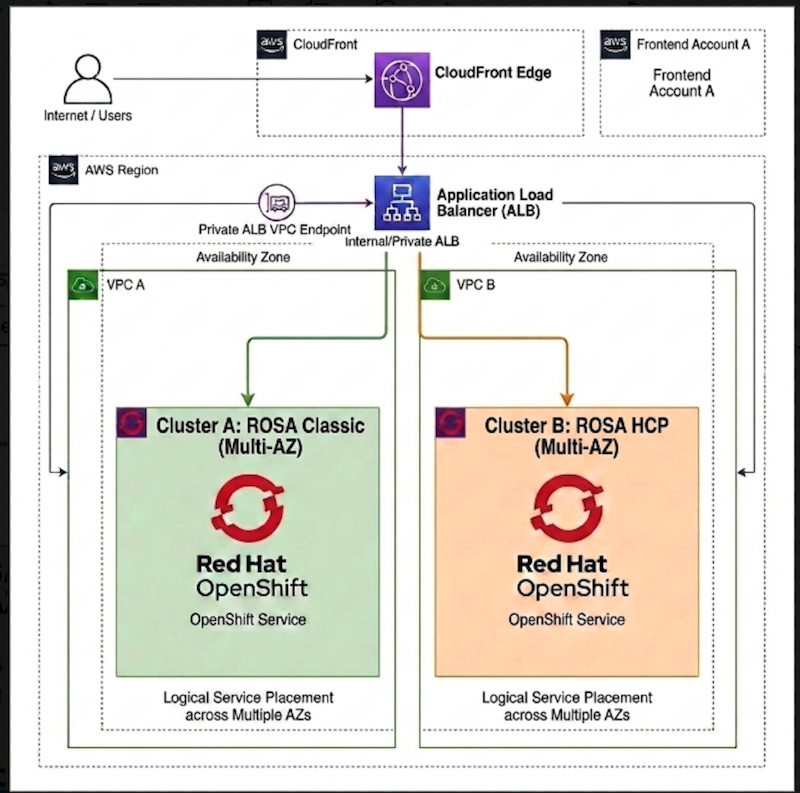

> In this guide, we will set up the architecture using a single cluster. However, you can repeat these steps to point the outer NLB to additional ROSA targets, as shown above. 

### High-Level Traffic Routing Flow
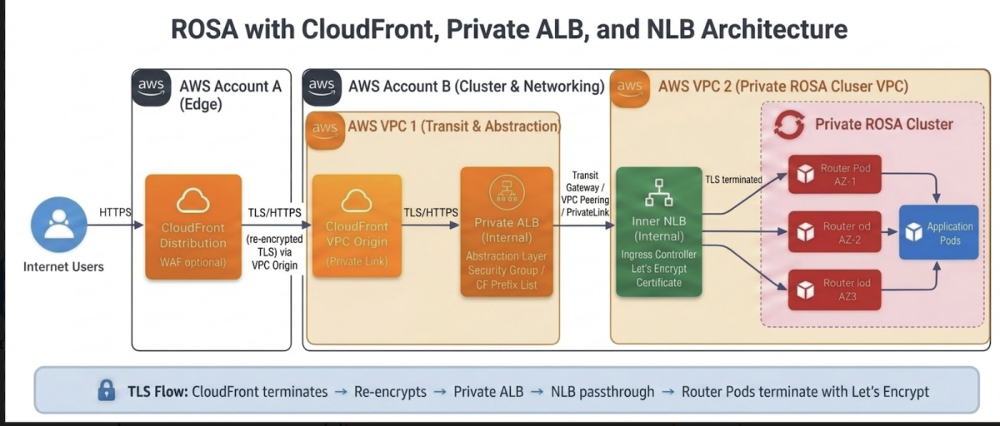

## 1. Prerequisites

- **Account A**: AWS account for Cloudfront distribution
- **Account B**: AWS account hosting the edge VPC, the ROSA VPC, the outer NLB, and the ROSA cluster
- **A private multi-AZ ROSA Cluster** deployed in AWS Account B. You can use these guides to deploy either a [ROSA classic](https://cloud.redhat.com/experts/rosa/terraform/classic/) or [ROSA HCP](https://cloud.redhat.com/experts/rosa/terraform/hcp/) cluster. This guide was validated on ROSA HCP 4.22.
- **Edge VPC**: VPC for the outer NLB. It must have an **internet gateway** attached, which CloudFront requires for a VPC origin even though the NLB stays internal.
- **ROSA VPC**: VPC where the ROSA cluster runs
- **Custom Domain**: A public domain you control with access to DNS management. In this guide we will be using a Route 53 domain e.g. cf.aws-amer.mobb.cloud
- **A publicly trusted certificate** for the origin hostname, applied to the secondary IngressController. CloudFront rejects a self-signed origin certificate. See step 6.1.
- **AWS CLI**
- **oc CLI**
- **CIDR Requirement**: The edge VPC and the ROSA VPC must have **non-overlapping** CIDRs for VPC Peering to work

## 2. Create a private IngressController (ROSA secondary NLB)

To connect to your private ROSA cluster, check this [guide](https://cloud.redhat.com/experts/rosa/vpn/) on how to configure an AWS Client VPN connection. Alternatively, you can setup a [jump host](https://cloud.redhat.com/experts/rosa/hcp-private-nlb/rosa-private-nlb-jumphost/) to connect to the private ROSA cluster.

Set the values used throughout this guide. Do this **before the first AWS CLI command**, so that every command up to step 5.3 runs against Account B in one region:

```bash
export AWS_PROFILE=<account-b-profile>   # Account B; step 5.3 switches to Account A
export REGION=ca-central-1               # your AWS region
export AWS_REGION=$REGION                # so every AWS CLI command targets the same region

export INGRESS_NAME=private-ingress
export DOMAIN=cf.aws-amer.mobb.cloud     # your custom domain
```

Follow [Private IngressController with ALB](https://cloud.redhat.com/experts/rosa/private-ingress-controller-with-alb/) **only as far as the "Create the Ingress Controller" section**, using `scope: Internal` and the `LoadBalancerService` strategy. That guide uses `lab.domain.com` in its examples; substitute your own `$DOMAIN`.

**Stop before** that guide's service patch exposing port `1936`, and skip its "Create the ALB" section entirely. Neither applies here: this architecture health checks the inner NLB with TCP from the outer NLB, so the `1936` port is not used.

Leave the IngressController's PROXY-protocol behaviour at its default. On the version tested, OpenShift set `ROUTER_USE_PROXY_PROTOCOL=true` and created the NLB target groups with `proxy_protocol_v2.enabled=true`, and the router's `:80` and `:443` listeners bind with `accept-proxy`. The inner NLB and the router must stay a matched pair.

{}
If the inner target group reports no healthy targets, **investigate before accepting the deployment**. Traffic may still succeed because an NLB forwards to all targets when none are healthy, so a working request does not by itself indicate a healthy, resilient deployment.

The outer NLB's TCP health check added in step 4 verifies connectivity to the inner NLB. It does **not** validate router or application readiness.

On the cluster tested for this guide the inner target groups reported `0/3` healthy with:

| | |
|---|---|
| Health check | `HTTP` on the Service's `healthCheckNodePort`, path `/healthz` |
| `proxy_protocol_v2.enabled` | `true` |
| Reported reason | `Target.FailedHealthChecks` |

`healthCheckNodePort` is the **node-level Service health endpoint** allocated for a Service with `externalTrafficPolicy: Local`. It reports whether that node currently holds endpoints for the Service. It is a different endpoint from the router's own readiness check on port `1936` (`/healthz/ready`), which reports HAProxy readiness and is not what this target group probes.

That `healthCheckNodePort` endpoint returned `200` when probed directly from a host in the NLB's own subnet, and setting `proxy_protocol_v2.enabled=false` on a target group changed its reported health to the expected `2/3`. That is consistent with AWS applying the PROXY v2 header to health-check connections as well as data connections, and the kube-proxy health endpoint not parsing it.

Do **not** treat clearing `proxy_protocol_v2` as the remediation. The same attribute governs the data connections to the router, whose `:443` listener binds with `accept-proxy`, so clearing it to satisfy the health check breaks the data path unless `ROUTER_USE_PROXY_PROTOCOL` is changed to match.

Treat this as an observation from one tested configuration, not an expected ROSA condition: confirm the health-check protocol, port, PROXY attribute and failure reason on your own cluster before concluding the same cause.
{}

{}
The inner target group's health-check failure described above was **not resolved** in the environment used to validate this guide. The end-to-end path in step 6.3 returned the application because the inner NLB forwards to all targets when none are healthy.

That means the validated result demonstrates a working traffic path, **not** a healthy or resilient one: with every inner target marked unhealthy, the inner NLB cannot shed a genuinely failed node. Resolve the inner health check before treating this deployment as production ready, or carry the limitation explicitly.
{}

Record the inner NLB's private IP addresses. These become the outer NLB's targets in step 4:

```bash
NLB_HOSTNAME=$(oc -n openshift-ingress get svc router-${INGRESS_NAME} \
  -o jsonpath='{.status.loadBalancer.ingress[0].hostname}')

# resolve the ARN from the DNS name; do not parse the hostname, since a
# load balancer name can itself contain hyphens
export INNER_NLB_ARN=$(aws elbv2 describe-load-balancers \
  --query "LoadBalancers[?DNSName=='${NLB_HOSTNAME}'].LoadBalancerArn" --output text)

# trailing "net/<name>/<id>", which is exactly how AWS describes the NLB's ENIs
INNER_NLB_REF=${INNER_NLB_ARN##*:loadbalancer/}

export INNER_NLB_IPS=$(aws ec2 describe-network-interfaces \
  --filters "Name=description,Values=ELB ${INNER_NLB_REF}" \
  --query 'NetworkInterfaces[].PrivateIpAddress' --output text)

echo $INNER_NLB_IPS
```

Keep `$INNER_NLB_ARN` and `$INNER_NLB_IPS` exported. Step 3.3 uses both and step 4 registers the addresses as the outer NLB's targets.

As a **smoke test only**, confirm the inner NLB answers from a host inside the ROSA VPC, such as your jump host:

```bash
curl -sk -o /dev/null -w '%{http_code}\n' https://<inner-nlb-private-ip>:443/
```

A `503` here means TLS completed and the router answered without a matching route, which is expected at this stage. This check uses `-k` and so deliberately bypasses certificate verification, and it does not exercise an application route. The acceptance test is the request through the custom application hostname in step 6.3.

{}
Deleting or recreating the router Service provisions a new NLB with new private IP addresses. If that happens, deregister the old addresses from the outer target group in step 4 and register the new ones, or the path silently breaks.
{}

## 3. VPC Peering Between Edge VPC and ROSA VPC (Account B)

Both VPCs are in Account B, so this will be a same account VPC peering connection

### 3.1: Create the VPC peering connection

`AWS_PROFILE`, `REGION` and `AWS_REGION` were set in step 2 and still apply. Add the VPC values:

```bash
export EDGE_VPC_ID="vpc-aaaaaaaaaa"   #Replace with your edge (outer NLB) VPC id
export ROSA_VPC_ID="vpc-bbbbbbbbbb"   #Replace with your ROSA_VPC_ID
export ROSA_VPC_CIDR="10.0.0.0/16"    #Replace with your ROSA_VPC_CIDR
export EDGE_VPC_CIDR="10.1.0.0/16"    #Replace with your edge VPC CIDR
```

Create VPC Peering Connection
```bash
aws ec2 create-vpc-peering-connection \
--vpc-id $EDGE_VPC_ID \
--peer-vpc-id $ROSA_VPC_ID \
--region $REGION 
``` 

Note the PeeringConnectionId from the output, and create a variable as below
```bash 
PEERING_ID="pcx-xxxxxxxxx" #Replace with your VpcPeeringConnectionId
```
Accept the peering connection
```bash
aws ec2 accept-vpc-peering-connection \
--vpc-peering-connection-id $PEERING_ID \
--region $REGION
```
### 3.2: Update Route Tables
 
Identify the **effective** route table for each participating subnet. A subnet with no explicit association uses its VPC's main route table, so filtering on `association.main=false` alone can miss subnets.

```bash
# effective route table per subnet, falling back to the VPC main table
for SUBNET in $(aws ec2 describe-subnets --filters "Name=vpc-id,Values=$EDGE_VPC_ID" \
                  --query 'Subnets[].SubnetId' --output text); do
  RT=$(aws ec2 describe-route-tables \
        --filters "Name=association.subnet-id,Values=$SUBNET" \
        --query 'RouteTables[0].RouteTableId' --output text)
  [ "$RT" = "None" ] && RT=$(aws ec2 describe-route-tables \
        --filters "Name=vpc-id,Values=$EDGE_VPC_ID" "Name=association.main,Values=true" \
        --query 'RouteTables[0].RouteTableId' --output text)
  echo "$SUBNET -> $RT"
done
```

Run the same loop again with `$ROSA_VPC_ID` substituted for `$EDGE_VPC_ID` in both places, and record the two lists of unique route table IDs. A main route table will appear once per subnet that falls back to it; add the route to it only once.

For EACH **edge VPC** route table reported by the loop, add a route to the ROSA VPC CIDR:

```bash
for route_table_id in <rtb-edge-1> <rtb-edge-2> <rtb-edge-3>; do
  aws ec2 create-route \
    --route-table-id "$route_table_id" \
    --destination-cidr-block "$ROSA_VPC_CIDR" \
    --vpc-peering-connection-id "$PEERING_ID"
done
```

For EACH **ROSA VPC** route table reported by the loop, add a route back to the edge VPC CIDR:

```bash
for route_table_id in <rtb-rosa-1> <rtb-rosa-2> <rtb-rosa-3>; do
  aws ec2 create-route \
    --route-table-id "$route_table_id" \
    --destination-cidr-block "$EDGE_VPC_CIDR" \
    --vpc-peering-connection-id "$PEERING_ID"
done
```

Both directions are required. A route in only one VPC produces a connection that opens and then times out.

### 3.3: Update ROSA_VPC Security Group

The outer NLB has to be allowed to reach the inner NLB. **Where that rule belongs depends on whether the inner NLB has its own security group**, so determine that first rather than guessing by name. `$INNER_NLB_ARN` was exported in step 2.

```bash
aws elbv2 describe-load-balancers --load-balancer-arns $INNER_NLB_ARN \
  --query 'LoadBalancers[0].SecurityGroups' --output text
```

Follow **branch A** or **branch B** depending on what that returns.

#### Branch A: the inner NLB has security groups

The group on the load balancer is what filters traffic arriving at the listener, so the rule goes there and the port is the **listener** port, `443`.

If more than one group is returned, pick the one you intend to carry edge traffic and confirm its rules before editing it:

```bash
export ROSA_VPC_SG=<sg-attached-to-the-inner-nlb>

aws ec2 describe-security-groups --group-ids $ROSA_VPC_SG \
  --query 'SecurityGroups[0].{Name:GroupName,Desc:Description}' --output table
```

```bash
aws ec2 authorize-security-group-ingress \
  --group-id $ROSA_VPC_SG \
  --protocol tcp \
  --port 443 \
  --cidr $EDGE_VPC_CIDR \
  --tag-specifications 'ResourceType=security-group-rule,Tags=[{Key=Name,Value=OuterNLB-to-InnerNLB-HTTPS}]'
```

#### Branch B: the command returned nothing

The inner NLB has no security group, so nothing is filtered at the load balancer and enforcement happens on the **targets**. Do not simply move the same `443` rule to a worker group: for `instance` targets the NLB connects to the Service's **NodePort**, which is an ephemeral high port, not `443`.

**First find the target group through the `443` listener.** A target group's `Port` field is the port on the *backend target*, not the port clients connect to, so it cannot be used to identify the HTTPS group:

```bash
INNER_TG=$(aws elbv2 describe-listeners --load-balancer-arn $INNER_NLB_ARN \
  --query "Listeners[?Port==\`443\`].DefaultActions[?Type=='forward'].TargetGroupArn | [0][0]" \
  --output text)

echo $INNER_TG
```

Then read that group's target type, ports and health-check settings:

```bash
aws elbv2 describe-target-groups --target-group-arns $INNER_TG \
  --query 'TargetGroups[0].{Type:TargetType,Port:Port,Proto:Protocol,HCPort:HealthCheckPort,HCProto:HealthCheckProtocol}' \
  --output table

aws elbv2 describe-target-group-attributes --target-group-arn $INNER_TG \
  --query "Attributes[?Key=='preserve_client_ip.enabled']" --output table

aws elbv2 describe-target-health --target-group-arn $INNER_TG \
  --query 'TargetHealthDescriptions[].[Target.Id,Target.Port,TargetHealth.State]' --output table
```

Record the `TargetType`, the registered target port, the health-check port (resolve `traffic-port` to the registered port), and the value of `preserve_client_ip.enabled`. The next steps depend on all four.

Now resolve the security groups from the **registered targets themselves**, not from an arbitrary instance that happens to match a tag. For `instance` targets:

```bash
for ID in $(aws elbv2 describe-target-health --target-group-arn $INNER_TG \
              --query 'TargetHealthDescriptions[].Target.Id' --output text); do
  aws ec2 describe-instances --instance-ids $ID \
    --query 'Reservations[].Instances[].NetworkInterfaces[].Groups[].[GroupId,GroupName]' \
    --output text
done | sort -u
```

For `ip` targets, resolve the interface that holds each address:

```bash
for IP in $(aws elbv2 describe-target-health --target-group-arn $INNER_TG \
              --query 'TargetHealthDescriptions[].Target.Id' --output text); do
  aws ec2 describe-network-interfaces \
    --filters "Name=addresses.private-ip-address,Values=$IP" \
    --query 'NetworkInterfaces[].Groups[].[GroupId,GroupName]' --output text
done | sort -u
```

Each resolved group needs **two separate rules**, because application traffic and the inner NLB's own health checks arrive from different sources. Do not write one rule for both.

**Rule 1: application traffic.** The source depends on the `preserve_client_ip.enabled` value you just read from the inner target group:

| `preserve_client_ip.enabled` on the inner target group | Source the backend targets see | Source to allow |
|---|---|---|
| `true` | the client address the inner NLB received, which is an outer NLB interface | `$EDGE_VPC_CIDR` |
| `false` | the inner NLB's own private addresses | the inner NLB IPs from step 2 |

```bash
# preserve_client_ip.enabled = true
aws ec2 authorize-security-group-ingress \
  --group-id <resolved-sg> \
  --protocol tcp \
  --port <registered-target-port> \
  --cidr $EDGE_VPC_CIDR \
  --tag-specifications 'ResourceType=security-group-rule,Tags=[{Key=Name,Value=InnerNLB-to-Targets-App}]'
```

```bash
# preserve_client_ip.enabled = false: repeat per inner NLB address
aws ec2 authorize-security-group-ingress \
  --group-id <resolved-sg> \
  --protocol tcp \
  --port <registered-target-port> \
  --cidr <inner-nlb-private-ip>/32 \
  --tag-specifications 'ResourceType=security-group-rule,Tags=[{Key=Name,Value=InnerNLB-to-Targets-App}]'
```

**Rule 2: health checks.** The inner NLB always originates its health checks from its **own private addresses**, regardless of the `preserve_client_ip` setting. Allow those addresses on the health-check port, never the edge CIDR:

```bash
for IP in $INNER_NLB_IPS; do
  aws ec2 authorize-security-group-ingress \
    --group-id <resolved-sg> \
    --protocol tcp \
    --port <health-check-port> \
    --cidr ${IP}/32 \
    --tag-specifications 'ResourceType=security-group-rule,Tags=[{Key=Name,Value=InnerNLB-HealthCheck}]'
done
```

If the health-check port equals the registered target port and client IP preservation is off, the two rules collapse into one; otherwise both are required.

{}
Setting `preserve_client_ip.enabled=false` on the **outer** target group in step 4.2 determines what the **inner NLB** receives: connections sourced from the outer NLB's own addresses, which is why the edge VPC CIDR is the correct source for branch A's listener rule.

It says nothing about what the inner NLB's backend targets receive. That hop is governed by the inner target group's own attributes, which is why branch B reads them separately above.
{}

## 4. Create the external private NLB

The edge hop is an **internal Network Load Balancer** operating as a TCP passthrough. It forwards TCP 443 to the inner NLB without terminating TLS, so CloudFront's TLS connection ends at the router.

{}
This guide documents a tested **NLB to NLB** path. An ALB was not used for the edge hop because its target group would have to health check the router through the inner NLB, and that NLB prepends a PROXY v2 header to the health-check connection, which the router's health listener on port `1936` cannot parse. ALB target groups support only HTTP and HTTPS health checks, so there is no TCP alternative on that path.

An NLB can health check with TCP, which succeeds through the PROXY-enabled inner NLB.

CloudFront VPC origins also prohibit an NLB with a TLS listener, and require the NLB to have a security group. Both constraints are satisfied by the TCP passthrough configuration below.
{}

`EDGE_VPC_ID` was set in step 3.1 and `INNER_NLB_IPS` in step 2; both still apply. Add the subnets for the outer NLB:

```bash
export EDGE_SUBNETS="<subnet-a> <subnet-b>"
```

### 4.1: Security group for the outer NLB

```bash
CF_PREFIX_LIST=$(aws ec2 describe-managed-prefix-lists \
  --filters "Name=prefix-list-name,Values=com.amazonaws.global.cloudfront.origin-facing" \
  --query 'PrefixLists[0].PrefixListId' --output text)

OUTER_SG=$(aws ec2 create-security-group \
  --group-name outer-nlb-sg --description "allow cloudfront to outer nlb" \
  --vpc-id $EDGE_VPC_ID --query GroupId --output text)

aws ec2 authorize-security-group-ingress --group-id $OUTER_SG \
  --ip-permissions "IpProtocol=tcp,FromPort=443,ToPort=443,PrefixListIds=[{PrefixListId=$CF_PREFIX_LIST}]"
```

The CloudFront managed prefix list is the documented option for IPv4 VPC origins. Referencing CloudFront's service-managed security group is a more restrictive alternative; a dual-stack origin additionally needs the IPv6 prefix list.

### 4.2: Target group

```bash
OUTER_TG=$(aws elbv2 create-target-group \
  --name outer-nlb-tg \
  --protocol TCP --port 443 \
  --vpc-id $EDGE_VPC_ID \
  --target-type ip \
  --health-check-protocol TCP --health-check-port traffic-port \
  --health-check-interval-seconds 30 --health-check-timeout-seconds 10 \
  --healthy-threshold-count 5 --unhealthy-threshold-count 2 \
  --query 'TargetGroups[0].TargetGroupArn' --output text)

aws elbv2 modify-target-group-attributes --target-group-arn $OUTER_TG \
  --attributes Key=preserve_client_ip.enabled,Value=false \
               Key=proxy_protocol_v2.enabled,Value=false
```

{}
`preserve_client_ip.enabled` must be **false**. AWS states that client IP preservation is unsupported when the targets are another NLB's network interfaces, and enabling it causes loss of communication.

`proxy_protocol_v2.enabled` must be **false** on this outer target group. The inner NLB already adds a PROXY v2 header, and the router expects exactly one. Enabling it here would prepend a second header rather than replace the first.
{}

### 4.3: Register the inner NLB addresses

```bash
for ip in $INNER_NLB_IPS; do
  aws elbv2 register-targets --target-group-arn $OUTER_TG \
    --targets Id=$ip,Port=443,AvailabilityZone=all
done
```

The `AvailabilityZone` parameter is required when registering IP targets that sit outside the target group's own VPC, which is the case here because the inner NLB's addresses are in the peered ROSA VPC. `all` was the value used in testing. Record the cross-zone setting you deploy with: the outer NLB in this test used the default (`load_balancing.cross_zone.enabled=false`), and the target group reported healthy targets in each participating zone.

### 4.4: Create the outer NLB and listener

```bash
OUTER_NLB=$(aws elbv2 create-load-balancer \
  --name outer-nlb \
  --subnets $EDGE_SUBNETS \
  --security-groups $OUTER_SG \
  --scheme internal --type network --ip-address-type ipv4 \
  --query 'LoadBalancers[0].LoadBalancerArn' --output text)

aws elbv2 create-listener --load-balancer-arn $OUTER_NLB \
  --protocol TCP --port 443 \
  --default-actions Type=forward,TargetGroupArn=$OUTER_TG
```

The listener must be **TCP**, not TLS. A TLS listener is incompatible with CloudFront VPC origins, and TCP passthrough is what allows the router to present the certificate CloudFront validates.

### 4.5: Confirm the targets are healthy

```bash
aws elbv2 describe-target-health --target-group-arn $OUTER_TG \
  --query 'TargetHealthDescriptions[].[Target.Id,TargetHealth.State]' --output table
```

Unlike the inner NLB, this target group should report **healthy** targets within a few minutes. If it does not, re-check the peering routes, the ROSA VPC security group rule from step 3.3, and that the registered addresses still match the current inner NLB.

Record the outer NLB's ARN for the next step.

## 5. Create CloudFront VPC Origin and Distribution

### 5.1: Create CloudFront VPC Origin

{}
CloudFront requires an internet gateway attached to the VPC that hosts the origin, even though the NLB stays internal and no public route to it is created. The subnets also need free IP addresses for the CloudFront-managed network interfaces. IPv6 subnet ranges are needed only for a dual-stack origin. Without one, `Create VPC origin` fails with `does not have an internet gateway in its VPC`.
{}

1. On the AWS console in Account B, look for **CloudFront**, and on the CloudFront sidebar select **VPC origins**, and then hit the **Create VPC origin**. Give it a name like `outer-nlb-vpc-og` and paste the outer NLB's ARN from step 4 for the **Origin ARN**. Choose **HTTPS only** for the protocol, leave the port to **443** and the minimum origin SSL protocol to **TLSv1.2.**

   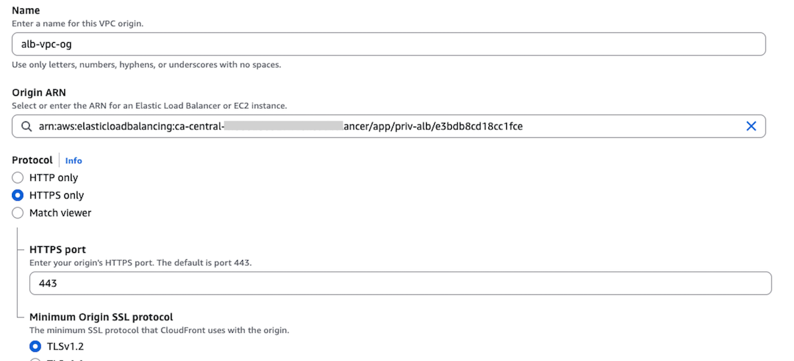

1. Click on the **Create VPC origin** button at the end of the page, and wait a few minures until the VPC origin is fully deployed.  

### 5.2: Create VPC origin Share

1. When the VPC origin status shows **Deployed**, select the VPC origin and click on the **Share VPC origin** button.

   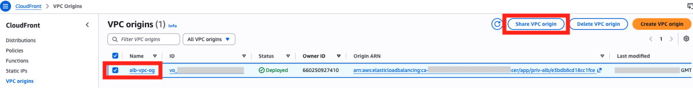

1. On the next screen, click on the **Create resource share** button, which should take you to a next screen.

1. On the next screen, enter a name for the resource share e.g. outer-nlb-og-share. Specify the **Principal type**. In this guide, we use AWS account as the Principal type and enter the **AWS account ID** corresponding to the AWS account where the Cloudfront distribution will be created (AWS Account A). Click on the button **Share resources** to proceed. A green banner at the top of the page confirms the successful creation of the resource share.
   
   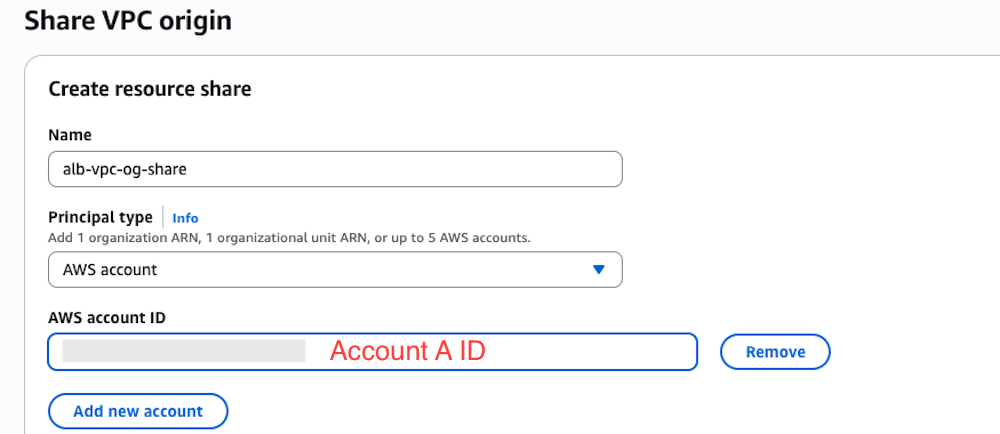


### 5.3: Accept the share and create the CloudFront distribution

1. Switch the CLI to Account A. Logging into the Account A console does **not** change which profile the CLI uses; the `AWS_PROFILE` exported in step 2 still points at Account B until you change it.

   ```bash
   export AWS_PROFILE=<account-a-profile>
   aws sts get-caller-identity --query Account --output text   # confirm Account A
   ```

   Everything in this section runs as Account A. Export the Account B profile again before returning to any Account B step. If you prefer not to change the environment, pass `--profile <account-a-profile>` on each command below instead.

1. Accept the resource share. Accounts in the same AWS Organization with sharing enabled may auto-accept, in which case no invitation appears; otherwise the share stays pending until accepted.

   ```bash
   aws ram get-resource-share-invitations --region us-east-1 \
     --query 'resourceShareInvitations[?status==`PENDING`].[resourceShareName,resourceShareInvitationArn]' --output table

   aws ram accept-resource-share-invitation --region us-east-1 \
     --resource-share-invitation-arn <invitation-arn>
   ```

   Confirm the origin is visible before continuing:

   ```bash
   aws cloudfront list-vpc-origins --query 'VpcOriginList.Items[].[Id,Name,Status]' --output table
   ```

1. On the Cloudfront sidebar, click on **VPC origins** to see the origin share we previously created. 

   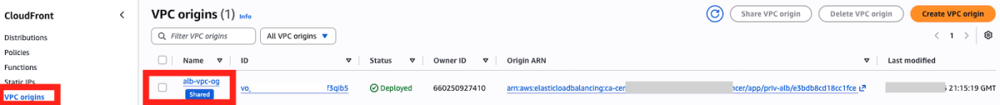

1. Click on **Distributions** in the sidebar, and hit the **Create distribution** button on the upper right corner. If this is your first time creating a distribution, you will be routed to a screen as below to choose a plan. We will be using the **Pay as you go** option for this guide. Click on **Choose pay-as-you-go** button at the end of the page to proceed.

   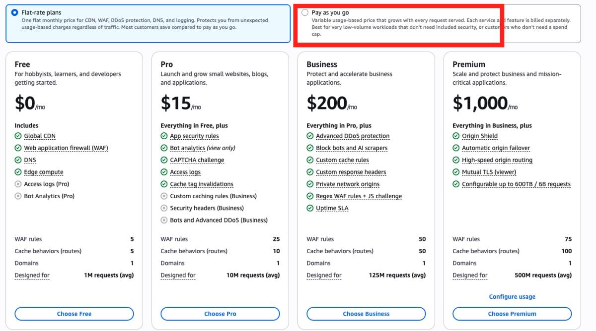

   >  The **Free** and **Pro** plans do not support VPC origins which is the required Origin type for this routing pattern.

1. On the **Distribution options** section, under **Distribution name**, give the distribution a name like `rosa-cf-distribution`. You can add a description if you want. Under **Distribution type**, select the type that works for your use case. We will be using the `Single website configuration` option. 
Skip the **Domain** section for now as our Route53 domain is registered in Account B. We will add that after the distribution is created. Click on **Next**.

1. On the **Specify origin** section, under the **Origin type**, select **VPC origin**. Next, on the **Origin** section, under **VPC origin**, click on **Browse VPC origins** and select the VPC origin share you created e.g `outer-nlb-og-share`. Under **VPC origin endpoint**, enter your custom domain (e.g. cf.aws-amer.mobb.cloud). Leave the origin path to blanks.

   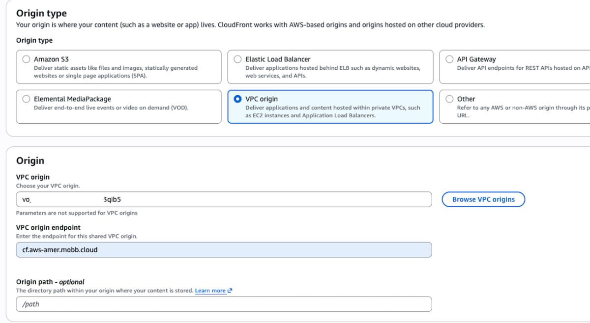

1. On the **Settings** section, leave the **Origin settings** to the default recommended setting. Under **Cache settings**, select **customize cache settings**. For the **Cache policy**, select **CachingDisabled** and choose **AllViewer** under **Origin request policy**. Leave the rest of the settings to default and click on **Next** at the end of the page.

   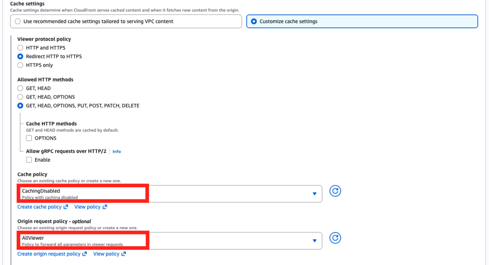

   > **AllViewer** forwards the viewer's `Host` header to the origin, so the router selects the route by the hostname the client requested. The meaningful acceptance test is therefore the request through your custom application hostname in step 6.3, once the alternate domain name and DNS record are in place.
   >
   > Requests to the generated `*.cloudfront.net` name before then are not a useful check: the router receives a hostname with no matching route, and the response may be a `503` from the router or a `502` if origin certificate validation fails first.

{}
If you automate this step instead of using the console, a cross-account VPC origin requires **`OwnerAccountId`** alongside the origin ID:

```json
"VpcOriginConfig": {
  "VpcOriginId": "vo_xxxxxxxxxxxx",
  "OwnerAccountId": "<account-B-id>"
}
```

Omitting it returns `EntityNotFound: The specified vpc origin does not exist`, even though `aws cloudfront list-vpc-origins` and `get-vpc-origin` in Account A both show the origin as `Deployed`.
{}

1. On the **Web Application Firewall (WAF)** section, select **Do not enable security protections**. Note that you can always enable WAF after you create the distribution later but we are not covering it here for the sake of simplicity. Click **Next**.

1. On the next screen, review the details, scroll down, and choose **Create distribution**. You'll be taken to a screen where you should see the distribution in the **Deploying** state (this takes a few minutes to complete)

1. Once the distribution is fully deployed, click on **Add domain** under **Alternate domain names**. 
   
   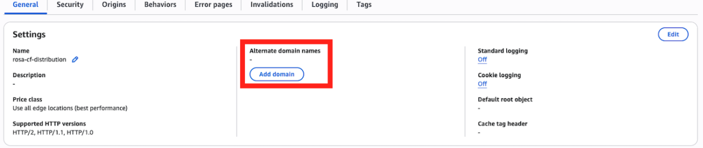

   Enter you domain as a wildcard entry and click on **Next**. Follow the steps to create a corresponding ACM cert for the domain in the **us-east-1** region. The distribution will be redeployed once the certificate is added. Wait until it fully redeploys, then copy the **Distribution domain name**

   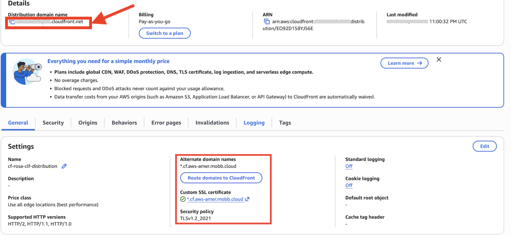

1. Go to your Route 53 hosted zone in  Account B. Click **Create record** button. Create a wildcard CNAME record (e.g. `*.cf.aws-amer.mobb.cloud`) and point it to the CloudFront distribution domain name you just created, and click **Save**. 

    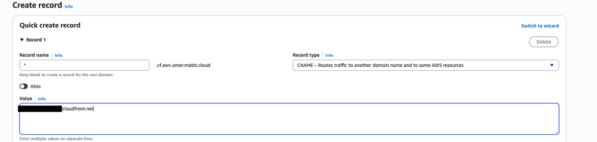

## 6. Validate the Architecture

### 6.1: Create Let's Encrypt certificate

{}
Both NLBs pass TCP through without terminating TLS, so CloudFront's origin TLS connection terminates at the **router**. The router must therefore present a **publicly trusted** certificate whose name matches the origin hostname you configure on the distribution. OpenShift's default self-signed certificate causes CloudFront to return **502** with no useful detail.

Keep the origin hostname, the forwarded `Host` header, the certificate's coverage, and the application route all consistent.

Let's Encrypt is one way to obtain that certificate; any publicly trusted certificate with a valid chain works. Complete this step and 6.2 **before** testing the distribution.
{}

Next, let's go back to the CLI. Skip this step if you already have a trusted certificate for your domain. To create one, you would need to run certbot so please install it if you have not already (if you're a Mac user, you can run `brew install certbot`).

First, create following directories:

```bash
sudo mkdir -p ~/letsencrypt/{config,work,logs}
sudo mkdir -p ~/openshift-certs
```

Then run the following as sudo to generate wildcard certificate. Change the email address to your email address.

```bash
sudo certbot certonly \
  --manual \
  --preferred-challenges=dns \
  --email email@example.com \
  --server https://acme-v02.api.letsencrypt.org/directory \
  --agree-tos \
  --config-dir ~/letsencrypt/config \
  --work-dir ~/letsencrypt/work \
  --logs-dir ~/letsencrypt/logs \
  -d "*.$DOMAIN" \
  -d "$DOMAIN"   
```

It will then ask you to deploy a DNS TXT record under the name `_acme-challenge.YOUR-DOMAIN` with certain value provided by certbot. To do that, go to Route 53 and create a new record type TXT and point to that new value. Wait for a couple of minutes until it fully propagates. 

Open a new CLI tab and run either:

```bash
dig TXT _acme-challenge.$DOMAIN
``` 

Or:

```bash
nslookup -type=TXT _acme-challenge.$DOMAIN
```

And see if the value matches. If it matches, then go back to the tab where you run certbot command, and hit Enter. 

Once the certificate (**fullchain.pem**) and the key (**privkey.pem**) were successfully created, set the following permissions:

```bash
sudo chmod 700 ~/letsencrypt/config/live/$DOMAIN/
sudo chmod 600 ~/letsencrypt/config/live/$DOMAIN/privkey.pem
```

Then copy them for next step:

```bash
sudo cp ~/letsencrypt/config/live/$DOMAIN/fullchain.pem ~/openshift-certs/
sudo cp ~/letsencrypt/config/live/$DOMAIN/privkey.pem ~/openshift-certs/
sudo chown $(whoami):$(id -gn) ~/openshift-certs/*
chmod 644 ~/openshift-certs/fullchain.pem
chmod 600 ~/openshift-certs/privkey.pem
```

### 6.2. Configure the trusted certificate on the secondary IngressController

Next, we are going to configure the certificate we created just now to the private secondary ingress controller. To do that, let's first create a TLS secret:

```bash
oc create secret tls ingress-certs \
  --cert=$HOME/openshift-certs/fullchain.pem \
  --key=$HOME/openshift-certs/privkey.pem \
  -n openshift-ingress
```

Then, configure the secondary IngressController's default certificate:

```bash
oc patch ingresscontroller $INGRESS_NAME \
  -n openshift-ingress-operator \
  --type=merge \
  --patch='{"spec":{"defaultCertificate":{"name":"ingress-certs"}}}'
```

Wait for a few minutes until the router pods restart:

```bash
oc get pods -n openshift-ingress -w | grep $INGRESS_NAME
```

### 6.3: Test an application

Finally, let's test this setup by creating a public application.

1. Create a new project

   ```bash
   oc new-project my-public-app
   ```

1. Create a new application

   ```bash
   oc new-app --docker-image=docker.io/openshift/hello-openshift
   ```

1. Create a route for the application

   ```bash
   oc create route edge --service=hello-openshift hello-openshift-tls \
     --hostname hello.$DOMAIN
   ```

1. Check that you can access the application:

   ```bash
   curl https://hello.$DOMAIN
   ```

You should see the output `Hello OpenShift!`. Alternatively, go to your browser and access it from there.

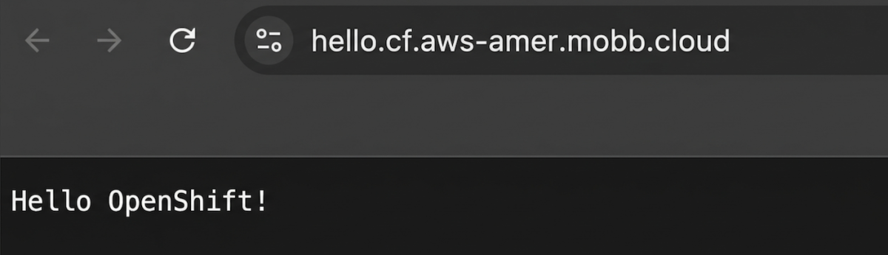
