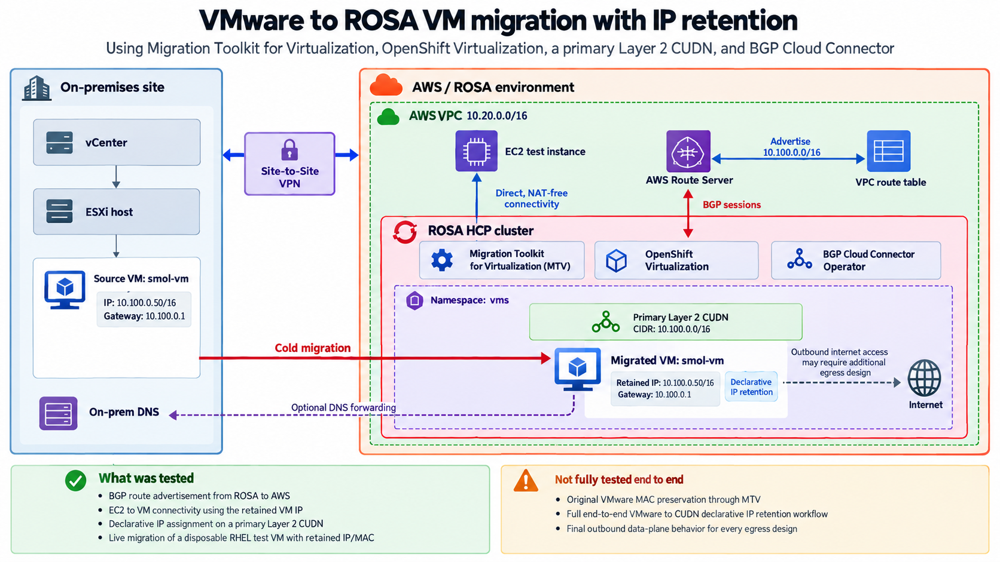

Many VM dependencies refer to an IP address rather than a VM name. Firewall rules, DNS records, load balancer members, licence servers, and monitoring targets can all require changes when a migrated VM is renumbered.

This guide describes how we migrated a Fedora VM from vSphere to Red Hat OpenShift Service on AWS (ROSA) with hosted control planes by using the Migration Toolkit for Virtualization (MTV). The destination VM used its original IP address, `10.100.0.50`, and an EC2 instance reached that address directly over BGP without inbound NAT.

We also tested declarative IP and MAC assignment on a separate RHEL 9 VM. Both addresses survived stop/start and live migration between worker nodes. We have not yet tested the combined workflow on a VMware-derived VM, from disk conversion through automatic IPAMClaim management and live migration with the requested identity.

This guide builds on [Deploying BGP Cloud Connector on ROSA HCP](/experts/rosa/bgp-cloud-connector/), which covers the official Red Hat Operator, AWS Route Server, FRR, the primary CUDN, and direct EC2-to-VM routing. The sections below focus on migration and identity retention.

## How IP preservation works

IP retention and reachability rely on the following components:



- **BGP Cloud Connector Operator**
  - Advertises the VM network into the AWS VPC route tables.
  - This is what makes the VM address reachable from outside the cluster, such as from an EC2 instance.

- **Primary Layer 2 CUDN with persistent IPAM**
  - Provides the VM subnet inside the cluster.
  - Keeps IP allocations stable across VM restarts, and with the right storage, across live migration.
  - In this workflow, you do not create the CUDN directly. The `BGPRouting` resource generates it.

- **Declarative address request**
  - The `network.kubevirt.io/addresses` annotation asks for a specific VM IP.
  - OVN-Kubernetes then creates and manages the backing `IPAMClaim` automatically.

- **`l2bridge` binding**
  - Lets the guest use the real CUDN address instead of a NATed pod address.
  - This is also the binding used in our live migration tests.

- **Inside the cluster**, the VM lives on a **Layer 2** network. That is what lets the VM keep the same subnet identity while moving between nodes.

- **Outside the cluster**, AWS reaches that subnet through **Layer 3 routing**. BGP advertises the route, and AWS sends traffic toward the selected node next hop.


The companion BGP deployment test used native KubeVirt `bridge: {}` for direct EC2-to-VM routing. This guide uses the **`l2bridge` binding plugin**, which supports live migration when the VM also uses suitable shared storage.


## Prerequisites

* A ROSA cluster with hosted control planes, version 4.22 or later
* The official BGP Cloud Connector Operator deployed as described in the [companion guide](/experts/rosa/bgp-cloud-connector/), with `BGPCloudConfiguration` and `BGPRouting` reporting `Ready`, established BGP sessions, and the CUDN prefix present in the required AWS route tables
* The **OpenShift Virtualization** operator installed, with a healthy `HyperConverged` resource. See [Deploying OpenShift Virtualization on ROSA](/experts/rosa/ocp-virt/basic/) if you have not done this yet
* At least **two bare metal worker nodes** that match `bgp_router=true`. The companion guide assigns that label through the ROSA machine pool so BGP Cloud Connector selects every node that can host a directly routed VM. Live migration requires a second eligible node, and only bare metal instance types expose `devices.kubevirt.io/kvm`
* Network connectivity from the cluster to your vSphere environment, for example an AWS Site to Site VPN or Direct Connect
* `oc`, `virtctl`, and the `aws` CLI available locally
* Cluster administrator access


Check which of your nodes can actually run VMs before you start. Only nodes reporting a `devices.kubevirt.io/kvm` value are eligible:

```bash
oc get nodes -o json | jq -r '.items[] | "\(.metadata.name)  kvm=\(.status.allocatable["devices.kubevirt.io/kvm"] // "none")"'
oc get nodes -l bgp_router=true -o wide
```

If virtualization uses a separate machine pool, configure `bgp_router=true` on that machine pool before scheduling these VMs. Do not use a different VM node selector unless the same nodes also match `BGPCloudConfiguration.spec.routerNodeSelector`.


## 1. Confirm the BGP and CUDN prerequisite

The companion deployment guide creates the primary Layer 2 CUDN through `BGPRouting`. For this migration example, use a non-overlapping subnet that contains the source VM address, such as `10.100.0.0/16`, and a workload namespace selected by the generated CUDN.

Before installing MTV, confirm the existing routing foundation:

```bash
oc get bgpcloudconfiguration cluster
oc get bgprouting
oc get bgpsessionstate -n openshift-frr-k8s
oc get clusteruserdefinednetwork
oc get routeadvertisements
```

Both BGP custom resources must report `Ready`, all expected sessions must report `Established`, and the CUDN route must be active in the AWS route tables used by migration test clients. Do not edit the Operator-generated CUDN directly.

The companion guide uses `bgp-test-vms` for its disposable VM. This migration guide uses a separate namespace named `vms`. Create it with both labels, matching the `bgp-test-cudn` network from the companion guide:

```bash
cat << EOF | oc apply -f -
apiVersion: v1
kind: Namespace
metadata:
  name: vms
  labels:
    cluster-udn: bgp-test-cudn
    k8s.ovn.org/primary-user-defined-network: ""
EOF
```

Both labels must be present when the namespace is created. Verify the namespace and generated CUDN before continuing:

```bash
oc get namespace vms -o json | jq '{
  clusterUDN: .metadata.labels["cluster-udn"],
  primaryUDN: .metadata.labels["k8s.ovn.org/primary-user-defined-network"]
}'
oc get clusteruserdefinednetwork cluster-udn-bgp-test-cudn -o yaml
```

Confirm that the generated CUDN selects `cluster-udn: bgp-test-cudn`, uses Layer 2 topology, contains the source address subnet, and has persistent IPAM.

## 2. Install the Migration Toolkit for Virtualization

```bash
cat << EOF | oc apply -f -
apiVersion: project.openshift.io/v1
kind: Project
metadata:
  name: openshift-mtv
---
apiVersion: operators.coreos.com/v1
kind: OperatorGroup
metadata:
  name: migration
  namespace: openshift-mtv
spec:
  targetNamespaces:
    - openshift-mtv
---
apiVersion: operators.coreos.com/v1alpha1
kind: Subscription
metadata:
  name: mtv-operator
  namespace: openshift-mtv
spec:
  channel: release-v2.12
  installPlanApproval: Automatic
  name: mtv-operator
  source: redhat-operators
  sourceNamespace: openshift-marketplace
EOF
```

Then create the controller:

```bash
cat << EOF | oc apply -f -
apiVersion: forklift.konveyor.io/v1beta1
kind: ForkliftController
metadata:
  name: forklift-controller
  namespace: openshift-mtv
spec:
  olm_managed: true
EOF
```

Wait for the MTV pods to come up:

```bash
oc get pods -n openshift-mtv
```

## 3. Add the vSphere provider

1. Retrieve your vCenter CA certificate. From the vCenter appliance, or by downloading `https://<vcenter>/certs/download.zip`.

1. Create the credentials secret:

    ```bash
    cat << EOF | oc apply -f -
    apiVersion: v1
    kind: Secret
    metadata:
      name: vcenter-credentials
      namespace: openshift-mtv
      labels:
        createdForResourceType: providers
        createdForProviderType: vsphere
    type: Opaque
    stringData:
      user: 'administrator@vsphere.local'
      password: '<password>'
      insecureSkipVerify: 'false'
      url: 'https://vcenter.example.com/sdk'
      cacert: |
        -----BEGIN CERTIFICATE-----
        <your vCenter CA certificate>
        -----END CERTIFICATE-----
    EOF
    ```

    
**Keep TLS verification enabled.** Supply the complete CA chain for every hostname used by vCenter and the VMDK download endpoint. Without a VDDK image, MTV can download the VMDK over HTTPS by using `nbdkit` and `curl`. In our lab, the provider accepted the custom CA but the child curl process did not use that trust path, and guest conversion failed with:

```text
virt-v2v: error: downloading https://vcenter.example.com/folder/...vmdk:
external command 'curl ...': exited with error 60
```

`curl` exit code 60 means the peer certificate could not be verified. Setting `insecureSkipVerify: 'true'` allowed the lab migration to proceed, but it disabled certificate verification for the VMware provider rather than only for one disk transfer. Treat that as an experimental lab workaround, not the standard configuration. Correct the CA chain or use the supported VDDK path before production migration. Configuring a VDDK image also avoids the slow direct-download transfer described in step 5.
    

1. Create the provider:

    ```bash
    cat << EOF | oc apply -f -
    apiVersion: forklift.konveyor.io/v1beta1
    kind: Provider
    metadata:
      name: vcenter
      namespace: openshift-mtv
    spec:
      type: vsphere
      url: https://vcenter.example.com/sdk
      settings:
        sdkEndpoint: vcenter
      secret:
        name: vcenter-credentials
        namespace: openshift-mtv
    EOF
    ```

    
**Consider building a VDDK image before you migrate anything.** This guide does not use one, which is why the transfer in step 5 is slow and why the TLS workaround above is needed at all. The MTV documentation is firm on the point: creating the image is optional but "highly recommended", and "using MTV without VDDK is not recommended and could result in significantly lower migration speeds."

It is not always optional. **You must use a VDDK image if the source VMs are backed by VMware vSAN.**

To use one, build and push the image per the MTV documentation, then set it on the provider:

```yaml
spec:
  settings:
    sdkEndpoint: vcenter
    vddkInitImage: <registry_path>/vddk:<tag>
```

Note that storing the VDDK image in a public registry might violate VMware licence terms.
    

1. Confirm the provider connects and populates its inventory:

    ```bash
    oc get provider -n openshift-mtv
    ```

    ```output
    NAME      TYPE        STATUS   READY   CONNECTED   INVENTORY
    host      openshift   Ready    True    True        True
    vcenter   vsphere     Ready    True    True        True
    ```

## 4. Record the VM address you intend to preserve

Query the MTV inventory for the source VM. The guest address comes from VMware Tools, so capture it **before** powering the VM off.

```bash
PROVIDER_UID=$(oc get provider vcenter -n openshift-mtv -o jsonpath='{.metadata.uid}')

oc get --raw \
  "/api/v1/namespaces/openshift-mtv/services/https:forklift-inventory:api-https/proxy/providers/vsphere/${PROVIDER_UID}/vms?detail=4" \
  | jq -r '.[] | select(.name=="my-vm") | .guestNetworks[]? | "\(.ip)/\(.prefix) mac=\(.mac)"'
```

```output
10.100.0.50/16 mac=00:50:56:bc:09:a3
```

Record that address. It is the value you request in step 7.

## 5. Create the network and storage maps, and run the migration


**Migrate into a namespace that does _not_ have the CUDN label.**

This is counterintuitive, but it matters. In a namespace selected by a **primary** CUDN, every pod receives the CUDN as its default route, including the MTV guest conversion pod. That pod needs to reach vCenter, and the CUDN has no path to your vSphere network, so conversion fails with a connection timeout after roughly two minutes.

Migrate into an ordinary namespace first, then reconstruct the destination VM in the CUDN namespace from the converted disk in step 6.


1. Create a staging namespace:

    ```bash
    oc new-project vm-staging
    ```

1. Create the maps. Map the source network to `pod`, and the source datastore to a storage class:

    ```bash
    cat << EOF | oc apply -f -
    apiVersion: forklift.konveyor.io/v1beta1
    kind: NetworkMap
    metadata:
      name: my-vm-network-map
      namespace: openshift-mtv
    spec:
      provider:
        source:
          name: vcenter
          namespace: openshift-mtv
        destination:
          name: host
          namespace: openshift-mtv
      map:
        - source:
            name: <source-port-group>
          destination:
            type: pod
    ---
    apiVersion: forklift.konveyor.io/v1beta1
    kind: StorageMap
    metadata:
      name: my-vm-storage-map
      namespace: openshift-mtv
    spec:
      provider:
        source:
          name: vcenter
          namespace: openshift-mtv
        destination:
          name: host
          namespace: openshift-mtv
      map:
        - source:
            name: <source-datastore>
          destination:
            storageClass: gp3-csi
            accessMode: ReadWriteOnce
            volumeMode: Block
    EOF
    ```

1. Power off the source VM in vSphere. Cold migration requires it.

1. Create the plan. Set `targetPowerState: "off"` on the VM entry so the converted staging VM remains halted for inspection. Set `skipGuestConversion: false` to use the standard virt-v2v conversion path. The successful Fedora migration used `preserveStaticIPs: false`. Destination CUDN address allocation is handled separately when the final VM is reconstructed in step 7. Do not substitute a different MTV preservation setting without testing it for the guest and migration path in use.

    ```bash
    cat << EOF | oc apply -f -
    apiVersion: forklift.konveyor.io/v1beta1
    kind: Plan
    metadata:
      name: my-vm-plan
      namespace: openshift-mtv
    spec:
      type: cold
      targetNamespace: vm-staging
      targetNodeSelector:
        bgp_router: "true"
      preserveStaticIPs: false
      skipGuestConversion: false
      provider:
        source:
          name: vcenter
          namespace: openshift-mtv
        destination:
          name: host
          namespace: openshift-mtv
      map:
        network:
          name: my-vm-network-map
          namespace: openshift-mtv
        storage:
          name: my-vm-storage-map
          namespace: openshift-mtv
      vms:
        - name: my-vm
          targetPowerState: "off"
    EOF
    ```

1. Start the migration:

    ```bash
    cat << EOF | oc apply -f -
    apiVersion: forklift.konveyor.io/v1beta1
    kind: Migration
    metadata:
      name: my-vm-migration
      namespace: openshift-mtv
    spec:
      plan:
        name: my-vm-plan
        namespace: openshift-mtv
    EOF
    ```

1. Watch progress:

    ```bash
    oc get migration my-vm-migration -n openshift-mtv -o json | \
      jq -r '.status.vms[]? | "phase=\(.phase)", (.pipeline[]? | "  \(.name): \(.phase)")'
    ```

<details>
<summary>Why did our migration take so long?</summary>

Cold migration requires transferring the VM disk from vSphere and converting the guest for OpenShift Virtualization. In our test, two steps accounted for most of the time:

- **`ConvertGuest`:** Prepares the guest for OpenShift Virtualization, including changes to support VirtIO devices. This step was particularly slow in our environment, where the VMware source was accessed over a high-latency VPN connection.
- **`CopyDisksVirtV2V`:** Transfers the VM disk data to the destination. Its performance depends on the source storage, network connection, and transfer method.

Our 16 GiB Fedora VM was migrated over a site-to-site VPN with approximately 72 ms round-trip latency. We observed transfer rates of around 0.13 MB/s during conversion and 1.75 MB/s during disk copying, with the migration taking approximately 85 minutes overall.

This test used the `nbdkit` curl transport over HTTPS. We did not compare it with VDDK in this environment. For the recommended VDDK configuration, see section 3.

</details>

## 6. Clone the converted disk onto the CUDN namespace

The converted disk now lives in the staging namespace. Keep the staging VM halted and clone its disk into the CUDN namespace. The destination VM is reconstructed from that converted disk in the following section. Never boot two VMs with the same IP or MAC.

This example places the clone on RWX storage so the destination VM can live migrate. The RHEL 9 test used this Block-to-Filesystem CDI copy pattern.

```bash
cat << EOF | oc apply -f -
apiVersion: cdi.kubevirt.io/v1beta1
kind: DataVolume
metadata:
  name: my-vm-root
  namespace: vms
spec:
  source:
    pvc:
      namespace: vm-staging
      name: <migrated-pvc-name>
  storage:
    accessModes: [ReadWriteMany]
    volumeMode: Filesystem
    resources:
      requests:
        storage: 16Gi
    storageClassName: trident-csi
EOF
```


This example uses `ReadWriteMany` because the destination VM will be live migrated between nodes. A VM that will remain on one node does not universally require RWX storage. On ROSA, Amazon FSx for NetApp ONTAP with the Trident CSI driver can provide RWX. See [Deploying OpenShift Virtualization on ROSA with NetApp FSx storage](/experts/rosa/ocp-virt/with-fsx/) for setup instructions.


Wait for the clone:

```bash
oc get dv my-vm-root -n vms -w
```

## 7. Request the destination IP and MAC declaratively

Persistent CUDN IPAM supports a declarative address request on the VM template. Put `network.kubevirt.io/addresses` under `spec.template.metadata.annotations`. The key inside the JSON object must match the KubeVirt interface and network name, which is `default` in this example.

The RHEL 9 tests confirmed declarative address assignment, automatic IPAMClaim management, stop/start persistence, and live migration. The steps below apply those results to a converted VMware disk, but that complete sequence has not yet been tested end to end. Verify the disk, guest network profile, requested identity, and first boot at each stage.

The controller creates `IPAMClaim/my-vm.default`, assigns the requested address, and owns its lifecycle. Do not create the claim or patch `IPAMClaim.status` yourself. 

1. Confirm that the address and MAC are not already allocated. Check VM definitions, VMIs, and existing claims. Repeat this check immediately before starting the final VM:

    ```bash
    oc get vm,vmi,ipamclaim -A -o yaml | \
      grep -E '10\.100\.0\.50|02:50:56:64:00:50'
    ```

1. Create the VM in a stopped state. This example requests the original VMware IP with a unique locally administered example MAC. Original VMware MAC preservation has not yet been tested through this complete procedure.

    ```bash
    cat << EOF | oc apply -f -
    apiVersion: kubevirt.io/v1
    kind: VirtualMachine
    metadata:
      name: my-vm
      namespace: vms
    spec:
      runStrategy: Halted
      template:
        metadata:
          labels:
            kubevirt.io/domain: my-vm
            vm.kubevirt.io/name: my-vm
          annotations:
            network.kubevirt.io/addresses: '{"default":["10.100.0.50"]}'
        spec:
          nodeSelector:
            bgp_router: "true"
          domain:
            cpu:
              cores: 2
            memory:
              guest: 2Gi
            firmware:
              bootloader:
                efi:
                  secureBoot: false
            devices:
              disks:
                - name: rootdisk
                  bootOrder: 1
                  disk:
                    bus: virtio
              interfaces:
                - name: default
                  model: virtio
                  macAddress: "02:50:56:64:00:50"
                  binding:
                    name: l2bridge
          networks:
            - name: default
              pod: {}
          volumes:
            - name: rootdisk
              persistentVolumeClaim:
                claimName: my-vm-root
    EOF
    ```

    
**Match the firmware to the converted VM.** If the vSphere VM used UEFI and the final definition falls back to legacy BIOS, the guest can stop at `SeaBIOS: Booting from Hard Disk...`. Copy the firmware settings from the halted MTV-generated VM:

```bash
oc get vm my-vm -n vm-staging -o jsonpath='{.spec.template.spec.domain.firmware}{"\n"}'
```

**Keep the primary network definition consistent.** Use `pod: {}` for the primary CUDN and `l2bridge` for the matching `default` interface. Adding a Multus network here would create another interface rather than selecting the primary CUDN.
    

1. Inspect the converted guest network profile while the VM is still halted. The annotation reserves an OVN address, but it does not rewrite NetworkManager inside the disk. Check for a stale VMware interface name such as `ens33`, a MAC match that no longer agrees with the VM definition, and destination gateway or DNS values that are not reachable from the CUDN.

    If virt-v2v already corrected the profile, keep its changes. If offline remediation is required, modify only the cloned destination disk. Do not change the VMware source guest. A DHCP profile matched to the explicit MAC is the simplest arrangement when the guest can use OVN DHCP. A guest-static profile can also work when its address, prefix, gateway, DNS, interface name, and MAC all match the destination design.

1. Start the VM. The persistent claim is created during VMI network admission:

    ```bash
    virtctl start my-vm -n vms

    oc get ipamclaim my-vm.default -n vms -o json | \
      jq '{ips: .status.ips, conditions: .status.conditions}'
    ```

    Stop immediately if the claim does not contain `10.100.0.50/16`, the VMI reports another MAC, or any other workload acquired the requested identity.

## 8. Verify

The migrated Fedora VM ran at `10.100.0.50`, and an EC2 tester reached it through the BGP-advertised route without inbound NAT. That destination used a different MAC from the VMware source. Separately, the RHEL 9 tests confirmed the declarative annotation and explicit MAC through stop/start and live migration. The output below shows the proposed Fedora address with the locally administered example MAC from step 7.

1. The VM should come up on the original address:

    ```bash
    oc get vmi my-vm -n vms -o wide
    ```

    ```output
    NAME    PHASE     IP            NODENAME       READY   LIVE-MIGRATABLE
    my-vm   Running   10.100.0.50   worker-1       True    True
    ```

1. Confirm the address from **inside** the guest, not just from the OVN port configuration. If `infoSource` includes `guest-agent`, the guest itself is reporting it:

    ```bash
    oc get vmi my-vm -n vms -o json | \
      jq -r '.status.interfaces[] | "ip=\(.ipAddress) mac=\(.mac) src=\(.infoSource)"'
    ```

    The following output is illustrative for the proposed original-IP and locally administered MAC configuration:

    ```output
    ip=10.100.0.50 mac=02:50:56:64:00:50 src=domain, guest-agent
    ```

    An explicit MAC in the VM definition prevents OVN from generating one from the IP address. Original VMware MAC preservation remains untested and requires separate verification when licences or access controls depend on it.

1. Confirm the VM is reachable from elsewhere in the VPC, which proves the BGP advertisement is working:

    ```bash
    ping 10.100.0.50
    ```

1. If the VM uses RWX storage and reports `LiveMigratable=True`, live migrate it and confirm the address survives:

    ```bash
    virtctl migrate my-vm -n vms
    ```

    Run a continuous ping from another host in the VPC while the migration happens. Record packet loss rather than assuming there is none. In the independent RHEL test, the node changed while the declarative IP, explicit MAC, and automatically managed IPAMClaim remained unchanged. The test lost 1 packet out of 980 and the longest observed reply gap was approximately 422 ms.

    ```output
    PRE : node=worker-2  ip=10.100.0.61  mac=02:50:56:64:00:61
    POST: node=worker-1  ip=10.100.0.61  mac=02:50:56:64:00:61
    980 packets transmitted, 979 received, 0.102% packet loss
    ```

    This live migration result came from a native RHEL 9 test VM, not the migrated Fedora VM.

## 9. Evaluate outbound connectivity separately

We confirmed direct EC2-to-VM connectivity over the advertised CUDN. We attempted outbound-path checks, but did not confirm end-to-end guest-originated internet connectivity. Successful DNS resolution or inbound BGP routing does not prove that path works.

OVN logical tracing showed traffic from `10.100.0.50` leaving the CUDN gateway toward the worker `br-ex` interface without being translated to a worker address. The worker subnet had a default route to an AWS NAT Gateway, and both the private and NAT Gateway subnet route tables had an active BGP return route for `10.100.0.0/16`. These observations support the NAT Gateway design, but do not prove the complete guest-to-internet path.

An OpenShift `EgressIP` is another possible design. It applies SNAT before traffic leaves the cluster. That can be useful when private destinations require a source address from the VPC CIDR, but it changes the source address those destinations observe. Firewall rules, database grants, and other controls that rely on the preserved VM IP might then need changes.

Our lab confirmed EgressIP control-plane assignment to an eligible worker and attachment of the secondary address to its AWS network interface. The VM-to-EC2 data-plane test did not produce packet evidence, so EgressIP outbound connectivity is also not presented as confirmed working.

Before selecting either approach, test both private and public destinations and capture the source address at each hop:

1. From the VM, inspect the routes to a private EC2 address and to a public address.
1. Capture the flow at the VM interface, worker `br-ex`, and private destination.
1. For the NAT Gateway design, confirm that `br-ex` sees the CUDN source address and that a public IP echo service returns the NAT Gateway EIP.
1. For EgressIP, confirm which destinations observe the EgressIP and review every source-IP-based access rule.
1. Reconfirm that EC2-initiated connections still reach the VM's real CUDN address over BGP.

Keep EgressIP selectors narrow. A namespace-wide selector can affect every VM in that namespace if an eligible node is added later.

## 10. Plan the on-premises routing cutover

Assigning the original IP to the ROSA VM does not move ownership of the source subnet from VMware to AWS. If the same subnet still contains running VMs on premises, routers must have an unambiguous path to each address during the migration window.

Do not advertise the same aggregate from both locations and assume normal routing will select the intended VM. A phased migration can require more-specific routes for migrated addresses, carefully controlled route preference, or an L2 extension between environments. Each design has failure and rollback implications and must be tested with the network team before migration.

At minimum, define:

* when the source VM is powered off;
* when the destination route becomes authoritative;
* how on-premises clients learn the destination path;
* how return traffic stays symmetric;
* how DNS, firewalls, and load balancers are updated or verified;
* how the route is withdrawn before a source rollback.

The BGP Cloud Connector advertises the CUDN into AWS. It does not automatically provide transparent connectivity from the original on-premises network or coordinate overlapping subnet ownership.

## Known limitations

- **Fedora 44 is not a supported MTV guest:** We used a disposable Fedora 44 VM for this test. For production migrations, use a supported guest operating system and check the current MTV compatibility matrix.

- **Migration pods need connectivity to vSphere:** MTV runs its migration pods in the target namespace. Our primary CUDN had no route to vCenter or ESXi, so we migrated the VM into a staging namespace using the default pod network, then reconstructed the destination VM in the CUDN namespace from the converted disk.

- **The original VMware MAC was not preserved:** Our migrated Fedora VM used a different MAC address. We separately confirmed that an explicitly assigned MAC survives VM restarts and live migration on RHEL 9. If your applications, licences, or security policies depend on the original MAC, test this before migrating.

- **Serial console access may not work out of the box:** Guests installed through a vSphere ISO may not have `console=ttyS0` configured. If `virtctl console` shows no output, use `virtctl vnc` or the VNC screenshot API to access the graphical console.


The VNC screenshot API is useful for non interactive troubleshooting, for example confirming whether a VM is actually booting:

```bash
oc get --raw \
  "/apis/subresources.kubevirt.io/v1/namespaces/vms/virtualmachineinstances/my-vm/vnc/screenshot?moveCursor=false" \
  > screenshot.png
```


## Cleanup

Once you are satisfied the migrated VM is healthy, identify the exact staging resources owned by this migration. Delete only those resources after checking their ownership and storage reclaim policies:

```bash
oc get vm,dv,pvc -n vm-staging
oc delete vm my-vm -n vm-staging
oc get all,vm,dv,pvc -n vm-staging
```

Do not delete `vm-staging` if it contains unrelated resources. Delete the namespace only when it was created exclusively for this migration and an inventory confirms that nothing else depends on it.

## Future research

The following areas still need testing:

* **Guest-originated outbound connectivity:** Test the AWS NAT Gateway and EgressIP designs from a normal guest session, with packet captures that show the source address before and after translation.
* **Full VMware-to-CUDN declarative workflow:** Test the staging clone, offline guest profile inspection, declarative address request, and first boot as one repeatable sequence on a VMware-derived disk.
* **On-premises routing cutover:** Test route ownership, symmetry, rollback, and phased migration when the original subnet still has active VMware workloads.
* **Original VMware MAC preservation:** Test the original MAC through conversion, reconstruction, restart, and live migration when an application requires it.
